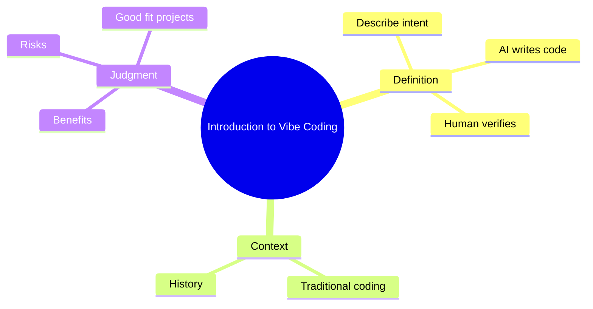

# 01 Introduction to Vibe Coding

> **Level:** Beginner · **Prerequisites:** None.

## Overview

Defines vibe coding, where it came from, how it differs from traditional development, and who it suits.

## Learning objectives

By the end of this chapter you can:

- Explain vibe coding and what the human must still decide
- Judge whether a project suits AI-assisted building
- Choose a learning track that fits your background

## Chapter mind map

## Lessons

Read in this order. Each lesson ends with a hands-on exercise.

| # | Lesson | Level | What you will do |
|---|---|---|---|
| 1 | [What Is Vibe Coding](./md/what_is_vibe_coding.md) | Beginner | Describe one app in plain language and list what AI must still be told |
| 2 | [History and Evolution](./md/history_and_evolution.md) | Beginner | Build a timeline of AI-assisted coding stages |
| 3 | [Vibe Coding vs Traditional Coding](./md/vibe_coding_vs_traditional_coding.md) | Beginner | Compare the same task done both ways |
| 4 | [Benefits Risks and Use Cases](./md/benefits_risks_and_use_cases.md) | Beginner | Rate three project ideas as suitable or unsuitable |
| 5 | [Roles and Who It Is for](./md/roles_and_who_it_is_for.md) | Beginner | Choose a learning track for your background |

## Related

- [Prompt library](../30-prompt-library-and-checklists/README.md)
- [Hands-on projects](../28-hands-on-projects/README.md)

## Next step

Continue with [Chapter 02: Software Development Fundamentals](../02-software-development-fundamentals/README.md).

---
[Back to the course home](../README.md)
