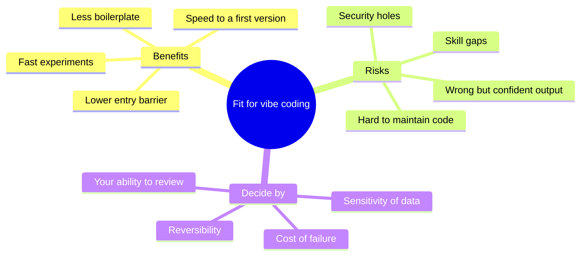
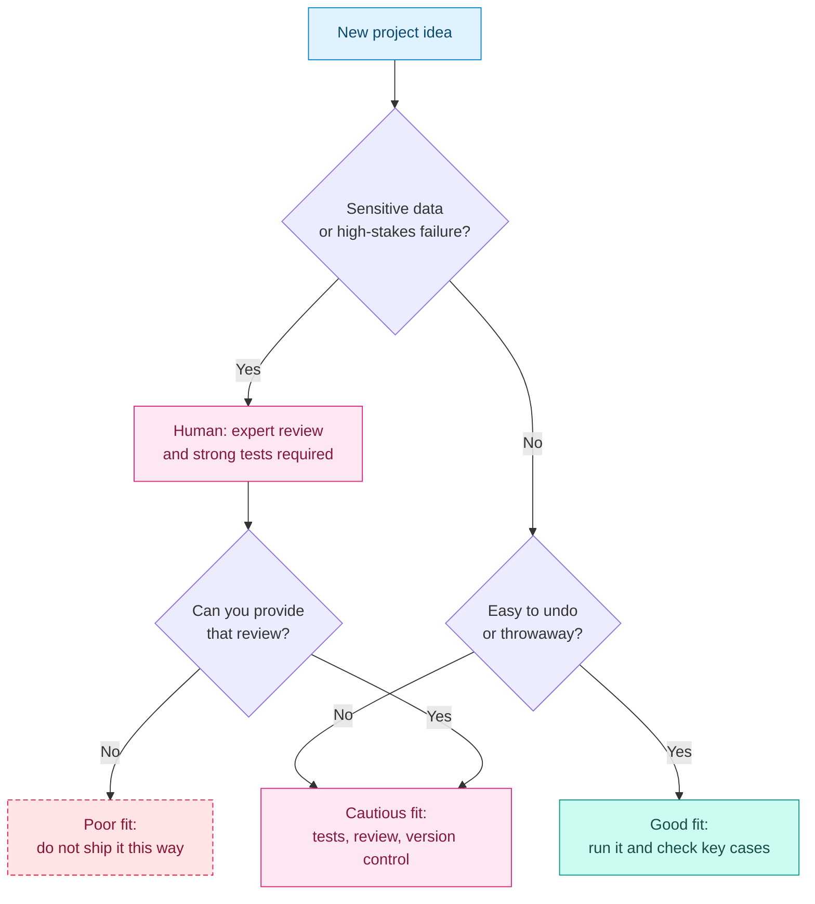

# Benefits, Risks and Use Cases

## Contents

- [Learning Objectives](#learning-objectives)
- [Prerequisites](#prerequisites)
- [Overview](#overview)
- [Mind Map](#mind-map)
- [Core Concepts](#core-concepts)
- [How It Works](#how-it-works)
- [Practical Example](#practical-example)
- [Step-by-Step Explanation](#step-by-step-explanation)
- [Expected Result](#expected-result)
- [Common Mistakes and Troubleshooting](#common-mistakes-and-troubleshooting)
- [Best Practices](#best-practices)
- [Hands-On Exercise](#hands-on-exercise)
- [Verification Checklist](#verification-checklist)
- [Conclusion](#conclusion)
- [Related Lessons](#related-lessons)
- [Official References](#official-references)

## Learning Objectives

After this lesson you can:

- Name the main benefits and the main risks of vibe coding.
- Rate a project idea as a good, cautious or poor fit using stated criteria.
- Choose how much verification a project needs.

## Prerequisites

[Vibe Coding vs Traditional Coding](./vibe_coding_vs_traditional_coding.md)

## Overview

Vibe coding lowers the cost of getting something working and leaves the cost of getting it right where it was. That asymmetry explains both its appeal and its dangers. This lesson gives you a way to decide, project by project, how far to trust it.

## Mind Map

## Core Concepts

**Benefits**

- **Speed to a first version.** Working prototypes appear in minutes, which makes it cheap to test whether an idea is worth pursuing.
- **Lower barrier.** People who cannot write code can build tools for themselves.
- **Less boilerplate.** Routine setup and repetitive code are written for you.
- **Exploration.** Trying three designs costs little, so you can compare real versions instead of imagining them.

**Risks**

- **Confident errors.** Wrong code looks as polished as right code.
- **Security gaps.** Generated code can omit input checks, expose secrets or use weak authentication. See [chapter 17](../../17-security-and-responsible-development/README.md).
- **Maintainability.** Code nobody understood when it was written is hard to change later.
- **Skill erosion.** Accepting everything without thought means you do not learn to judge it.
- **Unclear provenance.** Generated code and assets can raise licensing questions.

**Deciding factors.** Four questions determine how careful to be:

1. How bad is a failure? (annoying, costly, harmful)
2. Can I undo a bad result? (throwaway or deployed to users)
3. Does it touch sensitive data? (none, personal, financial, health)
4. Can I, or someone I trust, review it? (yes or no)

## How It Works

Legend: blue = starting point, pink = human review required, teal = good fit, dashed rose = poor fit. Labels repeat the meaning, so color is not the only cue.

## Practical Example

Rate these three ideas using the decision flow.

| Idea | Sensitive data or high stakes? | Easy to undo? | Rating | Reasoning |
|---|---|---|---|---|
| A page that converts recipe units for yourself | No | Yes | Good fit | Failure costs a wrong measurement; you can see the page work |
| A booking site for your friend's studio, with customer emails | Personal data | No | Cautious fit | Needs input validation, secure storage, tests and a review before launch |
| A tool that calculates medication doses for patients | High stakes | No | Poor fit without expert review | An undetected error can harm people; do not ship on the AI's word |

The rating depends on the answers, not on how clever the idea is.

## Step-by-Step Explanation

1. Answer the four deciding questions for your idea in writing.
2. Follow the flow to a rating.
3. For "cautious" and "poor" ratings, list the extra checks or reviewers required.
4. If you cannot provide those checks, change the scope. For example, build the booking site without storing customer data at first.

## Expected Result

Each idea you rate has a written rating and a list of required checks. A good-fit idea needs only a run-through of key cases. A cautious idea lists tests and review. A poor-fit idea states what must change before it can proceed.

## Common Mistakes and Troubleshooting

| Mistake | Consequence | Fix |
|---|---|---|
| Rating by excitement | Risky projects get treated like toys | Answer the four questions first |
| "It works on my screen" as the only test | Hidden failures reach users | Test invalid input, other devices and failure cases |
| Ignoring licensing and privacy | Legal and trust problems later | Apply [Licensing and Provenance](../../17-security-and-responsible-development/md/licensing_and_provenance.md) and [Privacy and Data Handling](../../17-security-and-responsible-development/md/privacy_and_data_handling.md) |
| Moving a prototype straight into production | Prototype shortcuts become permanent | Treat the prototype as a draft; rebuild or harden it |

## Best Practices

- Use vibe coding freely for prototypes and personal tools.
- Raise your verification level with the stakes, not with your confidence.
- Do not put real personal data or secrets into prompts or prototypes unless you know where they go.
- Say plainly to users and teammates which parts were AI-generated and how they were checked.

## Hands-On Exercise

List three real projects you might build.

1. Answer the four deciding questions for each.
2. Rate each project as good, cautious or poor fit.
3. For each cautious or poor fit, write the specific checks that would move it to good fit, or the scope change you would make.

## Verification Checklist

- [ ] Each project has answers to all four questions.
- [ ] Each rating follows from the answers.
- [ ] At least one project's scope or checks changed after the exercise.
- [ ] No poor-fit project is marked "ship as is".

## Conclusion

Vibe coding makes first versions cheap and leaves correctness expensive. Match the amount of checking to the cost of failure, the difficulty of undoing it, the sensitivity of the data and your ability to review. Fast is fine for throwaways; careful is required where people can be harmed or data exposed.

## Related Lessons

- Previous: [Vibe Coding vs Traditional Coding](./vibe_coding_vs_traditional_coding.md)
- Next: [Roles and Who It Is For](./roles_and_who_it_is_for.md)
- Later chapter: [Limitations and Best Practices](../../26-limitations-and-best-practices/README.md)
- Later chapter: [Security and Responsible Development](../../17-security-and-responsible-development/README.md)

## Official References

This lesson presents a decision framework written for this course and relies on no product-specific facts. Security and privacy lessons in chapter 17 cite their own official references.

---

**Navigation:** [Chapter index](../README.md) · [Previous: Vibe Coding vs Traditional Coding](./vibe_coding_vs_traditional_coding.md) · [Next: Roles and Who It Is For](./roles_and_who_it_is_for.md)
