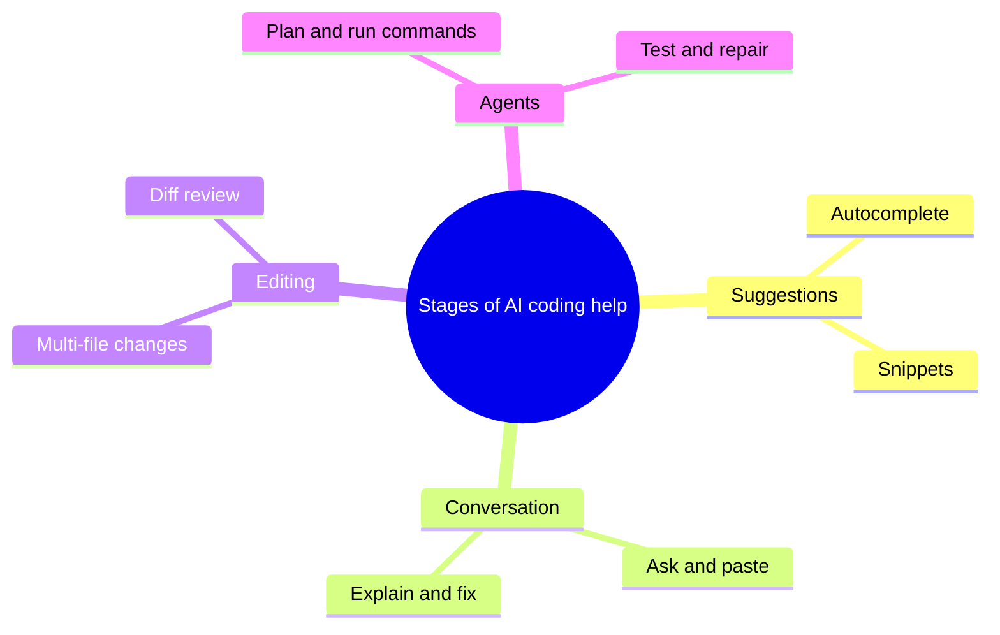
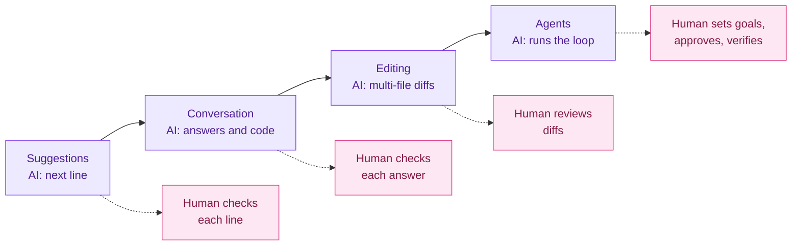

# History and Evolution of AI-Assisted Coding

## Contents

- [Learning Objectives](#learning-objectives)
- [Prerequisites](#prerequisites)
- [Overview](#overview)
- [Mind Map](#mind-map)
- [Core Concepts](#core-concepts)
- [How It Works](#how-it-works)
- [Practical Example](#practical-example)
- [Step-by-Step Explanation](#step-by-step-explanation)
- [Expected Result](#expected-result)
- [Common Mistakes and Troubleshooting](#common-mistakes-and-troubleshooting)
- [Best Practices](#best-practices)
- [Hands-On Exercise](#hands-on-exercise)
- [Verification Checklist](#verification-checklist)
- [Conclusion](#conclusion)
- [Related Lessons](#related-lessons)
- [Official References](#official-references)

## Learning Objectives

After this lesson you can:

- Describe the main stages by which AI help with coding grew from suggestions to autonomous work.
- Place the term "vibe coding" in that history.
- Explain why each stage changed what a human must verify.

## Prerequisites

[What Is Vibe Coding?](./what_is_vibe_coding.md)

## Overview

AI help for programmers did not arrive all at once. Each stage gave the tool more freedom and gave the human a different checking job. Knowing the stages explains why today's tools are built the way they are, and why "review what the AI did" matters more as tools do more.

**Historical context, not product advice.** This lesson describes how things developed. Current features, names and prices belong to the tool pages in [chapter 04](../../04-ai-coding-tools/README.md), which carry verification dates.

## Mind Map

## Core Concepts

**Stage 1: Suggestions.** Tools predict the next line or block as you type. You stay in control of every character; the AI saves typing. In June 2021 GitHub announced Copilot, which it described as "a new AI pair programmer that helps you write better code," launched as a technical preview with limited spots.

**Stage 2: Conversation.** Chat assistants let you describe a problem in plain language and receive code and explanations. OpenAI announced ChatGPT on 30 November 2022 as a research preview that "interacts in a conversational way." You copy code between the chat and your editor, so you see each piece.

**Stage 3: Editing in context.** Assistants built into code editors read your files and propose changes across several of them, shown as diffs you accept or reject. The unit of work grows from a line to a change.

**Stage 4: Agents.** Tools plan, edit files, run commands and tests, read the results and try again with limited supervision. The unit of work grows to a task. The human role shifts from writing to specifying, approving and verifying.

**Where "vibe coding" fits.** Andrej Karpathy coined the term on 2 February 2025, describing work where he mostly speaks, runs and pastes and "it mostly works." The label captured something that had been building across these stages: for the first time non-programmers and programmers alike could get working software from descriptions alone.

The stage boundaries are a teaching simplification. Real products blend several stages, and tools move between them as they are updated.

## How It Works

Legend: violet = what the AI does at each stage, pink = what the human must check, dashed lines connect a stage to its human responsibility. As the AI's share grows left to right, the human's work moves from reading lines to judging outcomes.

## Practical Example

Take the same task, "show a list of notes and let me delete one," at each stage.

| Stage | What you do | What the AI does | What you must verify |
|---|---|---|---|
| Suggestions | Type the function name and signature | Completes the function body | The completed lines do what you meant |
| Conversation | Describe the feature in chat | Returns code and an explanation | The pasted code fits your project and runs |
| Editing | Describe the feature in the editor | Edits the page, script and styles | Each diff is correct and nothing else changed |
| Agent | State the goal and acceptance rules | Plans, edits, runs the app and tests | The goal is met, tests are meaningful, no unwanted side effects |

## Step-by-Step Explanation

1. Read the table from top to bottom: the AI's share of the work increases.
2. Read the last column: the human's checking moves from lines to outcomes.
3. Notice that no stage removes the need to verify. It changes what you verify and how.

## Expected Result

You can explain, in your own words, why an agent that edits twenty files needs a different review habit than an autocomplete that adds one line.

## Common Mistakes and Troubleshooting

| Mistake | Why it is wrong | Better view |
|---|---|---|
| "Newer stages replace older ones" | Developers use all of them, depending on the task | Choose the stage that fits the task and its risk |
| "Agents are always better" | They do more, so they can break more | Use more autonomy where mistakes are cheap or easy to undo |
| "Vibe coding is a product" | It is a way of working, not a tool | Any stage-3 or stage-4 tool can be used this way |
| Quoting dates from memory | Product histories are easy to misremember | Cite the announcement, as this lesson does |

## Best Practices

- Match autonomy to risk: more freedom for throwaway prototypes, less for code that handles money, health or personal data.
- When a tool does more per step, make your checks stronger (tests, diffs, small commits).
- Cite primary sources for dates and product claims.

## Hands-On Exercise

Build a one-page timeline of the four stages.

1. For each stage write: what the AI did, what the human did, and one thing that could go wrong.
2. Mark where you have personally used each stage, if at all.
3. For the stage you use most, write the one check you will never skip.

## Verification Checklist

- [ ] My timeline has all four stages in order.
- [ ] Each stage lists a human responsibility, not only the AI's role.
- [ ] I can say which stage the 2021 Copilot preview and the 2022 ChatGPT preview belong to.
- [ ] I did not add a product date I could not source.

## Conclusion

AI coding help moved from completing lines, to answering questions, to editing across files, to running whole tasks. As the tool's freedom grew, the human's job shifted toward specifying, approving and verifying. Vibe coding names the style that this shift made possible.

## Related Lessons

- Previous: [What Is Vibe Coding?](./what_is_vibe_coding.md)
- Next: [Vibe Coding vs Traditional Coding](./vibe_coding_vs_traditional_coding.md)
- Tools today: [Tool Landscape Overview](../../04-ai-coding-tools/md/tool_landscape_overview.md)
- Agents in depth: [Agent Loop and Lifecycle](../../13-agentic-vibe-coding/md/agent_loop_and_lifecycle.md)

## Official References

- GitHub, [Introducing GitHub Copilot: your AI pair programmer](https://github.blog/news-insights/product-news/introducing-github-copilot-ai-pair-programmer/) (announced 29 June 2021; verified 12 October 2026).
- OpenAI, [Introducing ChatGPT](https://openai.com/index/chatgpt/) (announced 30 November 2022; verified 12 October 2026).
- [Know Your Meme: Vibe Coding](https://knowyourmeme.com/memes/vibe-coding) for the 2 February 2025 origin of the term (secondary source; verified 12 October 2026).

---

**Navigation:** [Chapter index](../README.md) · [Previous: What Is Vibe Coding?](./what_is_vibe_coding.md) · [Next: Vibe Coding vs Traditional Coding](./vibe_coding_vs_traditional_coding.md)
