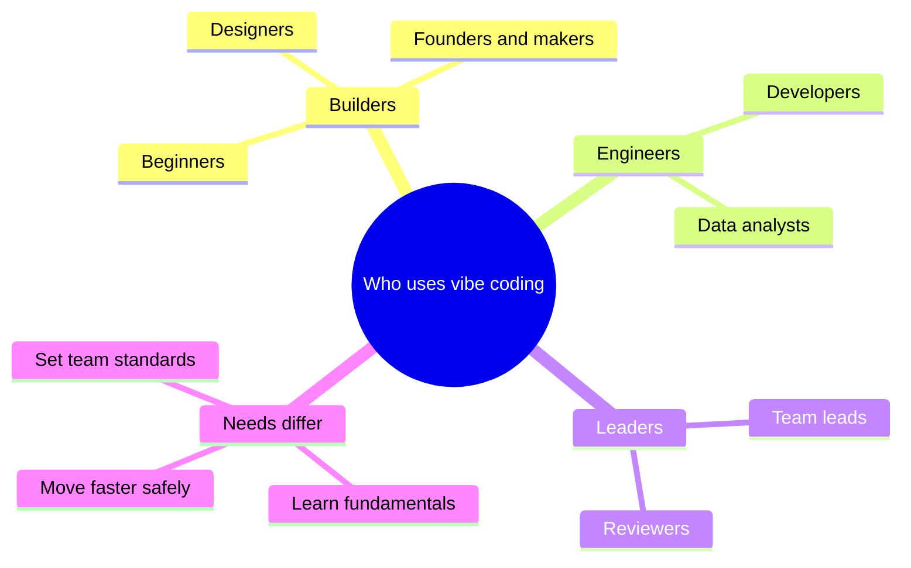
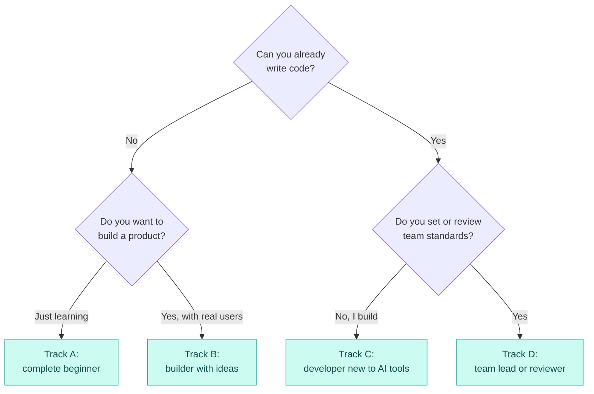

# Roles and Who It Is For

## Contents

- [Learning Objectives](#learning-objectives)
- [Prerequisites](#prerequisites)
- [Overview](#overview)
- [Mind Map](#mind-map)
- [Core Concepts](#core-concepts)
- [How It Works](#how-it-works)
- [Practical Example](#practical-example)
- [Step-by-Step Explanation](#step-by-step-explanation)
- [Expected Result](#expected-result)
- [Common Mistakes and Troubleshooting](#common-mistakes-and-troubleshooting)
- [Best Practices](#best-practices)
- [Hands-On Exercise](#hands-on-exercise)
- [Verification Checklist](#verification-checklist)
- [Conclusion](#conclusion)
- [Related Lessons](#related-lessons)
- [Official References](#official-references)

## Learning Objectives

After this lesson you can:

- Describe the roles people play in vibe-coding work.
- Choose one of four learning tracks through this course.
- Write a personal goal and a first milestone.

## Prerequisites

[Benefits, Risks and Use Cases](./benefits_risks_and_use_cases.md)

## Overview

People come to vibe coding with very different backgrounds: complete beginners, designers and founders who want to build their own tools, working developers, and team leads who must set standards. The course is the same for everyone; the order and depth differ. This lesson helps you pick a track.

## Mind Map

## Core Concepts

**Roles in a vibe-coding project.** One person often holds several.

| Role | Responsibility |
|---|---|
| Product owner | Decides what to build and what counts as done |
| Prompter or builder | Describes work to the AI and steers it |
| Reviewer | Reads and tests the output before it is accepted |
| Maintainer | Keeps the code understandable and working over time |
| Approver | Decides whether changes may reach users |

When one person holds every role, they cannot independently check their own work. That is a risk, and the reason the later chapters on testing and review exist.

**Four tracks.** Pick the one that matches where you are. You can switch at any time.

| Track | For | Chapters, in order |
|---|---|---|
| A. Complete beginner | No coding experience | 01 to 05, then 06, 07, 08, beginner projects in 28 |
| B. Builder with ideas | Founders, designers, analysts who want working tools | 01, 04, 05, 06, 07, 08, 09, 10, 11, then 28 |
| C. Developer new to AI tools | Already codes | 01, 04, 05, 13, 14, 15, 16, 17, then 22 |
| D. Team lead or reviewer | Sets standards, reviews AI-generated work | 01, 04, 05, 16, 17, 18, 19, 26, 27 |

Chapter 30, the prompt library, is useful in every track.

## How It Works

Legend: teal boxes are the four tracks. Diamonds are questions; each edge is labeled with the answer.

## Practical Example

**Maya** is a graphic designer who wants a small booking page for her studio. She has never coded.

- She answers the flow: cannot code, wants a product with real users. That is Track B.
- Her goal: "A booking page where clients pick a time and I get an email."
- Her first milestone: complete chapters 01, 04 and 05, then the landing-page project.
- Her honest gap: she will need help reviewing security before collecting client details, so she plans to complete chapter 17 before launch and to ask a developer to review.

**Dev** is a backend developer who has used autocomplete but never agents.

- He already codes and builds rather than leads, so Track C fits.
- His goal: "Use an agent on our existing service without breaking it."
- His first milestone: chapters 04 and 05 quickly, then 13 and 14.

## Step-by-Step Explanation

1. Answer the flow's questions honestly.
2. Write one goal in a sentence, naming the thing you want to build or the habit you want to establish.
3. Write the first milestone as chapters plus one concrete result, for example a working page.
4. Write your honest gap: one thing you cannot check yourself yet, and who or what chapter will cover it.

## Expected Result

You have a written track, goal, first milestone and gap, as Maya and Dev did above. The plan fits on a few lines.

## Common Mistakes and Troubleshooting

| Mistake | Consequence | Fix |
|---|---|---|
| Skipping the fundamentals chapters | You cannot judge generated code | Read at least the lessons on reading code and web basics |
| Choosing a goal too large | Nothing finishes | Pick one small result you can verify |
| Ignoring the gap | Blind spots go to production | Name who or what will cover each gap |
| Treating the track as fixed | You stall when needs change | Re-run the flow after each milestone |

## Best Practices

- Start with a small project from [chapter 28](../../28-hands-on-projects/README.md) as soon as you finish chapters 01 to 05.
- Revisit your plan after each chapter.
- Use the [prompt library](../../30-prompt-library-and-checklists/README.md) as a reference, not a script.

## Hands-On Exercise

1. Run the flow and pick your track.
2. Write your goal, first milestone and honest gap in three lines.
3. Open the chapter index of your first chapter and read its objectives.
4. Decide a date for your first milestone.

## Verification Checklist

- [ ] I picked a track using the flow.
- [ ] My goal names something concrete that I could demonstrate.
- [ ] My milestone lists specific chapters.
- [ ] My gap names a person, a chapter or a tool that will cover it.

## Conclusion

Vibe coding is useful to beginners, builders, developers and leaders, but each needs a different route. Pick the track that fits, set one concrete goal and name the thing you cannot yet check yourself. That honesty is the start of doing this responsibly.

## Related Lessons

- Previous: [Benefits, Risks and Use Cases](./benefits_risks_and_use_cases.md)
- Next chapter: [Programming Concepts](../../02-software-development-fundamentals/md/programming_concepts.md)
- [Career Paths and Roles](../../27-professional-development/md/career_paths_and_roles.md)
- Practice: [Hands-On Projects](../../28-hands-on-projects/README.md)

## Official References

This lesson is a planning guide written for this course and relies on no external sources.

---

**Navigation:** [Chapter index](../README.md) · [Previous: Benefits, Risks and Use Cases](./benefits_risks_and_use_cases.md) · [Next chapter: Software Development Fundamentals](../../02-software-development-fundamentals/md/programming_concepts.md)
