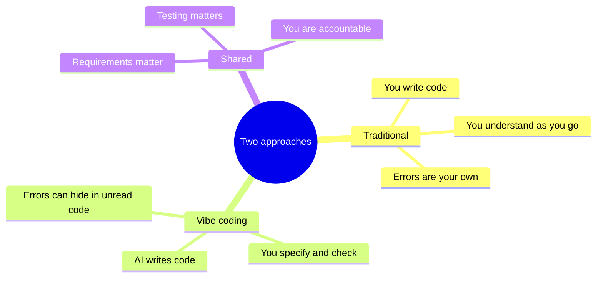
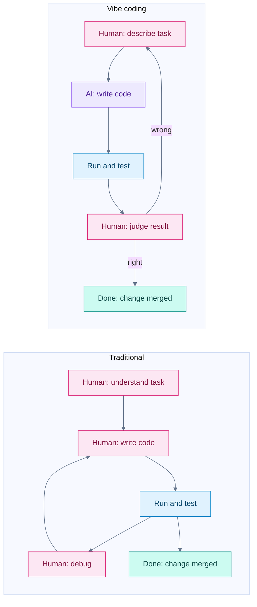

# Vibe Coding vs Traditional Coding

## Contents

- [Learning Objectives](#learning-objectives)
- [Prerequisites](#prerequisites)
- [Overview](#overview)
- [Mind Map](#mind-map)
- [Core Concepts](#core-concepts)
- [How It Works](#how-it-works)
- [Practical Example](#practical-example)
- [Step-by-Step Explanation](#step-by-step-explanation)
- [Expected Result](#expected-result)
- [Common Mistakes and Troubleshooting](#common-mistakes-and-troubleshooting)
- [Best Practices](#best-practices)
- [Hands-On Exercise](#hands-on-exercise)
- [Verification Checklist](#verification-checklist)
- [Conclusion](#conclusion)
- [Related Lessons](#related-lessons)
- [Official References](#official-references)

## Learning Objectives

After this lesson you can:

- Compare the two approaches on who writes code, what you read, and where errors hide.
- Explain which skills matter more and which matter less in vibe coding.
- Choose an approach for a given task and justify it.

## Prerequisites

[What Is Vibe Coding?](./what_is_vibe_coding.md) and [History and Evolution](./history_and_evolution.md)

## Overview

In traditional coding you write the code line by line and understand it as you write. In vibe coding the AI writes most of it and you understand it afterwards, if at all. Neither approach is better in general. They shift the effort: traditional coding front-loads effort into writing, vibe coding shifts it into specifying and checking.

This lesson compares them on stated dimensions rather than slogans.

## Mind Map

## Core Concepts

**Who writes the code.** Traditional: you. Vibe coding: the AI, with you approving or correcting.

**When you understand the code.** Traditional: while writing it. Vibe coding: after it appears, which means understanding is optional and therefore easy to skip. Skipping it is the main risk.

**Where errors come from.** Traditional: your mistakes, which you often feel as you make them. Vibe coding: the AI's guesses, which look equally confident when they are wrong.

**What stays the same.** Both approaches need clear requirements, small steps, version control, tests and security attention. Vibe coding does not remove software engineering; it moves where your effort goes.

**Skills that grow in importance:** writing precise requirements, reading code critically, testing, debugging, judging risk.

**Skills that shrink in importance:** remembering syntax and library details, typing boilerplate.

## How It Works

Legend: pink = human work, violet = AI work, blue = running and testing, teal = completion. The vibe-coding column has fewer human writing steps, but the human judgment step is still there and cannot be skipped.

## Practical Example

**Task:** add a search box to a page that lists books, filtering the list as you type.

| Dimension | Traditional | Vibe coding |
|---|---|---|
| First step | Look up how to listen for input events and filter an array | Describe the behavior and rules in a prompt |
| Who writes the filter | You | The AI |
| How you learn it works | You wrote it and ran it | You must run it and try cases: empty text, capital letters, no matches |
| Typical hidden fault | Off-by-one or wrong event | Case-sensitive matching, or the list is never restored when the box is cleared |
| What you did not do | Describe edge cases up front | Read the code line by line |

Vibe coding saves the writing; it creates the need to check cases you did not think of. A good prompt names them: "matching ignores case, an empty box shows all books, no matches shows the message 'No books found'."

## Step-by-Step Explanation

1. Write the behavior as rules. The same rules serve as acceptance tests in both approaches.
2. Decide how much you need to read. A throwaway page: run it. Code that handles other people's data: read it all.
3. Test the edge cases from your rules, not only the happy path.
4. If it fails, say which rule failed. Compare "it's broken" with "typing capital letters returns nothing."

## Expected Result

You can fill the table below for a task of your own and defend your choice.

| Question | Your answer |
|---|---|
| What is at stake if this is wrong? | |
| Can I read and understand the code? | |
| Could I undo a bad change easily? | |
| Chosen approach and reason | |

## Common Mistakes and Troubleshooting

| Mistake | Consequence | Fix |
|---|---|---|
| Assuming AI-written code is correct because it looks professional | Confident wrong code ships | Verify with a run and tests |
| Using vibe coding for everything | Poor fit where precision or safety matter | See [Benefits, Risks and Use Cases](./benefits_risks_and_use_cases.md) |
| Refusing AI help for everything | Slower on routine work | Use it for boilerplate and drafts, review the output |
| Not learning fundamentals | You cannot judge output | Study [chapter 02](../../02-software-development-fundamentals/README.md) alongside |

## Best Practices

- Choose the approach per task, not per identity.
- Write your acceptance rules before you start, whichever approach you use.
- Increase checking when the cost of an error rises.

## Hands-On Exercise

Pick three tasks from your own work or interests, one trivial (a personal script), one moderate (a small web page for others) and one serious (anything involving payments or personal data).

1. Fill the decision table above for each.
2. For each, write the first prompt you would give an AI tool, or explain why you would write it yourself.
3. Name the one check you will do before trusting the result.

## Verification Checklist

- [ ] All three tasks have a stated cost of failure.
- [ ] The serious task has stronger checks than the trivial one.
- [ ] Each prompt includes at least two rules or edge cases.
- [ ] I can explain what stayed the same between the two approaches.

## Conclusion

Vibe coding moves effort from writing code to specifying behavior and checking results. It does not remove requirements, testing or accountability. Choose the approach that fits the task's risk, and verify in proportion to what is at stake.

## Related Lessons

- Previous: [History and Evolution](./history_and_evolution.md)
- Next: [Benefits, Risks and Use Cases](./benefits_risks_and_use_cases.md)
- [Reading and Understanding Code](../../02-software-development-fundamentals/md/reading_and_understanding_code.md)
- [Software Development Lifecycle](../../02-software-development-fundamentals/md/software_development_lifecycle.md)

## Official References

This lesson is conceptual and relies on no product-specific facts. Product-specific comparisons, with dates, are in [chapter 04](../../04-ai-coding-tools/README.md).

---

**Navigation:** [Chapter index](../README.md) · [Previous: History and Evolution](./history_and_evolution.md) · [Next: Benefits, Risks and Use Cases](./benefits_risks_and_use_cases.md)
