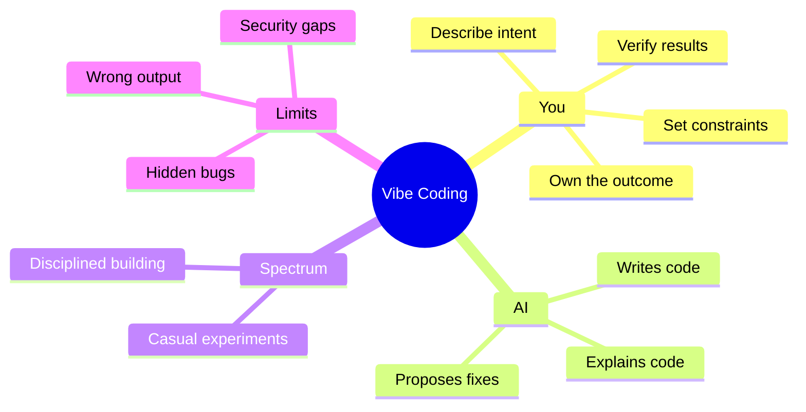
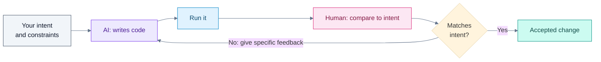

# What Is Vibe Coding?

## Contents

- [Learning Objectives](#learning-objectives)
- [Prerequisites](#prerequisites)
- [Overview](#overview)
- [Mind Map](#mind-map)
- [Core Concepts](#core-concepts)
- [How It Works](#how-it-works)
- [Practical Example](#practical-example)
- [Step-by-Step Explanation](#step-by-step-explanation)
- [Expected Result](#expected-result)
- [Common Mistakes and Troubleshooting](#common-mistakes-and-troubleshooting)
- [Best Practices](#best-practices)
- [Hands-On Exercise](#hands-on-exercise)
- [Verification Checklist](#verification-checklist)
- [Conclusion](#conclusion)
- [Related Lessons](#related-lessons)
- [Official References](#official-references)

## Learning Objectives

After this lesson you can:

- Define vibe coding in one sentence and name the three activities in its loop.
- List what you must still decide even when AI writes all the code.
- Turn a vague request into a specific prompt and see why the result improves.

## Prerequisites

None. You do not need to know how to program.

## Overview

Vibe coding means building software by describing what you want to an AI tool in plain language, running what it produces, and steering it with feedback. The term was coined by Andrej Karpathy in a post on X on 2 February 2025, where he called it "a new kind of coding."

The word "vibe" is the risky part. In its loosest form you accept the AI's output without reading it. This course teaches the disciplined version: you let AI write most of the code, but you decide what to build, you check that it works, and you stay responsible for the result.

**Why it matters:** the same tools that let a beginner build a working app in an afternoon also let anyone ship broken or insecure software just as quickly. The skill is not typing prompts. It is knowing what to ask for and how to tell whether you got it.

## Mind Map



## Core Concepts

**The loop.** Every vibe-coding session repeats three steps: *describe* what you want, *run* what the AI produced, *refine* with specific feedback. Each trip around the loop should be small enough that you can tell whether it worked.

**Intent versus implementation.** You supply intent: what the software does, for whom, and what counts as correct. The AI supplies implementation: the code. When intent is vague, the AI fills the gaps with guesses.

**What the AI cannot know.** The AI does not know your users, your constraints, your data, or what "done" means for you. It will not tell you when it has guessed.

**A spectrum, not a switch.** At one end you try an idea for fun and never read the code. At the other end you review every change, run tests and treat generated code like a colleague's pull request. Choose your position on purpose, based on what is at stake. The next lessons help you choose.

## How It Works



Legend: grey = your input, violet = AI step, blue = running the code, pink = human judgment, teal = accepted. The loop only works because a human compares the result to the intent.

## Practical Example

You want a tip calculator. Compare two prompts.

**Vague prompt**

```text
Make me a tip calculator.
```

The AI must now guess: Is it a web page or a phone app? What tip default? Can the bill be split? What happens with a negative bill?

**Specific prompt**

```text
Build a single-file web page (index.html, no libraries) that calculates a tip.

Inputs: bill amount, tip percent (default 15), number of people (default 1).
Output: "Each person pays X.XX", updated as the user types.

Rules:
- Bill and tip must be 0 or more. People must be at least 1.
- If an input is invalid, show a short error message and no result.
- If the bill field is empty, show nothing.

Before finishing, tell me how to check it works, including the invalid cases.
```

The second prompt states the platform, the inputs, the output format, the rules and a way to verify. A working result of this prompt is in [`examples/tip-calculator/index.html`](../examples/tip-calculator/index.html).

## Step-by-Step Explanation

1. **Name the platform and form** (single web page, no libraries). This removes a whole class of guesses.
2. **List inputs with defaults.** Defaults are decisions you would otherwise discover later.
3. **State the output exactly.** "Each person pays X.XX" can be checked; "show the result" cannot.
4. **Write the rules, including bad input.** Edge cases are where AI output most often fails silently.
5. **Ask for verification steps.** You then have something concrete to do after the code arrives.

## Expected Result

Opening `examples/tip-calculator/index.html` in a browser and entering a bill of 100, tip 20 and 4 people shows `Each person pays 30.00`. Entering 0 people shows the error message and no result.

**Tested:** `examples/tip-calculator/test_tip_calculator.py` runs six browser checks against this page and passed when this lesson was written (Python with Playwright and Chromium). The page was written for this course to satisfy that prompt, and was checked by that test. It was not generated by a model on demand, so output from your own tool will differ in code and styling.

## Common Mistakes and Troubleshooting

| Mistake | What happens | Fix |
|---|---|---|
| Asking for a whole app in one prompt | Large result that is hard to check | Start with one working slice, then add |
| Not saying what "correct" means | AI invents rules | Add rules and examples of valid and invalid input |
| Accepting output you never ran | Bugs surface later | Run it and try the invalid cases first |
| Repeating the same prompt louder | Same wrong result | Say specifically what was wrong and what you expected |
| Treating a working demo as finished | Missing validation, security and tests | Use the later chapters on testing and security |

## Best Practices

- Describe the outcome and the rules, not just the topic.
- Keep each request small enough to verify in a minute or two.
- Always run the result and try at least one invalid input.
- Keep what works. Save a copy or commit before asking for the next change.

## Hands-On Exercise

Pick a small app idea you care about (for example a habit tracker or a unit converter).

1. Write the vague version of the prompt in one line.
2. Write the specific version using the five steps above.
3. List every question the vague prompt left unanswered.
4. If you have access to an AI coding tool, run both prompts and compare the results. If not, skip this step; the first three still apply.

## Verification Checklist

- [ ] My specific prompt names the platform and form of the app.
- [ ] Every input has a default or is marked required.
- [ ] The output is described exactly enough that I could check it.
- [ ] I wrote at least two rules for invalid input.
- [ ] I asked how to verify the result.
- [ ] I can state in one sentence what I would still have to decide myself.

## Conclusion

Vibe coding is describing intent, running the result and refining, in small steps you can check. AI supplies the code; you supply the intent, the rules and the judgment. The more clearly you state intent, the less the AI has to guess.

## Related Lessons

- Next: [History and Evolution](./history_and_evolution.md)
- [Vibe Coding vs Traditional Coding](./vibe_coding_vs_traditional_coding.md)
- Prompt writing in depth: [Prompt Anatomy](../../05-prompt-engineering-and-context/md/prompt_anatomy.md)
- Project using this skill: [Landing page](../../28-hands-on-projects/beginner/landing-page/README.md)

## Official References

- The term's origin: Andrej Karpathy's post on X, 2 February 2025, summarized by [Know Your Meme: Vibe Coding](https://knowyourmeme.com/memes/vibe-coding) (secondary source; verified 12 October 2026). The original post is on X and was not opened for this lesson.

---

**Navigation:** [Chapter index](../README.md) · [Next: History and Evolution](./history_and_evolution.md)
