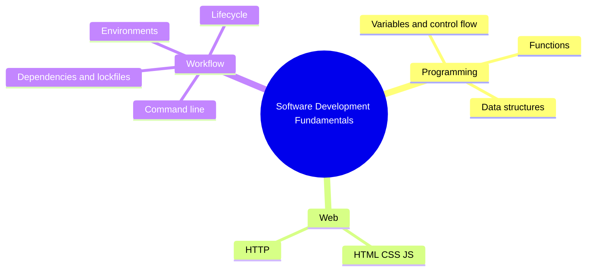

# 02 Software Development Fundamentals

> **Level:** Beginner · **Prerequisites:** Chapter 01.

## Overview

The programming, web and workflow basics you need in order to read and judge what AI produces.

## Learning objectives

By the end of this chapter you can:

- Read and explain short generated programs
- Trace a web request from browser to server
- Set up an isolated project environment and reproduce a build

## Chapter mind map

## Lessons

Read in this order. Each lesson ends with a hands-on exercise.

| # | Lesson | Level | What you will do |
|---|---|---|---|
| 1 | [Programming Concepts](./md/programming_concepts.md) | Beginner | Annotate a short generated script |
| 2 | [Data Structures and Algorithms Basics](./md/data_structures_and_algorithms_basics.md) | Beginner | Pick the right structure for three scenarios |
| 3 | [Web Fundamentals: HTTP, HTML, CSS and JS](./md/web_fundamentals_http_html_css_js.md) | Beginner | Trace one request from browser to response |
| 4 | [Command Line and Environments](./md/command_line_and_environments.md) | Beginner | Set up an isolated project environment |
| 5 | [Software Development Lifecycle](./md/software_development_lifecycle.md) | Beginner | Map a feature through the lifecycle stages |
| 6 | [Reading and Understanding Code](./md/reading_and_understanding_code.md) | Beginner | Explain a generated function line by line |
| 7 | [Build Systems Dependencies and Lockfiles](./md/build_systems_dependencies_and_lockfiles.md) | Beginner | Reproduce a build from a lockfile |

## Related

- [Prompt library](../30-prompt-library-and-checklists/README.md)
- [Hands-on projects](../28-hands-on-projects/README.md)

## Next step

Continue with [Chapter 03: AI Fundamentals](../03-ai-fundamentals/README.md).

---
[Back to the course home](../README.md)
