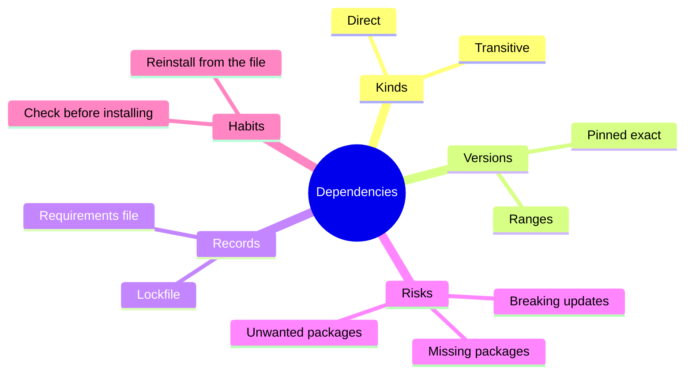
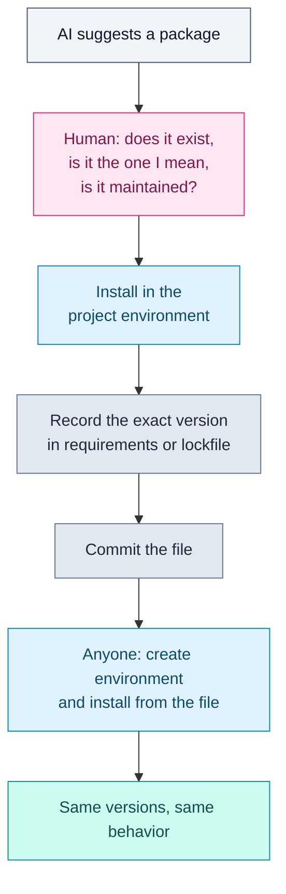

# Build Systems, Dependencies and Lockfiles

## Contents

- [Learning Objectives](#learning-objectives)
- [Prerequisites](#prerequisites)
- [Overview](#overview)
- [Mind Map](#mind-map)
- [Core Concepts](#core-concepts)
- [How It Works](#how-it-works)
- [Practical Example](#practical-example)
- [Step-by-Step Explanation](#step-by-step-explanation)
- [Expected Result](#expected-result)
- [Common Mistakes and Troubleshooting](#common-mistakes-and-troubleshooting)
- [Best Practices](#best-practices)
- [Hands-On Exercise](#hands-on-exercise)
- [Verification Checklist](#verification-checklist)
- [Conclusion](#conclusion)
- [Related Lessons](#related-lessons)
- [Official References](#official-references)

## Learning Objectives

After this lesson you can:

- Explain what a dependency is and why exact versions matter.
- Tell a direct dependency from a transitive one.
- Describe what a lockfile does and why a project should have one.
- Check an AI-suggested package before installing it.

## Prerequisites

[Command Line and Environments](./command_line_and_environments.md)

## Overview

Almost no software is written from scratch. Projects use *dependencies*: libraries that other people wrote. AI tools add them freely, often with one line: "install this package." Dependencies make you faster and make your project fragile in new ways: a library can change, disappear, or turn out not to be what you expected. A *build system* and a *lockfile* are how you keep a project reproducible, meaning anyone can rebuild exactly what you have.

## Mind Map



## Core Concepts

**Dependency.** A library your project needs in order to run.

**Direct and transitive.** A *direct* dependency is one you chose. A *transitive* dependency is one your dependency needs. You may end up with dozens of transitive packages you never named.

**Version pinning.** Writing an exact version, such as `six==1.16.0`, so every install gets the same code. Without a pin, installing tomorrow could fetch a newer release that behaves differently. The pip documentation recommends pinning with `==` and notes that `pip freeze` can generate a pinned file that also includes transitive dependencies.

**Lockfile.** A file recording the exact version of every dependency, direct and transitive, so a rebuild matches. In Python this role is often played by a pinned `requirements.txt`; other ecosystems, such as JavaScript with npm, generate a dedicated lockfile (`package-lock.json`). Keep lockfiles under version control.

**Hash checking.** An extra step where each requirement carries a checksum (`--hash=sha256:...`), and pip verifies each download against it. The pip documentation describes this as protection against a compromised package index or a package that changes without a version change.

**Build system.** The tool and steps that turn source files into something runnable: install dependencies, compile or bundle, run checks. For small Python scripts the "build" may be just creating an environment and installing requirements.

## How It Works



Legend: grey = AI input, pink = human check, blue = steps, slate = files you keep, teal = reproducible result.

## Practical Example

The folder [`examples/dependencies/`](../examples/dependencies/) holds two small files.

`requirements.txt`:

```text
# Direct dependency, pinned to an exact version so every install is the same.
six==1.16.0
```

`use_six.py`:

```python
import six
print("six version:", six.__version__)
```

**Rebuild from the file** (macOS and Linux shown; see the previous lesson for Windows):

```bash
python3 -m venv .venv
source .venv/bin/activate
pip install -r requirements.txt
python use_six.py
```

Expected output of the last line: `six version: 1.16.0`.

**Why the file matters.** Without installing first, the script fails. Running it in a fresh environment produced exactly this:

```text
    import six
ModuleNotFoundError: No module named 'six'
```

That error is what a teammate sees if the dependency exists only on your machine and not in a recorded file.

**Recording what is installed.** After installing, `pip freeze` lists every installed package with its version, including transitive ones, which you can save with `pip freeze > requirements.txt`.

## Step-by-Step Explanation

1. Create and activate an environment so the install does not touch other projects.
2. `pip install -r requirements.txt` reads the file and installs each pinned version.
3. Running the script proves the dependency is available and at the expected version.
4. If you add a new package, add it to the file (or regenerate it with `pip freeze`) and commit both the code and the file.

**Before installing anything an AI suggests**, check:

- The package exists on the official index and the name is spelled exactly as intended. Look-alike names are a known way to trick people.
- It does what you need and is actively maintained.
- You actually need it. The standard library or an existing dependency may already do the job.

## Expected Result

On a computer with internet access to the Python Package Index, the commands above print `six version: 1.16.0`. Deleting `.venv` and repeating the steps gives the same result.

**Honest status:** the `venv` creation and the failing-without-install error were run in the sandbox used to write this lesson. The `pip install -r requirements.txt` step was **not executed successfully** because that sandbox could not reach the Python Package Index (name resolution failed). The expected output `six version: 1.16.0` is therefore what the pinned requirement should produce, not an observed result. Run the steps yourself to confirm.

For JavaScript projects, npm installs the exact versions in `package-lock.json` with `npm ci`; that behavior is described in npm's documentation and was not run for this lesson.

## Common Mistakes and Troubleshooting

| Mistake or symptom | Cause | Fix |
|---|---|---|
| "Works on my machine" | Dependency not recorded, or different versions | Pin and commit the requirements or lockfile |
| `ModuleNotFoundError` | Not installed in the active environment | Activate the right environment and install |
| Everything broke after an update | Unpinned dependency upgraded | Pin exact versions and upgrade deliberately |
| Installing a package the AI named, then it does something odd | Wrong or unexpected package | Verify the package name and source before installing |
| Huge numbers of transitive packages | Normal for large libraries | Prefer fewer, well-known direct dependencies |
| Installing with administrator rights | Habit | Use a virtual environment; avoid `sudo pip` |

## Best Practices

- Use one environment per project and one requirements file or lockfile per project.
- Commit the lockfile.
- Upgrade dependencies on purpose, one at a time, and run the tests after each.
- Prefer fewer dependencies. Each one is code you did not write and must trust.
- Treat an unfamiliar package suggestion as a claim to check, not a fact. The next chapters on security cover this further.

## Hands-On Exercise

1. Create a folder with the two example files and a virtual environment.
2. Run `python use_six.py` before installing anything. Record the error.
3. Install from `requirements.txt` and run it again. Record the output. If you cannot reach the package index, record that instead.
4. Run `pip freeze` and compare its output with `requirements.txt`. Which entries did you not write yourself?
5. Pick one package an AI tool has suggested to you in the past (or ask for one for parsing dates) and complete the three-point check above before installing.

## Verification Checklist

- [ ] I saw the `ModuleNotFoundError` before installing.
- [ ] After installing, the script ran, or I recorded why I could not install.
- [ ] I can name one direct and one transitive dependency from my `pip freeze` output.
- [ ] My requirements file is in version control.
- [ ] I completed the package check before installing the suggested package.

## Conclusion

Dependencies are code you borrow. Record exact versions in a file you keep in version control so anyone can rebuild the same environment, and check any package an AI suggests before you install it. A reproducible build is what turns a personal experiment into something a team can rely on.

## Related Lessons

- Previous: [Reading and Understanding Code](./reading_and_understanding_code.md)
- Next chapter: [AI Fundamentals](../../03-ai-fundamentals/md/how_llms_work.md)
- Supply-chain risk in depth: [Dependency and Supply Chain Risk](../../17-security-and-responsible-development/md/dependency_and_supply_chain_risk.md)
- Environment setup: [Command Line and Environments](./command_line_and_environments.md)

## Official References

- pip documentation, [Repeatable Installs](https://pip.pypa.io/en/stable/topics/repeatable-installs/) (verified 12 October 2026).
- Python Software Foundation, [`venv`: Creation of virtual environments](https://docs.python.org/3/library/venv.html) (verified 12 October 2026).

---

**Navigation:** [Chapter index](../README.md) · [Previous: Reading and Understanding Code](./reading_and_understanding_code.md) · [Next chapter: AI Fundamentals](../../03-ai-fundamentals/md/how_llms_work.md)
