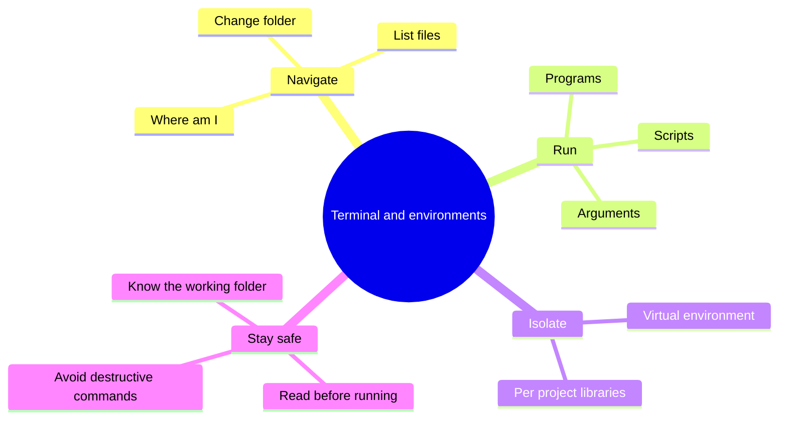
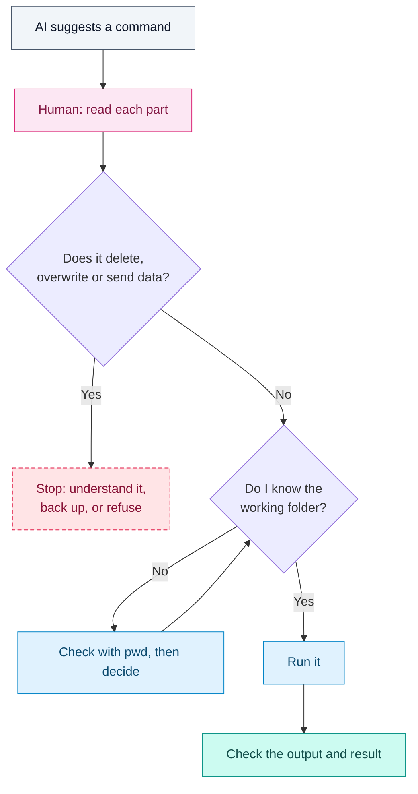

# Command Line and Environments

## Contents

- [Learning Objectives](#learning-objectives)
- [Prerequisites](#prerequisites)
- [Overview](#overview)
- [Mind Map](#mind-map)
- [Core Concepts](#core-concepts)
- [How It Works](#how-it-works)
- [Practical Example](#practical-example)
- [Step-by-Step Explanation](#step-by-step-explanation)
- [Expected Result](#expected-result)
- [Common Mistakes and Troubleshooting](#common-mistakes-and-troubleshooting)
- [Best Practices](#best-practices)
- [Hands-On Exercise](#hands-on-exercise)
- [Verification Checklist](#verification-checklist)
- [Conclusion](#conclusion)
- [Related Lessons](#related-lessons)
- [Official References](#official-references)

## Learning Objectives

After this lesson you can:

- Move around folders and run programs from a terminal.
- Create and use an isolated Python environment for a project.
- Decide, before running an AI-suggested command, whether it is safe.

## Prerequisites

[Programming Concepts](./programming_concepts.md)

## Overview

AI coding tools constantly tell you to "run this command." The command line is a text interface to your computer: you type an instruction, the computer runs it. An *environment* is a self-contained set of tools and libraries for one project, so that projects do not interfere with one another. Together they are the workshop you build in.

The risk is real: a terminal does exactly what it is told, including deleting files. This lesson teaches the habit of reading a command before running it.

## Mind Map



## Core Concepts

**The working directory.** Every command runs from a folder, the *working directory*. Many mistakes are right command, wrong folder. Always know where you are.

**Equivalent commands.** The same ideas have different spellings.

| Task | macOS and Linux (bash or zsh) | Windows PowerShell |
|---|---|---|
| Show current folder | `pwd` | `pwd` (alias of `Get-Location`) |
| List files | `ls` | `ls` or `dir` (aliases of `Get-ChildItem`) |
| Change folder | `cd folder` | `cd folder` |
| Go up one folder | `cd ..` | `cd ..` |
| Show a file | `cat file.txt` | `cat file.txt` (alias of `Get-Content`) |

**Virtual environment.** A project-specific folder holding its own copy of the Python interpreter setup and installed libraries. Without it, every project shares one pile of libraries, and an upgrade for one project can break another. Python includes a tool for this called `venv`.

**Activating.** Activating a virtual environment points your terminal at it for the rest of that session. It is optional; you can also run the environment's Python by its full path. `deactivate` leaves it.

**Arguments and flags.** Extra words after a command, such as `python -m venv .venv`. Here `-m venv` tells Python to run the `venv` module, and `.venv` is the folder to create.

## How It Works



Legend: grey = AI input, pink = human judgment, blue = steps, dashed rose = stop, teal = result checked. The loop at "working folder" shows you repeat the check until you are sure where you are.

## Practical Example

Create an isolated environment for a new project and confirm that it is active.

**macOS and Linux**

```bash
mkdir my-project
cd my-project
python3 -m venv .venv
source .venv/bin/activate
python -c "import sys; print(sys.prefix != sys.base_prefix)"
deactivate
```

**Windows PowerShell**

```powershell
mkdir my-project
cd my-project
python -m venv .venv
.venv\Scripts\Activate.ps1
python -c "import sys; print(sys.prefix != sys.base_prefix)"
deactivate
```

If PowerShell refuses to run the activation script, the Python documentation describes allowing scripts for your user with `Set-ExecutionPolicy -ExecutionPolicy RemoteSigned -Scope CurrentUser`. That changes a security setting, so read what it does first. You can avoid it entirely by skipping activation and running `.venv\Scripts\python.exe` directly.

## Step-by-Step Explanation

1. `mkdir my-project` creates a folder; `cd my-project` enters it.
2. `python -m venv .venv` creates a hidden-by-convention folder `.venv` containing the environment.
3. The `activate` command points the terminal at that environment. The prompt usually shows `(.venv)`.
4. The one-line Python check prints `True` when the interpreter is running inside a virtual environment, because its `prefix` differs from the base installation's.
5. `deactivate` returns the terminal to normal.

## Expected Result

The check prints `True` while the environment is active. After `deactivate`, running the same check with the system Python prints `False`.

**Tested:** creating a virtual environment with `python3 -m venv` and running the `prefix` check inside it printed `True` on Linux with Python 3.13 when this lesson was written. The Windows PowerShell commands follow the Python documentation and were **not run** for this lesson.

## Common Mistakes and Troubleshooting

| Mistake or symptom | Cause | Fix |
|---|---|---|
| `python: command not found` | Python not installed, or the command is `python3` | Try `python3`; install Python if neither works |
| Packages missing after installing | Installed into a different Python | Activate the environment, then install |
| Commit includes a huge `.venv` folder | `.venv` not ignored | Add `.venv/` to `.gitignore` |
| Running a command in the wrong folder | Forgot where you were | Run `pwd` before commands that change files |
| Pasting a long command you do not understand | Trusting the source | Stop; see the safety checklist below |
| PowerShell blocks `Activate.ps1` | Script execution policy | See the note above, or run the environment's Python by path |

**Safety checklist for AI-suggested commands.** Do not run a command until you can answer yes to all of these:

- [ ] I know what each part of it does.
- [ ] It does not delete files (`rm`, `del`, `Remove-Item`, `format`) in a folder I have not checked.
- [ ] It does not send my files or secrets somewhere (`curl ... | sh`, uploads).
- [ ] It does not need administrator rights, or I know why it does.
- [ ] I am in the folder I think I am in.

## Best Practices

- Create one virtual environment per project and keep it inside the project folder.
- Keep `.venv/` out of version control.
- Run `pwd` before any command that changes or deletes files.
- Ask the AI to explain a command before you run it, then confirm against documentation.
- Never run anything piped from the internet straight into a shell.

## Hands-On Exercise

1. Create `my-project` and a virtual environment as shown for your operating system.
2. Activate it and run the one-line check. Record the output.
3. Run `deactivate` and run the check again. Record the output.
4. Ask an AI tool for a command to "clean up temporary files." Apply the safety checklist before deciding whether to run it. Write down which items on the list you could not answer.

## Verification Checklist

- [ ] The check printed `True` inside the environment.
- [ ] After `deactivate` I understood why it changed.
- [ ] `.venv/` is listed in my `.gitignore` or I know how to add it.
- [ ] I did not run the "clean up" command without answering every checklist item.

## Conclusion

The command line runs exactly what you type, from the folder you are in. Isolated environments keep each project's libraries separate. Before running any AI-suggested command, read it, check the folder, and refuse anything that deletes or sends data you do not understand.

## Related Lessons

- Previous: [Web Fundamentals: HTTP, HTML, CSS and JS](./web_fundamentals_http_html_css_js.md)
- Next: [Software Development Lifecycle](./software_development_lifecycle.md)
- [Build Systems, Dependencies and Lockfiles](./build_systems_dependencies_and_lockfiles.md)
- Agent command safety: [Tool Permissions and Command Approval](../../04-ai-coding-tools/md/tool_permissions_and_command_approval.md)

## Official References

- Python Software Foundation, [`venv`: Creation of virtual environments](https://docs.python.org/3/library/venv.html) (verified 12 October 2026).

---

**Navigation:** [Chapter index](../README.md) · [Previous: Web Fundamentals: HTTP, HTML, CSS and JS](./web_fundamentals_http_html_css_js.md) · [Next: Software Development Lifecycle](./software_development_lifecycle.md)
