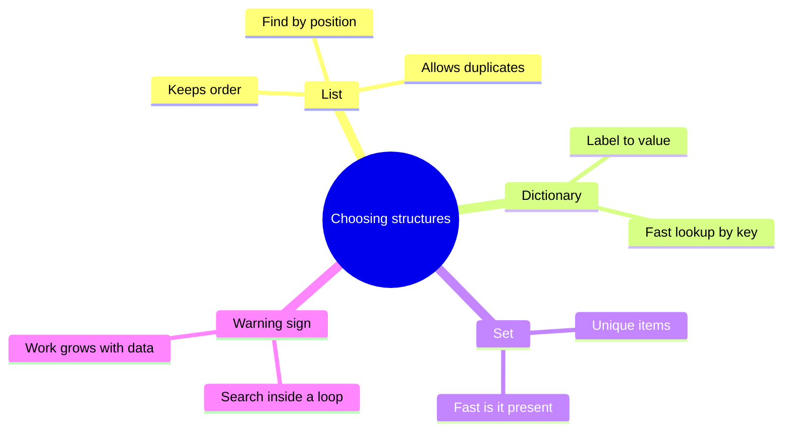
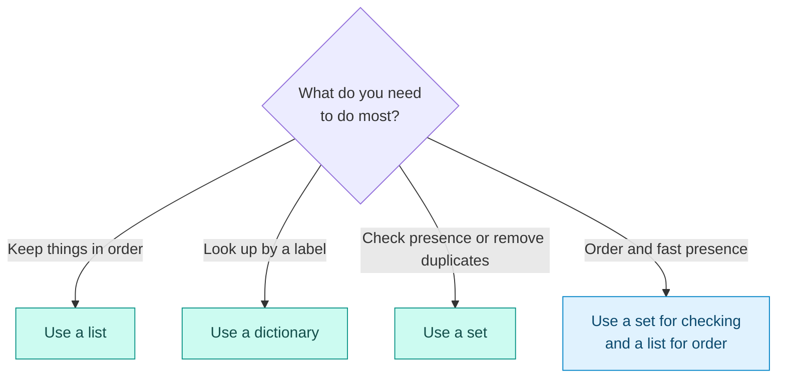

# Data Structures and Algorithms Basics

## Contents

- [Learning Objectives](#learning-objectives)
- [Prerequisites](#prerequisites)
- [Overview](#overview)
- [Mind Map](#mind-map)
- [Core Concepts](#core-concepts)
- [How It Works](#how-it-works)
- [Practical Example](#practical-example)
- [Step-by-Step Explanation](#step-by-step-explanation)
- [Expected Result](#expected-result)
- [Common Mistakes and Troubleshooting](#common-mistakes-and-troubleshooting)
- [Best Practices](#best-practices)
- [Hands-On Exercise](#hands-on-exercise)
- [Verification Checklist](#verification-checklist)
- [Conclusion](#conclusion)
- [Related Lessons](#related-lessons)
- [Official References](#official-references)

## Learning Objectives

After this lesson you can:

- Choose among a list, a dictionary and a set for a given job.
- Explain in plain language why some code slows down as data grows.
- Spot a wasteful pattern in generated code, such as searching a list inside a loop.

## Prerequisites

[Programming Concepts](./programming_concepts.md)

## Overview

A *data structure* is a way of organizing data. An *algorithm* is a procedure for solving a problem with it. AI tools usually pick something that works. They do not always pick something that keeps working when the data grows from ten items to a million. You do not need advanced theory; you need to recognize three structures and one warning sign.

## Mind Map



## Core Concepts

**List.** Ordered items, duplicates allowed. Good for sequences you will walk through in order. Finding an item by value means checking items one by one.

**Dictionary.** Items stored under labels (keys): `{"Asha": 91}`. Good when you look things up by a name or ID. Looking up a key is fast regardless of size.

**Set.** A collection of unique items with no order. Good for "have I seen this?" and for removing duplicates. Checking membership is fast regardless of size.

**How work grows.** Some code does a fixed amount of work per item (walk the list once). Other code repeats a search for every item. If you search a list of *n* items for each of *n* items, the work grows with *n × n*: 1,000 items means about a million comparisons, 100,000 items means about ten billion. People call this "quadratic growth." You do not need the notation, only the habit of asking: *what happens when there are a hundred times more items?*

**The warning sign.** A membership check on a list (`if x in some_list`) inside a loop. Replacing the list with a set or dictionary often fixes it.

## How It Works



Legend: diamond = the question to ask, teal = a single structure fits, blue = combine two. Edge labels name the main need.

## Practical Example

**Task:** remove duplicate email addresses from a list but keep the order each address first appeared. Treat `Ann@x.com` and ` ann@x.com` (with a leading space) as the same address.

The code is in [`examples/data-structures/unique_emails.py`](../examples/data-structures/unique_emails.py):

```python
def unique_in_order(items):
    seen = set()          # a set answers "have I seen this?" quickly
    result = []           # a list keeps the order
    for item in items:
        key = item.strip().lower()
        if key not in seen:
            seen.add(key)
            result.append(key)
    return result
```

It uses two structures, each for what it does best. A tempting AI-written alternative is `if key not in result:`, which searches the list for every item. It gives the same answer for ten emails and becomes very slow for a million.

## Step-by-Step Explanation

1. `seen` is an empty set. `result` is an empty list.
2. For each item, clean it (`strip` removes spaces, `lower` removes capital letters) into `key`.
3. If `key` is not in `seen`, it is new: record it in `seen` and append it to `result`.
4. Otherwise skip it.
5. The list keeps first-seen order; the set makes each "seen before?" check fast.

## Expected Result

```python
unique_in_order(["Ann@x.com", "bob@x.com", " ann@x.com", "BOB@x.com", "cy@x.com"])
# ['ann@x.com', 'bob@x.com', 'cy@x.com']
```

**Tested:** `examples/data-structures/test_unique_emails.py` checks this case, an empty list, and a list of identical entries. It passed with Python 3.13 when this lesson was written. This lesson makes no timing claim; the growth description above is a general property, and the tests only check correctness.

## Common Mistakes and Troubleshooting

| Mistake | Symptom | Fix |
|---|---|---|
| Using a list for membership checks inside a loop | Fine on small data, very slow on large data | Use a set or dictionary |
| Using a set when order matters | Items come out in an unpredictable order | Keep a list for order |
| Forgetting to normalize (case, spaces) before comparing | "Ann" and "ann" counted as different | Clean the value to a standard form first |
| Using a dictionary key that can change | Lookups fail later | Use stable keys such as IDs |

## Best Practices

- Ask what you do most: iterate, look up or check presence.
- Look for membership checks inside loops when reviewing generated code.
- Normalize data before comparing it.
- Test with a small set of cases, then ask what changes with a thousand times more data.

## Hands-On Exercise

1. Write down the list, set or dictionary you would use for each: (a) names in the order people arrive, (b) a phone book from name to number, (c) the distinct countries in a customer file.
2. In `examples/data-structures/`, change `unique_in_order` so it returns the *count* of unique addresses instead. Which structure do you need?
3. Ask an AI tool to write the same function with a list-only approach. Compare the two versions and explain which one you would keep as the data grows.

## Verification Checklist

- [ ] My answers to part 1 match the structure's strengths described above.
- [ ] My modified function passes the original tests after adapting them to the new return value.
- [ ] I can explain why a membership check inside a loop is a warning sign.
- [ ] I did not claim a speed difference I had not measured.

## Conclusion

Lists keep order, dictionaries look up by label and sets check presence and uniqueness. Many slowdowns in generated code come from searching a list inside a loop. Ask what happens when the data grows a hundred times larger, and choose structures to match.

## Related Lessons

- Previous: [Programming Concepts](./programming_concepts.md)
- Next: [Web Fundamentals: HTTP, HTML, CSS and JS](./web_fundamentals_http_html_css_js.md)
- Measuring speed properly later: [Profiling and Performance Basics](../../25-performance-and-cost-optimization/md/profiling_and_performance_basics.md)

## Official References

- Python Software Foundation, [The Python Tutorial](https://docs.python.org/3/tutorial/index.html), which covers lists, dictionaries and sets (verified 12 October 2026).

---

**Navigation:** [Chapter index](../README.md) · [Previous: Programming Concepts](./programming_concepts.md) · [Next: Web Fundamentals: HTTP, HTML, CSS and JS](./web_fundamentals_http_html_css_js.md)
