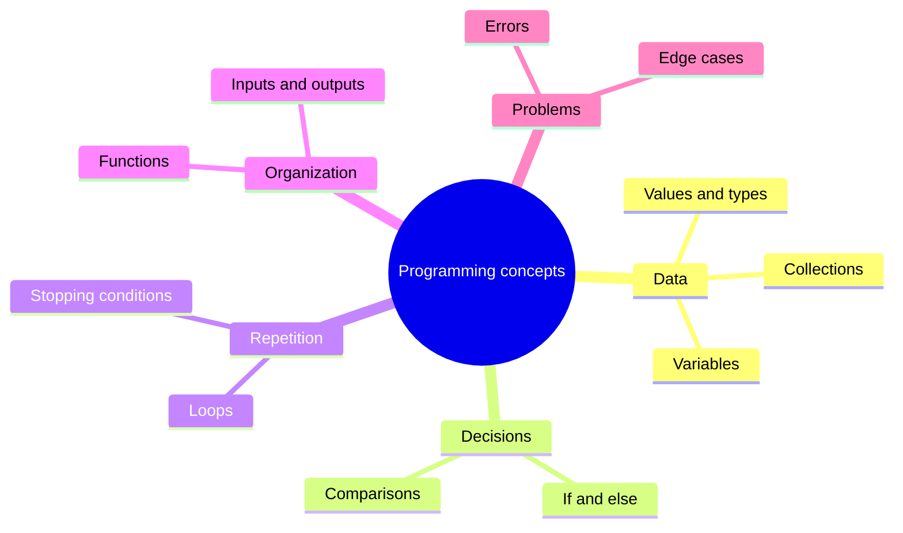
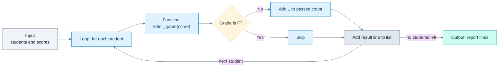

# Programming Concepts

## Contents

- [Learning Objectives](#learning-objectives)
- [Prerequisites](#prerequisites)
- [Overview](#overview)
- [Mind Map](#mind-map)
- [Core Concepts](#core-concepts)
- [How It Works](#how-it-works)
- [Practical Example](#practical-example)
- [Step-by-Step Explanation](#step-by-step-explanation)
- [Expected Result](#expected-result)
- [Common Mistakes and Troubleshooting](#common-mistakes-and-troubleshooting)
- [Best Practices](#best-practices)
- [Hands-On Exercise](#hands-on-exercise)
- [Verification Checklist](#verification-checklist)
- [Conclusion](#conclusion)
- [Related Lessons](#related-lessons)
- [Official References](#official-references)

## Learning Objectives

After this lesson you can:

- Name the building blocks found in almost every program: values, variables, conditions, loops, functions and collections.
- Read a short Python program and predict its output.
- Change one rule in a program and say what will change before you run it.

## Prerequisites

[What Is Vibe Coding?](../../01-introduction-to-vibe-coding/md/what_is_vibe_coding.md)

## Overview

You do not need to write programs from memory to vibe code. You do need to read them, because the AI's output is code and you are the one who must judge it. Nearly all programs are built from a handful of ideas. Learn those and unfamiliar code becomes much less intimidating.

The examples use Python because it is readable. The ideas are the same in JavaScript, Java, C# and most other languages; only the spelling changes.

## Mind Map



## Core Concepts

**Values and types.** A value is a piece of data, such as the number `91`, the text `"Asha"`, or true/false. Its *type* says what you can do with it. You can add numbers; you cannot sensibly add a number to a name.

**Variables.** A name attached to a value, like `score = 91`. The name lets later lines refer to it. A *constant* is a variable you agree not to change, such as `PASS_MARK = 50`.

**Conditions.** Code that chooses: `if score >= 80` do one thing, otherwise another. Conditions compare values. The comparison `>=` means "greater than or equal to".

**Loops.** Code that repeats: for each student in a list, do the same steps. Every loop needs a way to end, either the data runs out or a condition becomes false.

**Functions.** A named, reusable piece of code that takes inputs and returns an output. `letter_grade(score)` takes a number and returns a letter. Functions let you test one small thing at a time.

**Collections.** Several values held together: a *list* (ordered items), a *dictionary* (labelled items, like name to score) and a *set* (unique items). The next lesson covers choosing among them.

**Errors and edge cases.** Programs fail when they meet input they were not written for: an empty list, a missing value, a negative number. Many AI-generated bugs are edge cases the prompt never mentioned.

## How It Works



Legend: grey = input, blue = steps the program performs, slate = data being collected, teal = final output. The arrow back to the loop shows repetition; "no students left" is the stopping condition.

## Practical Example

This script is in [`examples/programming-concepts/grade_report.py`](../examples/programming-concepts/grade_report.py).

```python
PASS_MARK = 50  # a constant: a value that should not change


def letter_grade(score):
    """Return a letter for a score from 0 to 100."""
    if score >= 80:
        return "A"
    elif score >= PASS_MARK:
        return "B"
    return "F"


def report(students):
    """Build one line per student and count how many passed."""
    lines = []
    passed = 0
    for name, score in students.items():  # a loop over key/value pairs
        grade = letter_grade(score)
        if grade != "F":
            passed += 1
        lines.append(f"{name}: {score} -> {grade}")
    lines.append(f"Passed: {passed} of {len(students)}")
    return lines
```

## Step-by-Step Explanation

1. `PASS_MARK = 50` creates a constant used by `letter_grade`.
2. `letter_grade` checks conditions from highest to lowest. The first true condition returns. A score of 79 fails `>= 80`, passes `>= PASS_MARK`, and returns `"B"`.
3. `report` starts with an empty list `lines` and a counter `passed` of 0.
4. The `for` loop visits each name and score pair. For each, it calls `letter_grade`, counts a pass if the grade is not `"F"`, and appends a text line.
5. After the loop, one more line summarizes the count.
6. The function returns the list of lines. The caller decides what to do with them.

## Expected Result

Running the script prints:

```text
Asha: 91 -> A
Ben: 64 -> B
Chen: 38 -> F
Passed: 2 of 3
```

**Tested:** `examples/programming-concepts/test_grade_report.py` checks the boundaries (80, 79, 50, 49), the full report, and an empty class. It passed with Python 3.13 when this lesson was written. Run it from that folder with `python test_grade_report.py`.

## Common Mistakes and Troubleshooting

| Mistake | Symptom | Fix |
|---|---|---|
| Off-by-one in a comparison (`>` instead of `>=`) | A score of exactly 80 gets the wrong grade | Test the boundary values |
| Forgetting the empty case | Crash or a nonsense summary | Test with an empty collection |
| Changing a list while looping over it | Skipped items | Build a new list instead |
| Misreading indentation in Python | Code runs at the wrong time or not at all | Indentation shows which lines belong together |
| Assuming a function does more than its name says | Surprising results | Read the function body or its docstring |

## Best Practices

- Read code top to bottom once for the shape, then again line by line.
- Test boundaries and empty input, not just typical values.
- Prefer small functions with clear names; they are easier to check.
- Change one thing at a time and re-run.

## Hands-On Exercise

Work in the `examples/programming-concepts/` folder.

1. Without running it, predict the output if `PASS_MARK` becomes 65. Write your prediction down.
2. Change `PASS_MARK` to 65, run `python grade_report.py`, and compare.
3. Add a student with score 80 and one with 49. Predict their grades first.
4. Run the test file. Which check fails, and why does that failure make sense?

## Verification Checklist

- [ ] My prediction was written before I ran the code.
- [ ] I can explain why Ben's grade changed (or did not) when the pass mark changed.
- [ ] I can point to the loop, the condition, the function and the collection in the script.
- [ ] I know which test failed and can explain why.

## Conclusion

Programs combine values, variables, conditions, loops, functions and collections. When you can identify each in a piece of generated code, you can predict what it does and spot where it might break, most often at boundaries and on empty input.

## Related Lessons

- Next: [Data Structures and Algorithms Basics](./data_structures_and_algorithms_basics.md)
- [Reading and Understanding Code](./reading_and_understanding_code.md)
- Testing these ideas later: [Unit and Integration Tests](../../16-testing-and-qa/md/unit_and_integration_tests.md)

## Official References

- Python Software Foundation, [The Python Tutorial](https://docs.python.org/3/tutorial/index.html) (verified 12 October 2026; the page notes it is aimed at programmers new to Python rather than complete beginners).

---

**Navigation:** [Chapter index](../README.md) · [Next: Data Structures and Algorithms Basics](./data_structures_and_algorithms_basics.md)
