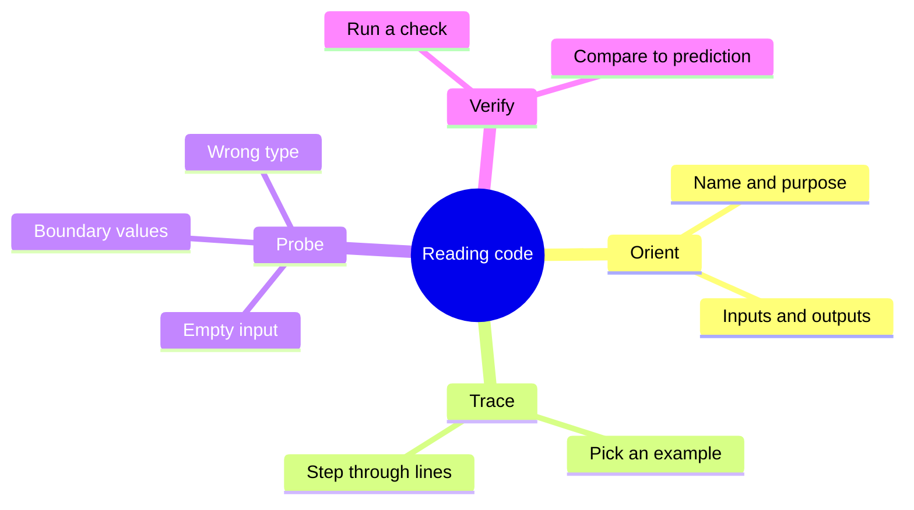
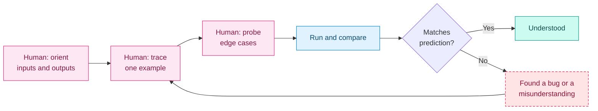

# Reading and Understanding Code

## Contents

- [Learning Objectives](#learning-objectives)
- [Prerequisites](#prerequisites)
- [Overview](#overview)
- [Mind Map](#mind-map)
- [Core Concepts](#core-concepts)
- [How It Works](#how-it-works)
- [Practical Example](#practical-example)
- [Step-by-Step Explanation](#step-by-step-explanation)
- [Expected Result](#expected-result)
- [Common Mistakes and Troubleshooting](#common-mistakes-and-troubleshooting)
- [Best Practices](#best-practices)
- [Hands-On Exercise](#hands-on-exercise)
- [Verification Checklist](#verification-checklist)
- [Conclusion](#conclusion)
- [Related Lessons](#related-lessons)
- [Official References](#official-references)

## Learning Objectives

After this lesson you can:

- Read an unfamiliar function using a repeatable method.
- Find a bug by reading and reasoning before running anything.
- Use an AI tool to explain code without trusting the explanation blindly.

## Prerequisites

[Programming Concepts](./programming_concepts.md)

## Overview

In vibe coding the AI writes and you read. Reading code well is the skill that separates "it seems to work" from "I know it works." You do not need to understand every library call; you need to understand what the code does with your data, especially at the edges.

## Mind Map



## Core Concepts

**Method: orient, trace, probe, verify.**

1. **Orient.** Read the name and docstring. What goes in? What comes out?
2. **Trace.** Choose a small concrete example and follow it line by line, writing down each variable's value.
3. **Probe.** Try the awkward inputs: empty, one item, fewer items than expected, negative, very large.
4. **Verify.** Run it and compare with what you predicted. A difference means you misunderstood something or found a bug. Either way you learn.

**Reading versus asking.** You can ask an AI to explain code. Treat the explanation as a hypothesis. It may be plausible and wrong. Check it by tracing an example yourself.

**What to skim.** Imports, logging and formatting lines rarely hide the bug. Spend time on conditions, loops, arithmetic and anything that touches the edges of the data.

## How It Works



Legend: pink = your reading steps, blue = running it, dashed rose = a mismatch to investigate, teal = understood. A mismatch sends you back to tracing.

## Practical Example

Read this function from [`examples/reading-code/average.py`](../examples/reading-code/average.py) **before** running anything:

```python
def average_of_top(scores, n):
    """Average of the n highest scores."""
    ordered = sorted(scores, reverse=True)
    top = ordered[:n]
    return sum(top) / len(top)
```

**Orient:** takes a list of scores and a count `n`, returns the average of the `n` highest.

**Trace** with `scores = [10, 20, 30, 40]`, `n = 2`:

| Line | Value |
|---|---|
| `ordered` | `[40, 30, 20, 10]` |
| `top` | `[40, 30]` |
| `sum(top) / len(top)` | `70 / 2 = 35` |

**Probe:**

| Input | What the code does |
|---|---|
| `scores = [5, 5], n = 5` | `ordered[:5]` just returns both items; the result is 5. Reasonable. |
| `scores = []` | `top` is empty, so `len(top)` is 0 and the division fails. |
| `n = 0` | `top` is empty, the same failure. |
| `n = -1` | `ordered[:-1]` drops the last item, which is a surprising result. |

The flaw: nothing defines what should happen when there is nothing to average, and negative `n` silently does something odd.

## Step-by-Step Explanation

1. Decide what the function is *meant* to do for every input class, not only the typical one.
2. Compare each probe with that intention.
3. Where the code and the intention differ, you have a bug or a missing rule.
4. Decide the rule (return 0? raise a clear error? return `None`?), then write it into the code or the prompt.

## Expected Result

Running `examples/reading-code/test_average.py` confirms your reading:

```text
empty list -> ZeroDivisionError (the flaw)
average: expected checks passed
```

**Tested:** this was run with Python 3.13 when this lesson was written. The checks for `[10, 20, 30, 40]` with `n = 2` and for `[5, 5]` with `n = 5` pass, and the empty list raises `ZeroDivisionError`. The behaviour for `n = -1` was derived by reading and is not covered by the test file; checking it is part of the exercise.

## Common Mistakes and Troubleshooting

| Mistake | Consequence | Fix |
|---|---|---|
| Reading only the happy path | Edge-case bugs ship | Always probe empty, boundary and wrong-type input |
| Trusting an AI explanation without tracing | Confident wrong understanding | Trace one example yourself |
| Reading the whole file at once | Overwhelm | Read one function at a time |
| Assuming a library call behaves as named | Surprises | Check its documentation |
| Never running the code to compare | Misread code stays misread | Predict, run, compare |

## Best Practices

- Write your prediction down before you run.
- Prefer concrete examples to abstract reasoning.
- Decide what the code *should* do at the edges, then check it does.
- When you find a gap, put the decision in your prompt or in a test so it cannot silently return.

## Hands-On Exercise

1. Without running anything, write what `average_of_top([3, 9, 6], -1)` returns. Trace it.
2. Run it and compare.
3. Decide what the function should do for `n <= 0` and for an empty list. Write your decision as two sentences.
4. Change the function to follow your decision and add two checks to the test file.
5. Ask an AI tool to explain the original function. Mark any statement in its explanation that you could not confirm by tracing.

## Verification Checklist

- [ ] My prediction for `n = -1` was written before I ran the code.
- [ ] I can state the function's intended behavior for every input class I probed.
- [ ] My changed function passes the original two checks and my two new ones.
- [ ] I distinguished what I verified from what the AI merely asserted.

## Conclusion

Read code with a method: orient, trace an example, probe the edges, then run and compare. Most generated bugs live at the edges, such as empty input and boundary values. Deciding what the code should do there, and testing it, is what turns "it seems to work" into "I know it works."

## Related Lessons

- Previous: [Software Development Lifecycle](./software_development_lifecycle.md)
- Next: [Build Systems, Dependencies and Lockfiles](./build_systems_dependencies_and_lockfiles.md)
- Debugging method: [Reading Errors and Stack Traces](../../15-debugging-and-code-quality/md/reading_errors_and_stack_traces.md)
- Reviewing AI output: [AI-Assisted Code Review](../../15-debugging-and-code-quality/md/ai_assisted_code_review.md)

## Official References

This lesson teaches a reading method written for this course. Python behavior for slicing and division is described in [The Python Tutorial](https://docs.python.org/3/tutorial/index.html) (verified 12 October 2026).

---

**Navigation:** [Chapter index](../README.md) · [Previous: Software Development Lifecycle](./software_development_lifecycle.md) · [Next: Build Systems, Dependencies and Lockfiles](./build_systems_dependencies_and_lockfiles.md)
