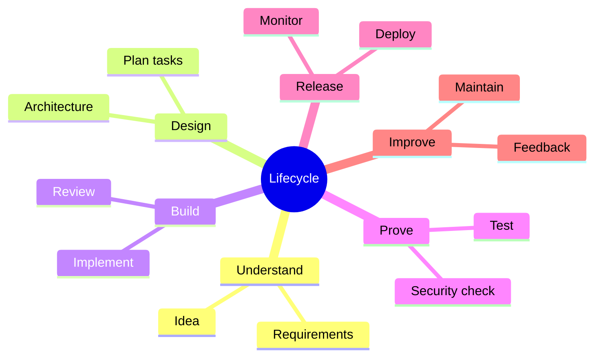
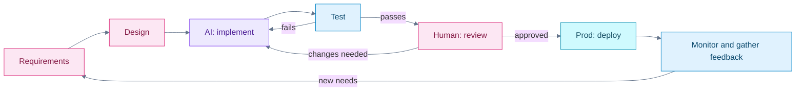

# Software Development Lifecycle

## Contents

- [Learning Objectives](#learning-objectives)
- [Prerequisites](#prerequisites)
- [Overview](#overview)
- [Mind Map](#mind-map)
- [Core Concepts](#core-concepts)
- [How It Works](#how-it-works)
- [Practical Example](#practical-example)
- [Step-by-Step Explanation](#step-by-step-explanation)
- [Expected Result](#expected-result)
- [Common Mistakes and Troubleshooting](#common-mistakes-and-troubleshooting)
- [Best Practices](#best-practices)
- [Hands-On Exercise](#hands-on-exercise)
- [Verification Checklist](#verification-checklist)
- [Conclusion](#conclusion)
- [Related Lessons](#related-lessons)
- [Official References](#official-references)

## Learning Objectives

After this lesson you can:

- Name the stages every software change passes through.
- Say where AI helps most in each stage and what a human must still check.
- Map one feature through the stages in order.

## Prerequisites

[Vibe Coding vs Traditional Coding](../../01-introduction-to-vibe-coding/md/vibe_coding_vs_traditional_coding.md)

## Overview

The *software development lifecycle* (SDLC) is the sequence of activities by which software goes from idea to running product and keeps improving. Even tiny projects pass through every stage, though sometimes in minutes. Vibe coders who skip stages usually discover them later, painfully: no requirements means rebuilding, no testing means bugs in front of users, no monitoring means not knowing it broke.

## Mind Map

## Core Concepts

| Stage | Question it answers | Where AI helps | What a human must still do |
|---|---|---|---|
| Requirements | What should it do, for whom? | Draft stories and questions | Decide priorities and accept criteria |
| Design | How will it be organized? | Propose structures and diagrams | Choose, and justify trade-offs |
| Implementation | Make it work | Write code | Review and run it |
| Testing | Does it do what was agreed? | Draft tests | Check the tests prove something real |
| Deployment | Make it available | Draft config and scripts | Control secrets and approve release |
| Operation | Is it healthy? | Explain logs, suggest fixes | Decide what to do on an incident |
| Maintenance | Keep it working and evolving | Refactor, document | Decide what to change and when |

**Iterative, not one-way.** Real work loops: testing reveals a requirement was unclear, so you go back. Lifecycles are drawn as loops for a reason.

**Small cycles.** The safest way to work with AI is a short cycle for each small change: specify, build, test, review, commit.

## How It Works

Legend: pink = human-led, violet = AI-assisted, blue = checking and observing, cyan = production. Three loops matter: fix after failing tests, fix after review, and learn from production back to requirements.

## Practical Example

**Feature:** a search box on a list of books.

| Stage | What happens |
|---|---|
| Requirements | "As a reader I can type part of a title and see matching books. Capital letters do not matter. No match shows 'No books found'." |
| Design | A text input above the list. Filtering happens in the browser; no server change. |
| Implementation | AI writes the filter; you read it. |
| Testing | Checks: empty box shows all, `HARRY` finds `Harry Potter`, `zzz` shows the message. |
| Deployment | Merge the change and publish the page. |
| Operation | After release, check the page still loads and note any user complaints. |
| Maintenance | Later, if the list has 10,000 books, revisit performance. |

Notice that the requirements are what you test against. If you cannot write a testable requirement, you are not ready to ask the AI to build it.

## Step-by-Step Explanation

1. Write the requirement as a sentence that includes a check ("no match shows ...").
2. Decide the design in a line or two, so the AI does not invent a different one.
3. Implement in a small change, run it, test each rule.
4. Review the diff before accepting.
5. Release, then watch what happens.
6. Feed what you learn back into new requirements.

## Expected Result

For any feature you choose, you can fill in every row of the table above with one specific sentence.

## Common Mistakes and Troubleshooting

| Mistake | Consequence | Fix |
|---|---|---|
| Skipping requirements | AI builds the wrong thing, confidently | Write rules and checks first |
| Skipping tests because "it ran once" | Regressions and edge-case bugs | Test each rule |
| Never looking after release | Failures go unnoticed | Add a health check and read the logs |
| One giant change | Review is impossible | Break work into small, reversible tasks |
| Treating the lifecycle as strictly linear | Frustration when a later stage reveals a problem | Expect loops and go back |

## Best Practices

- Keep requirements, tests and code in step: change one, check the others.
- Prefer many small cycles to one large one.
- Decide up front what "done" means.
- Record decisions so future you understands them.

## Hands-On Exercise

Pick a small feature, such as "mark a to-do item as complete."

1. Fill in the seven-row table above for it.
2. Write three testable checks.
3. Mark which stages you would hand to AI and which you would keep, and why.
4. Name one loop that might send you back to an earlier stage.

## Verification Checklist

- [ ] Every stage has a specific sentence, not a generic one.
- [ ] My checks could be run, not just read.
- [ ] I kept at least one stage as a human decision.
- [ ] I identified at least one loop back.

## Conclusion

Every software change passes through understanding, design, building, proving, releasing and learning, usually more than once. AI speeds up building and drafting, but requirements, review, release control and decisions about what to change remain human work.

## Related Lessons

- Previous: [Command Line and Environments](./command_line_and_environments.md)
- Next: [Reading and Understanding Code](./reading_and_understanding_code.md)
- Next in the course: [Requirements and Planning](../../06-requirements-and-planning/README.md)
- Quality in the lifecycle: [Testing Strategy](../../16-testing-and-qa/md/testing_strategy.md)

## Official References

This lesson describes a general process and relies on no product-specific facts.

---

**Navigation:** [Chapter index](../README.md) · [Previous: Command Line and Environments](./command_line_and_environments.md) · [Next: Reading and Understanding Code](./reading_and_understanding_code.md)
