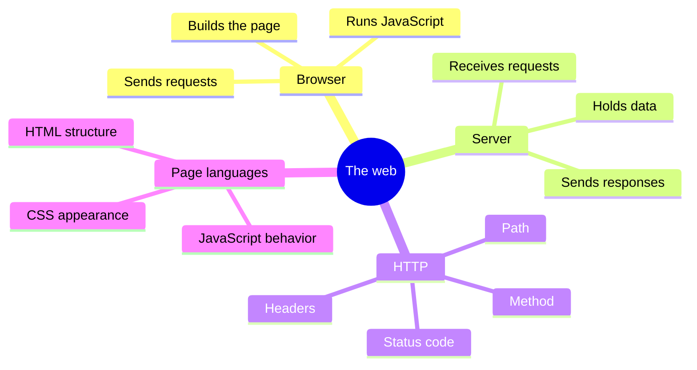
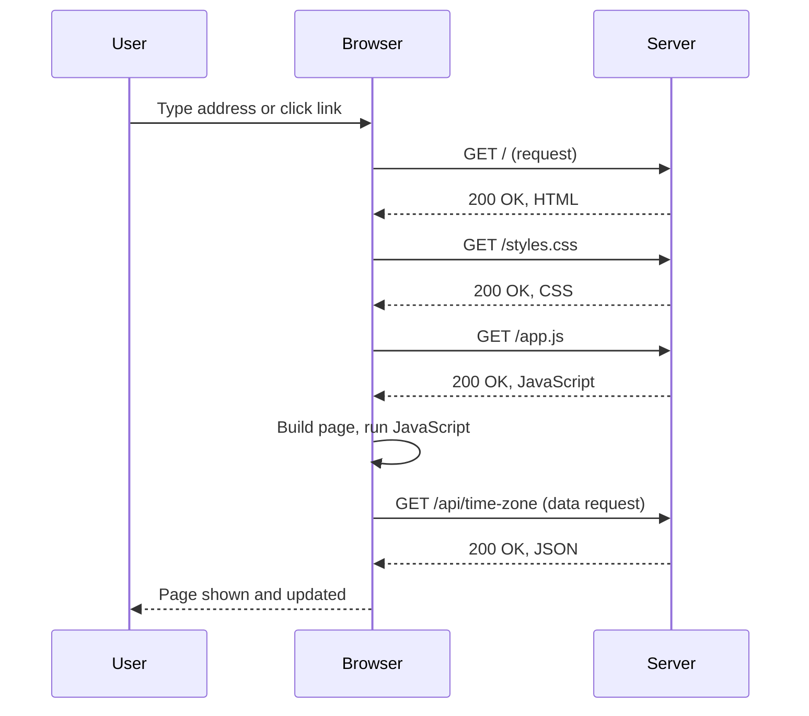

# Web Fundamentals: HTTP, HTML, CSS and JS

## Contents

- [Learning Objectives](#learning-objectives)
- [Prerequisites](#prerequisites)
- [Overview](#overview)
- [Mind Map](#mind-map)
- [Core Concepts](#core-concepts)
- [How It Works](#how-it-works)
- [Practical Example](#practical-example)
- [Step-by-Step Explanation](#step-by-step-explanation)
- [Expected Result](#expected-result)
- [Common Mistakes and Troubleshooting](#common-mistakes-and-troubleshooting)
- [Best Practices](#best-practices)
- [Hands-On Exercise](#hands-on-exercise)
- [Verification Checklist](#verification-checklist)
- [Conclusion](#conclusion)
- [Related Lessons](#related-lessons)
- [Official References](#official-references)

## Learning Objectives

After this lesson you can:

- Describe what happens, step by step, when a browser loads a page.
- Say what HTML, CSS and JavaScript each do.
- Read an HTTP request and response, including the status code.

## Prerequisites

[Programming Concepts](./programming_concepts.md)

## Overview

Most vibe-coded projects are web applications, so you need a mental model of how the web works. A browser asks a server for something; the server answers; the browser turns the answer into a page. Three languages describe the page: HTML for structure, CSS for appearance and JavaScript for behavior. When something is broken, knowing which layer to look at saves hours.

## Mind Map



## Core Concepts

**Client and server.** The browser (the *client*) starts every exchange by sending a *request*. The server sends back a *response*. The server never reaches out to the browser on its own in this basic model.

**HTTP request.** It has a *method* (such as `GET` to read or `POST` to send data), a *path* (such as `/api/time-zone`), *headers* (extra information) and sometimes a *body*.

**HTTP response.** It has a *status code*, headers and usually a body. Common status codes:

| Code | Meaning |
|---|---|
| 200 | OK: the request worked |
| 404 | Not found: nothing at that path |
| 500 | Server error: the server failed while handling it |

The first digit groups them: 2xx success, 3xx redirect, 4xx a problem with the request, 5xx a problem on the server.

**HTML** describes structure: headings, paragraphs, forms, links.
**CSS** describes appearance: colors, spacing, layout.
**JavaScript** adds behavior: reacting to clicks, changing the page, requesting more data.

**Statelessness.** At its core, HTTP does not remember earlier requests. Features such as logins work by sending extra information, such as cookies, with each request. This matters in [chapter 09](../../09-backend-development/README.md).

## How It Works



Read it top to bottom. Solid arrows are requests; dashed arrows are responses. The browser first fetches HTML, then the CSS and JavaScript the HTML refers to, then JavaScript may request more data.

## Practical Example

[`examples/web-request/server.py`](../examples/web-request/server.py) is a tiny Python server with three paths. It uses only Python's standard library.

```python
if self.path == "/":
    # sends an HTML page with status 200
elif self.path == "/api/time-zone":
    # sends JSON {"zone": "UTC"} with status 200
else:
    # sends "Not found" with status 404
```

**Run it** from the `examples/web-request/` folder:

```bash
python server.py
```

Leave it running, and in a second terminal or in a browser, request each path:

```bash
curl -i http://127.0.0.1:8000/
curl -i http://127.0.0.1:8000/api/time-zone
curl -i http://127.0.0.1:8000/missing
```

(`curl` is built into most modern systems; in Windows PowerShell use `curl.exe` so you do not hit a different built-in command. A browser address bar works for the first two paths too.) Stop the server with Ctrl+C.

## Step-by-Step Explanation

1. The server listens on `127.0.0.1` port 8000. `127.0.0.1` means "this computer", so only you can reach it.
2. `curl -i` prints the response *including headers*. Look at the first line: `HTTP/1.0 200 OK` or similar, then `Content-Type`.
3. For `/`, the `Content-Type` is `text/html`, so a browser would draw a page. For `/api/time-zone` it is `application/json`, data meant for code, not for people.
4. For `/missing`, the status is `404`, and the body is plain text. A wrong URL is a request problem, not a server failure.

## Expected Result

- `/` returns status 200 and the HTML `Hello from the server`.
- `/api/time-zone` returns status 200 and `{"zone": "UTC"}`.
- `/missing` returns status 404.

**Tested:** `examples/web-request/test_server.py` starts the server on a free port, requests all three paths with Python's standard library, and checks the status codes, content types and bodies. It passed with Python 3.13 when this lesson was written. The `curl` commands themselves were not run for this lesson, and the exact first line of the response (`HTTP/1.0` or `HTTP/1.1`) depends on your Python version.

## Common Mistakes and Troubleshooting

| Symptom | Likely cause | What to check |
|---|---|---|
| `Address already in use` when starting the server | Another program (or a previous run) is using port 8000 | Stop it, or change the port in `server.py` |
| `Connection refused` from curl | Server not running | Start `python server.py` first |
| Browser shows raw text, not a page | Wrong `Content-Type` | Check the response header |
| 404 for a path that should exist | Typo in the path or the server does not handle it | Compare the path to the server's code |
| 500 error | The server code failed | Read the server's terminal output |
| Page loads but is unstyled | CSS request failed | Open the browser's developer tools, Network tab |

## Best Practices

- When something fails, find the layer: did the request go out, what status came back, what did the page do with it?
- Learn to open your browser's developer tools (usually F12) and watch the Network tab.
- Use `127.0.0.1` for local experiments so nothing is exposed to your network.
- Read the status code before you read anything else.

## Hands-On Exercise

1. Start the server and request the three paths. Write down the status code for each.
2. Add a fourth path, `/about`, that returns a short HTML page. Restart the server and test it.
3. Open the browser developer tools Network tab, visit `http://127.0.0.1:8000/`, and find the request and its response headers.
4. Predict what status code you would see if you stopped the server and reloaded the page. (Hint: it is not one of the three above, because no response arrives.)

## Verification Checklist

- [ ] I can say which of the three languages handles structure, appearance and behavior.
- [ ] I got 200, 200 and 404 from the three paths.
- [ ] My new `/about` path returns 200.
- [ ] I can find a response's status and `Content-Type` in the developer tools.
- [ ] I know what to check first if a page loads without styling.

## Conclusion

A web page is the result of a request-response conversation: the browser asks, the server answers with a status code and content, and the browser builds the page from HTML, CSS and JavaScript. Reading status codes and headers tells you which side to debug.

## Related Lessons

- Previous: [Data Structures and Algorithms Basics](./data_structures_and_algorithms_basics.md)
- Next: [Command Line and Environments](./command_line_and_environments.md)
- Building pages: [HTML and CSS with AI](../../08-frontend-development/md/html_and_css_with_ai.md)
- Building servers: [Backend Fundamentals](../../09-backend-development/md/backend_fundamentals.md)

## Official References

- MDN Web Docs, [Overview of HTTP](https://developer.mozilla.org/en-US/docs/Web/HTTP/Overview) (verified 12 October 2026).

---

**Navigation:** [Chapter index](../README.md) · [Previous: Data Structures and Algorithms Basics](./data_structures_and_algorithms_basics.md) · [Next: Command Line and Environments](./command_line_and_environments.md)
