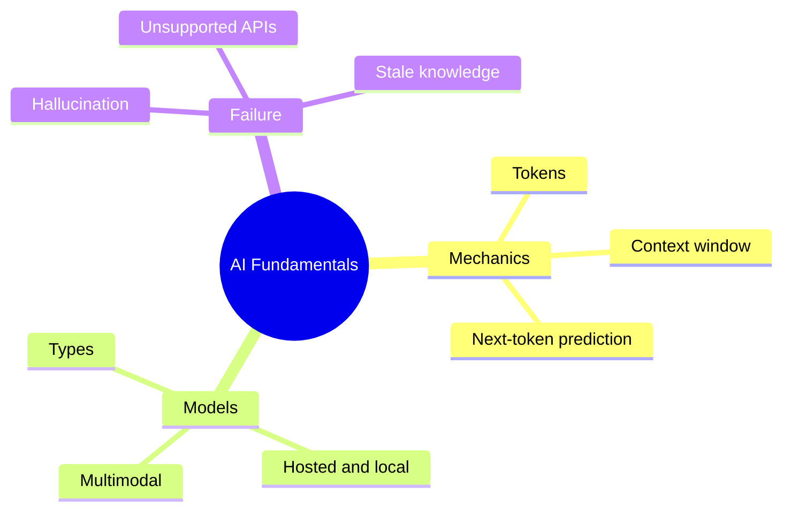

# 03 AI Fundamentals

> **Level:** Beginner · **Prerequisites:** Chapter 01.

## Overview

How language models work, what limits them, and why they sometimes invent things.

## Learning objectives

By the end of this chapter you can:

- Explain next-token prediction and context windows
- Estimate token use for a task
- Spot hallucinated functions and libraries

## Chapter mind map

## Lessons

Read in this order. Each lesson ends with a hands-on exercise.

| # | Lesson | Level | What you will do |
|---|---|---|---|
| 1 | [How LLMs Work](./md/how_llms_work.md) | Beginner | Explain next-token prediction in your own words |
| 2 | [Tokens and Context Windows](./md/tokens_and_context_windows.md) | Beginner | Estimate token use of a prompt plus files |
| 3 | [Model Types and Capabilities](./md/model_types_and_capabilities.md) | Beginner | Fill a capability comparison table from official docs |
| 4 | [Hallucinations and Unsupported Apis](./md/hallucinations_and_unsupported_apis.md) | Beginner | Catch an invented function in sample output |
| 5 | [Multimodal Local and Hosted Models](./md/multimodal_local_and_hosted_models.md) | Beginner | Choose a model hosting approach for a scenario |

## Related

- [Prompt library](../30-prompt-library-and-checklists/README.md)
- [Hands-on projects](../28-hands-on-projects/README.md)

## Next step

Continue with [Chapter 04: AI Coding Tools](../04-ai-coding-tools/README.md).

---
[Back to the course home](../README.md)
