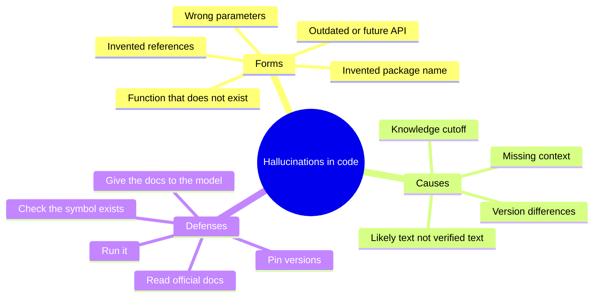
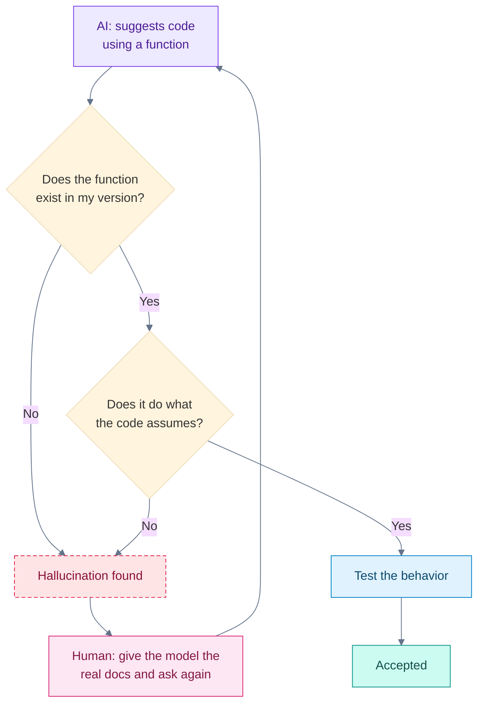

# Hallucinations and Unsupported APIs

## Contents

- [Learning Objectives](#learning-objectives)
- [Prerequisites](#prerequisites)
- [Overview](#overview)
- [Mind Map](#mind-map)
- [Core Concepts](#core-concepts)
- [How It Works](#how-it-works)
- [Practical Example](#practical-example)
- [Step-by-Step Explanation](#step-by-step-explanation)
- [Expected Result](#expected-result)
- [Common Mistakes and Troubleshooting](#common-mistakes-and-troubleshooting)
- [Best Practices](#best-practices)
- [Hands-On Exercise](#hands-on-exercise)
- [Verification Checklist](#verification-checklist)
- [Conclusion](#conclusion)
- [Related Lessons](#related-lessons)
- [Official References](#official-references)

## Learning Objectives

After this lesson you can:

- Recognize the common forms of hallucination in generated code.
- Check that a function, class or package really exists before relying on it.
- Reduce hallucinations by giving the model the right information.

## Prerequisites

[How Large Language Models Work](./how_llms_work.md)

## Overview

A *hallucination* is output that sounds right but is not: a function that does not exist, a parameter that was never part of the library, a made-up reference. It happens because a model produces *likely-looking* text and has no built-in check against reality. In code the effect is concrete: the program fails when you run it, or worse, appears to work while doing something different from what you intended.

## Mind Map



## Core Concepts

**Forms**

| Form | Example |
|---|---|
| Nonexistent function | `json.parse(text)` in Python. `JSON.parse` exists in JavaScript; Python's function is `json.loads`. |
| Real function, wrong arguments | A parameter the library never had |
| Wrong version | A function that existed in an older release, or one that exists only in a newer one |
| Invented package | An install command for a library that does not exist, or one with a similar name |
| Invented reference | A documentation page or article that is not real |

**Why it happens.** The model completes patterns. The pattern "a JSON library has a parse function" is common across languages, so it can produce `json.parse` in Python. It also lacks anything after its training cutoff and may blend versions.

**Why it is dangerous.** It is written with the same confidence as correct output, and a hallucinated *package name* is a security risk: installing something you did not verify could run unwanted code. See the supply-chain lesson in [chapter 17](../../17-security-and-responsible-development/README.md).

**Defenses that work**

1. **Run it.** Most hallucinated calls fail immediately with a clear error.
2. **Check the symbol exists** with the language's own tools before building on it.
3. **Read the official documentation** for anything unfamiliar.
4. **Give the model the facts.** Paste the relevant documentation or type signatures, and state your versions.
5. **Pin versions** so behavior does not drift (see the dependencies lesson).
6. **Test behavior, not only existence.** A call can exist and still do the wrong thing.

## How It Works



Legend: violet = AI output, pink = human correction, blue = testing, dashed rose = a problem, teal = accepted. Two separate questions are asked: does it exist, and does it do what is assumed.

## Practical Example

[`examples/check-api/check_symbol.py`](../examples/check-api/check_symbol.py) checks whether a name exists in a module.

```python
import importlib

def symbol_exists(module_name, attribute):
    try:
        module = importlib.import_module(module_name)
    except ImportError:
        return False
    return hasattr(module, attribute)
```

Run `python check_symbol.py`:

```text
json.loads: True
json.parse: False
math.cbrt: True
no_such_module.x: False
```

`json.loads` is the real Python function. `json.parse` is the JavaScript habit that models sometimes carry over. `math.cbrt` exists on the Python 3.13 used for this lesson; older Python versions may not have it, which shows how version differences produce "it works for me" confusion. `no_such_module` shows the check also handles an invented package name.

## Step-by-Step Explanation

1. `importlib.import_module` tries to load the module by its name. If that fails, the function returns `False`.
2. `hasattr(module, attribute)` asks whether the loaded module has the named function or value.
3. A `False` result is strong evidence of a problem. A `True` result only shows the name exists, not that it behaves as assumed.
4. After existence, test behavior with a small example.

## Expected Result

The four lines shown above. The `math.cbrt` line depends on your Python version.

**Tested:** `examples/check-api/test_check_symbol.py` checks `json.loads`, `json.parse`, `os.path.join` and an invented module. It passed with Python 3.13 when this lesson was written. The check covers Python names only; for other languages use that language's own tooling, and for a package name always confirm it on the official package index before installing.

## Common Mistakes and Troubleshooting

| Mistake or symptom | Cause | Fix |
|---|---|---|
| `AttributeError: module has no attribute ...` | Hallucinated or wrong-version function | Check the documentation for your version |
| `ModuleNotFoundError` after an AI-suggested install | Invented or misspelled package | Verify the name on the official index before installing |
| Code works but gives wrong results | Real function used with wrong assumptions | Test the behavior with known inputs |
| The AI invents a source when asked for evidence | It produces plausible references | Open the source and confirm it says what is claimed |
| Fixing by asking "are you sure?" | The model may agree or flip without checking | Verify with docs or a run, not with the model's confidence |

## Best Practices

- Never install a package or call an unfamiliar function without confirming it exists.
- State your language and library versions in prompts.
- Paste relevant official documentation when working with newer or less common libraries.
- Prefer functions you can verify by running a small example.
- Do not treat a confident tone as evidence.

## Hands-On Exercise

1. Run `check_symbol.py` and confirm the output.
2. Ask an AI tool for Python code to "parse a JSON string." If it uses a name you do not recognize, check it with `symbol_exists`.
3. Pick a library you use. Ask the tool for a function you suspect does not exist (for example, a plausible-sounding but invented one) and check what it says. Record whether it caught the problem or invented an answer.
4. Write the follow-up prompt you would send, including your version and a pasted documentation snippet.

## Verification Checklist

- [ ] I saw `json.parse` reported as missing and `json.loads` as present.
- [ ] I checked at least one AI-suggested name myself.
- [ ] My follow-up prompt includes a version and a documentation snippet.
- [ ] I know that existence does not prove correct behavior.

## Conclusion

Models can invent functions, parameters, versions and packages with full confidence. Counter it by running code, checking that names exist, reading official documentation, supplying real documentation in the prompt, pinning versions and testing behavior. Treat the model's confidence as irrelevant.

## Related Lessons

- Previous: [Model Types and Capabilities](./model_types_and_capabilities.md)
- Next: [Multimodal, Local and Hosted Models](./multimodal_local_and_hosted_models.md)
- Supply chain safety: [Build Systems, Dependencies and Lockfiles](../../02-software-development-fundamentals/md/build_systems_dependencies_and_lockfiles.md)
- Debugging: [Reading Errors and Stack Traces](../../15-debugging-and-code-quality/md/reading_errors_and_stack_traces.md)

## Official References

- Python Software Foundation, [`importlib`](https://docs.python.org/3/library/importlib.html): `import_module` returns the named module and raises `ImportError` (or a subclass) if it cannot be imported (verified 13 October 2026).
- Python Software Foundation, [`json`](https://docs.python.org/3/library/json.html): `json.loads` parses a JSON string (verified 13 October 2026).

---

**Navigation:** [Chapter index](../README.md) · [Previous: Model Types and Capabilities](./model_types_and_capabilities.md) · [Next: Multimodal, Local and Hosted Models](./multimodal_local_and_hosted_models.md)
