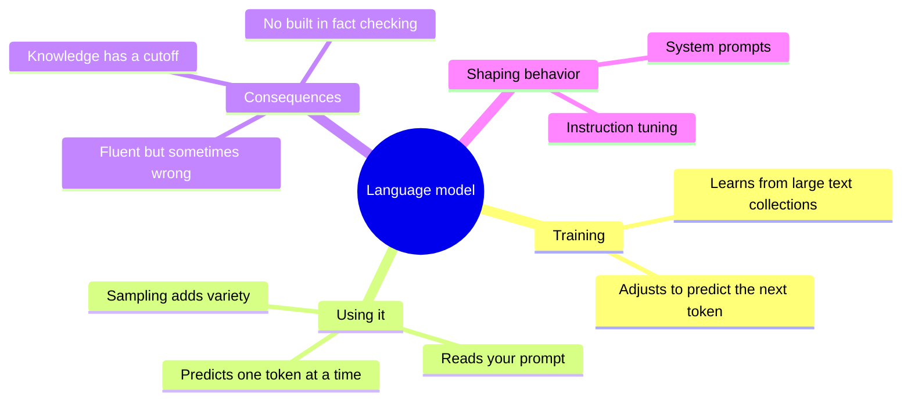
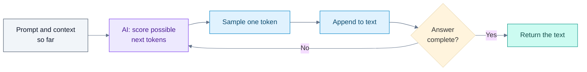

# How Large Language Models Work

## Contents

- [Learning Objectives](#learning-objectives)
- [Prerequisites](#prerequisites)
- [Overview](#overview)
- [Mind Map](#mind-map)
- [Core Concepts](#core-concepts)
- [How It Works](#how-it-works)
- [Practical Example](#practical-example)
- [Step-by-Step Explanation](#step-by-step-explanation)
- [Expected Result](#expected-result)
- [Common Mistakes and Troubleshooting](#common-mistakes-and-troubleshooting)
- [Best Practices](#best-practices)
- [Hands-On Exercise](#hands-on-exercise)
- [Verification Checklist](#verification-checklist)
- [Conclusion](#conclusion)
- [Related Lessons](#related-lessons)
- [Official References](#official-references)

## Learning Objectives

After this lesson you can:

- Explain, in plain language, that a language model predicts the next piece of text.
- Say why the same prompt can produce different answers.
- Explain why a model can write fluent text that is wrong.

## Prerequisites

[What Is Vibe Coding?](../../01-introduction-to-vibe-coding/md/what_is_vibe_coding.md)

## Overview

The AI tools in this course are built on *large language models* (LLMs). You do not need the mathematics, but you do need an accurate mental model, because most surprises in AI-assisted coding follow from it. The central fact is simple: an LLM is trained to continue text. Given everything written so far, it produces a likely next piece, then the next, and so on until the answer is complete.

## Mind Map



## Core Concepts

**Next-token prediction.** Text is split into small pieces called *tokens* (the next lesson covers them). During training the model reads enormous amounts of text and repeatedly learns to guess the next token. After training, it uses the same skill to continue whatever you give it.

**Generation is a loop.** The model predicts one token, appends it to the text, then predicts the next, using everything so far. A whole answer is built this way.

**Probabilities and sampling.** At each step the model produces a probability for many possible next tokens. The system then *samples* one. Because sampling involves chance, the same prompt can yield different text each time. Settings often called *temperature* control how adventurous the sampling is. Lower values favor the likeliest tokens; higher values allow more variety.

**Patterns, not lookup.** The model does not search a database of facts. It has absorbed statistical patterns from its training text. That is why it can write convincing code and also invent a function that does not exist: both are "text that fits the pattern."

**Architecture.** Modern LLMs are typically built on the *transformer*, introduced in the 2017 paper "Attention Is All You Need," which describes a model based entirely on attention mechanisms. Attention lets the model weigh which earlier words matter most for the next one.

**Shaping.** After basic training, models are further trained to follow instructions and behave helpfully. A *system prompt* is hidden or fixed text placed before your messages that tells the model how to act. Tools you use add their own system prompts and context.

**Knowledge cutoff.** Training data ends at some date. The model does not know about later libraries, versions or events unless you supply them or give it tools to look them up.

## How It Works



Legend: grey = input, violet = the model's step, blue = the system's steps, teal = the result. The loop back to scoring is why long answers take longer: each token is produced in turn.

## Practical Example

[`examples/toy-next-token/toy_model.py`](../examples/toy-next-token/toy_model.py) is a miniature next-word predictor. It counts, in one short text, which word follows which, then generates new text by sampling from those counts. Real models are enormously larger and use neural networks, not counting tables, but the task is the same.

Training text: `the cat sat on the mat . the cat ate the fish . the dog sat on the rug . the dog ate the bone .`

Key function:

```python
def next_word_probabilities(model, word):
    counts = model[word]
    total = sum(counts.values())
    return {w: c / total for w, c in counts.items()}
```

## Step-by-Step Explanation

1. `train` walks through the words and counts what follows each one.
2. `the` appears eight times, followed by `cat` twice, `dog` twice and each of `mat`, `fish`, `rug`, `bone` once. So the probability of `cat` after `the` is 2/8 = 0.25.
3. `sat` is always followed by `on`, so its probability is 1.0.
4. `generate` repeatedly picks the next word by sampling those probabilities, using a *seed* so a run can be repeated.
5. Different seeds give different sentences from the same start word.

## Expected Result

```text
{'cat': 0.25, 'mat': 0.125, 'fish': 0.125, 'dog': 0.25, 'rug': 0.125, 'bone': 0.125}
the cat ate the mat . the dog ate
the bone . the cat ate the dog sat
```

The two generated lines are from seeds 1 and 2. The text is fluent-looking and sometimes nonsense ("the cat ate the dog sat"). That is the point: patterns without understanding.

**Tested:** `examples/toy-next-token/test_toy_model.py` checks the probabilities, that `sat` always leads to `on`, that the same seed repeats exactly, and that different seeds differ. It passed with Python 3.13 when this lesson was written. The exact generated sentences depend on Python's random number generator and may differ across versions.

## Common Mistakes and Troubleshooting

| Misconception | Reality | Practical consequence |
|---|---|---|
| "The model looks facts up" | It predicts likely text | Verify facts and APIs |
| "It understands like a person" | It models patterns in text | It can sound sure and be wrong |
| "The same prompt gives the same answer" | Sampling adds variation | Expect differences; test results, not wording |
| "It knows today's libraries" | Knowledge stops at a cutoff | Supply current docs or versions |
| "If it says it checked, it checked" | It may describe actions it did not perform | Run and test it yourself |

## Best Practices

- Treat output as a strong draft, not a verified answer.
- Give the model what it cannot know: your files, your versions, your rules.
- Re-run when you want a second opinion and compare, rather than assuming the first answer is the only one.
- Verify anything you will depend on.

## Hands-On Exercise

Work in `examples/toy-next-token/`.

1. Run `python toy_model.py` and note the probabilities.
2. Predict, before running, what happens to `the` probabilities if you add the sentence `the cat sat on the mat .` once more to `TEXT`. Then check.
3. Change the seeds. Does generation ever repeat a sentence exactly?
4. Write two sentences explaining why this toy model can produce a sentence that was not in its training text.

## Verification Checklist

- [ ] I can state in one sentence what the model is trained to do.
- [ ] My prediction for step 2 was written first, and I compared it with the result.
- [ ] I can explain why different seeds produce different text.
- [ ] I can explain why fluent output is not evidence of correctness.

## Conclusion

An LLM continues text by repeatedly predicting a likely next token, with a little chance involved. It has absorbed patterns, not a verified fact base, and its knowledge stops at a cutoff. That is why it can be brilliant and wrong in the same answer, and why verification is your job.

## Related Lessons

- Next: [Tokens and Context Windows](./tokens_and_context_windows.md)
- [Hallucinations and Unsupported APIs](./hallucinations_and_unsupported_apis.md)
- [Prompt Anatomy](../../05-prompt-engineering-and-context/md/prompt_anatomy.md)

## Official References

- Vaswani et al., [Attention Is All You Need](https://arxiv.org/abs/1706.03762) (submitted 12 June 2017; verified 12 October 2026).

---

**Navigation:** [Chapter index](../README.md) · [Next: Tokens and Context Windows](./tokens_and_context_windows.md)
