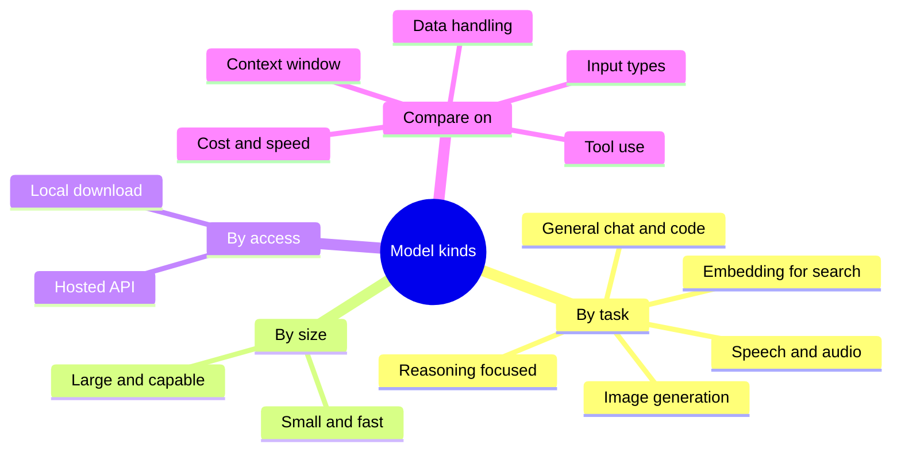
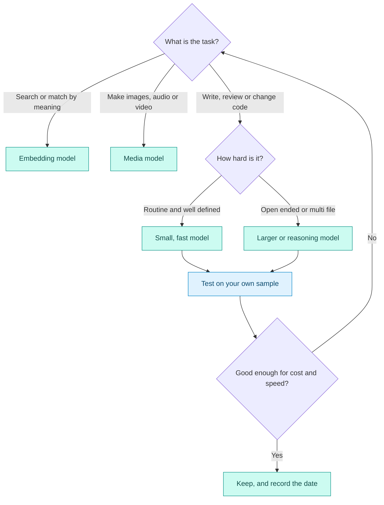

# Model Types and Capabilities

## Contents

- [Learning Objectives](#learning-objectives)
- [Prerequisites](#prerequisites)
- [Overview](#overview)
- [Mind Map](#mind-map)
- [Core Concepts](#core-concepts)
- [How It Works](#how-it-works)
- [Practical Example](#practical-example)
- [Step-by-Step Explanation](#step-by-step-explanation)
- [Expected Result](#expected-result)
- [Common Mistakes and Troubleshooting](#common-mistakes-and-troubleshooting)
- [Best Practices](#best-practices)
- [Hands-On Exercise](#hands-on-exercise)
- [Verification Checklist](#verification-checklist)
- [Conclusion](#conclusion)
- [Related Lessons](#related-lessons)
- [Official References](#official-references)

## Learning Objectives

After this lesson you can:

- Describe the main kinds of AI models used in software work.
- Name the dimensions on which to compare models.
- Build a dated comparison table from official documentation instead of rumor.

## Prerequisites

[Tokens and Context Windows](./tokens_and_context_windows.md)

## Overview

"The AI" is not one thing. A project may use a large general model for planning, a small fast model for simple edits, an image model for assets and an embedding model for search. Names, versions and prices change often, so this lesson teaches the *categories* and the *questions to ask*, and shows how to record answers with the date you checked.

## Mind Map

## Core Concepts

**By task**

| Kind | Typical use in this course |
|---|---|
| General-purpose language model | Chat, planning, writing and reviewing code |
| Reasoning-oriented variant | Harder problems where the model works through steps before answering; usually slower and costlier |
| Code-specialized model | Completion and editing inside development tools |
| Embedding model | Turns text into numbers so you can search by meaning (used in retrieval) |
| Image, audio and video models | Generating assets and media |

**By size.** Larger models are generally more capable and slower and costlier per request. Smaller models are faster and cheaper and may suffice for routine edits. Using one model for everything wastes money or quality.

**Dimensions for comparing models.** Compare on stated facts, not reputation:

| Dimension | Why it matters |
|---|---|
| Context window | How much code and history fit in one request |
| Maximum output length | Whether it can produce a large file in one go |
| Input types | Text only, or also images, documents, audio |
| Tool use and structured output | Whether it can call functions and return reliable formats |
| Speed | Waiting time inside your workflow |
| Price | Per token, per request or per subscription |
| Data handling | Whether your prompts are stored or used for training, and for how long |
| Availability | Regions, plans, rate limits |

**Benchmarks.** Published benchmark scores measure particular tasks under particular conditions. They are a hint, not a guarantee for your project. Test candidates on a small sample of your own tasks.

## How It Works

Legend: blue = a testing step, teal = a decision outcome. Edge labels show the answers. The final test on your own sample is not optional.

## Practical Example

Compare two candidate models for the task "review this pull request for bugs." Use the template below and fill it **only from official documentation**, noting where each fact came from.

| Dimension | Model A | Model B | Source and date |
|---|---|---|---|
| Context window (tokens) | | | |
| Maximum output (tokens) | | | |
| Accepts images or documents? | | | |
| Tool use / structured output? | | | |
| Price per million input and output tokens | | | |
| Prompt data retention and training policy | | | |
| Result on my 5-pull-request sample | | | |

The first six rows come from documentation. The last row comes from your own test and is the most important.

## Step-by-Step Explanation

1. Choose two models from the provider documentation you intend to use. Record their exact names as written there.
2. Read each documentation page and fill in the facts. If a fact is not stated, write "not stated" rather than guessing.
3. Write the date and the page address next to every fact. These details change.
4. Take five real examples of your task. Run both models on them with the same prompt and compare the results against what you know is correct.
5. Decide using cost, speed and results together.

## Expected Result

A table with every cell filled, either with a cited fact or with "not stated," and a final row of your own measured results. Different learners will get different tables, depending on the models and the date.

This lesson contains no tested code. It deliberately lists no specific model names, prices or limits, because they would be out of date quickly. Current comparisons appear, with verification dates, in [chapter 04](../../04-ai-coding-tools/README.md).

## Common Mistakes and Troubleshooting

| Mistake | Consequence | Fix |
|---|---|---|
| Choosing by hype or a leaderboard alone | Poor fit for your task | Test on your own tasks |
| Using the largest model for everything | High cost, slow responses | Match model size to task difficulty |
| Copying specs from a blog or social post | Wrong or stale numbers | Use official docs and record the date |
| Assuming every plan includes every feature | Surprises at scale | Check plan and availability |
| Ignoring data policies | Privacy exposure | Read retention and training terms before sending code |

## Best Practices

- Record the model name exactly as the provider writes it, plus a verification date.
- Keep a small, fixed set of your own test tasks to compare models fairly.
- Use cheaper models for easy work and stronger ones for hard work.
- Re-check periodically; models and terms change.

## Hands-On Exercise

1. Pick two models you could use. Fill the template from their official documentation.
2. Write down any cell you could not fill and why.
3. Choose five tasks from your own project. Run each model on them and score the results correct, partly correct or wrong.
4. Decide which you would use, and write one sentence on why, citing cost, speed and results.

## Verification Checklist

- [ ] Every filled fact cites a source and a date.
- [ ] Unknown facts are marked "not stated," not guessed.
- [ ] My result row comes from my own test, not from a benchmark.
- [ ] I considered data handling, not only quality.

## Conclusion

Different models suit different jobs. Compare them on stated dimensions from official sources, test them on your own tasks, and record when you checked. The right choice balances capability, speed, cost and data handling for the job at hand.

## Related Lessons

- Previous: [Tokens and Context Windows](./tokens_and_context_windows.md)
- Next: [Hallucinations and Unsupported APIs](./hallucinations_and_unsupported_apis.md)
- Choosing in practice: [Model Providers and Selection](../../04-ai-coding-tools/md/model_providers_and_selection.md)
- Cost trade-offs: [Model Choice, Cost, Latency and Quality](../../25-performance-and-cost-optimization/md/model_choice_cost_latency_quality.md)

## Official References

This lesson is deliberately product-neutral. Each provider's own model documentation is the source for the comparison template; chapter 04 lists the ones used in this course with verification dates.

---

**Navigation:** [Chapter index](../README.md) · [Previous: Tokens and Context Windows](./tokens_and_context_windows.md) · [Next: Hallucinations and Unsupported APIs](./hallucinations_and_unsupported_apis.md)
