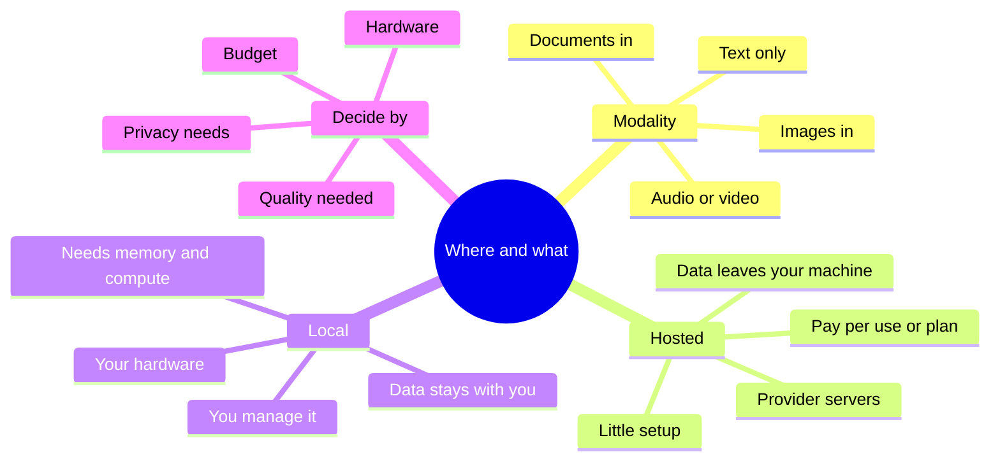
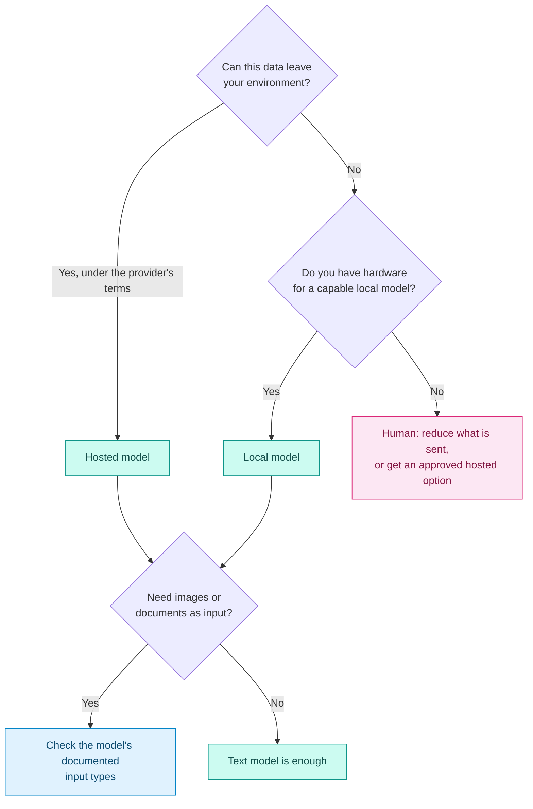

# Multimodal, Local and Hosted Models

## Contents

- [Learning Objectives](#learning-objectives)
- [Prerequisites](#prerequisites)
- [Overview](#overview)
- [Mind Map](#mind-map)
- [Core Concepts](#core-concepts)
- [How It Works](#how-it-works)
- [Practical Example](#practical-example)
- [Step-by-Step Explanation](#step-by-step-explanation)
- [Expected Result](#expected-result)
- [Common Mistakes and Troubleshooting](#common-mistakes-and-troubleshooting)
- [Best Practices](#best-practices)
- [Hands-On Exercise](#hands-on-exercise)
- [Verification Checklist](#verification-checklist)
- [Conclusion](#conclusion)
- [Related Lessons](#related-lessons)
- [Official References](#official-references)

## Learning Objectives

After this lesson you can:

- Explain what "multimodal" means and when it helps in development.
- Compare running a model locally with using one hosted by a provider.
- Estimate how much memory a local model's weights need.
- Choose an approach for a scenario and justify it.

## Prerequisites

[Model Types and Capabilities](./model_types_and_capabilities.md)

## Overview

Two choices shape how you use AI: *what kinds of input and output* the model handles (multimodal or text only), and *where it runs* (on a provider's servers or on your own machine). Both affect quality, cost, privacy and effort, and the right answer depends on your project rather than on fashion.

## Mind Map



## Core Concepts

**Multimodal.** A model that works with more than text, for example reading an image or a document as well as words. In development this helps with turning a screenshot or mockup into code, reading an error shown in an image, or analysing a chart. Whether a given model supports a type of input is a documented, checkable fact.

**Hosted models.** You send requests over the internet to a provider's servers, usually through an application or an API. Advantages: no hardware to manage, access to large models, quick start. Costs: usage fees, dependence on the provider's availability and terms, and your prompts travel to a third party under that provider's data policy.

**Local models.** You download a model and run it on your own computer or server. Advantages: your data does not leave your environment, no per-request fees, it can work offline. Costs: you need enough memory and compute, setup effort, and smaller models are usually less capable than the largest hosted ones.

**Memory for weights.** A model's size is quoted in parameters (for example "7B" means about seven billion). The memory needed just to hold the weights is roughly parameters × bytes per parameter. Precision matters: 16-bit values take 2 bytes each, 8-bit take 1 and 4-bit take half a byte. This ignores working memory used during generation and other overhead, so real use needs more.

**Hybrid.** Many teams mix approaches: a hosted model for hard problems, a local model for sensitive code, a small fast model for routine edits.

## How It Works



Legend: blue = a check, pink = a human decision, teal = an outcome. Diamond edges are labeled with the answers.

## Practical Example

[`examples/model-memory/memory_estimate.py`](../examples/model-memory/memory_estimate.py) estimates the memory for weights alone.

```python
BYTES_PER_PARAMETER = {"16-bit": 2.0, "8-bit": 1.0, "4-bit": 0.5}

def weight_gigabytes(billions_of_parameters, precision):
    return billions_of_parameters * BYTES_PER_PARAMETER[precision]
```

Output:

```text
7B parameters -> 16-bit: 14.0 GB, 8-bit: 7.0 GB, 4-bit: 3.5 GB
13B parameters -> 16-bit: 26.0 GB, 8-bit: 13.0 GB, 4-bit: 6.5 GB
70B parameters -> 16-bit: 140.0 GB, 8-bit: 70.0 GB, 4-bit: 35.0 GB
```

**Scenario:** a freelancer wants to keep a client's confidential code on their own laptop with 16 GB of memory.

| Question | Answer |
|---|---|
| Can the code leave the machine? | No, by contract |
| Which model sizes could fit? | A 7B model at 4-bit needs about 3.5 GB for weights, which plausibly fits; a 70B model at 4-bit needs 35 GB, which does not |
| What else uses memory? | The operating system, other programs and the model's working memory during generation, none of which this estimate includes |
| Likely result | A small local model, with lower capability than the largest hosted ones; test whether it is good enough for the tasks |

## Step-by-Step Explanation

1. Convert the model's parameter count to billions.
2. Multiply by bytes per parameter for the precision you plan to use.
3. Compare with your available memory, leaving generous room for everything else.
4. Test the model on your own tasks before committing.

## Expected Result

For the 7B row, 16-bit weights need 14 GB, 8-bit need 7 GB and 4-bit need 3.5 GB. These are the output of the arithmetic above and are lower bounds for real use.

**Tested:** `examples/model-memory/test_memory_estimate.py` checks 7B at 16-bit and 4-bit and 70B at 8-bit. It passed with Python 3.13 when this lesson was written. This confirms the arithmetic only; no model was downloaded or run, and the memory figures are not measured values from any real tool.

## Common Mistakes and Troubleshooting

| Mistake | Consequence | Fix |
|---|---|---|
| Assuming local means private by default | Other leaks (logs, plugins) remain possible | Review where data actually goes |
| Assuming hosted means insecure | Overcautious avoidance | Read the provider's data terms and decide on facts |
| Sizing memory by weights alone | Out-of-memory failures | Leave a large margin; test |
| Expecting a small local model to match a large hosted one | Disappointment | Test on your tasks; use it where it is enough |
| Sending screenshots with secrets | Exposes data to a third party | Crop or redact before sending |

## Best Practices

- Decide by data sensitivity first, capability second, cost third.
- Check a model's documented input types before designing around images or documents.
- Test local models on real tasks before committing hardware or time.
- Use a hybrid when needs differ by task.

## Hands-On Exercise

1. Run `memory_estimate.py`. Choose a model size and precision, and compare with the memory of a computer you have access to.
2. Write the answers to the first diamond in the decision diagram for three projects of your own.
3. For one project, decide hosted, local or hybrid and give two reasons.
4. Find the data-retention terms of one hosted provider you might use, and record the date you read them.

## Verification Checklist

- [ ] My memory estimate states that it excludes working memory and overhead.
- [ ] My decision for each project follows the diagram's answers.
- [ ] I cited the provider terms I read, with a date.
- [ ] I did not assume a model accepts images without checking its documentation.

## Conclusion

Choose modality by what the task needs and hosting by data sensitivity, hardware and budget. Hosted models are easy and powerful but send data to a provider; local models keep data with you but need hardware and may be less capable. Estimate memory honestly, test on real tasks, and mix approaches when that fits.

## Related Lessons

- Previous: [Hallucinations and Unsupported APIs](./hallucinations_and_unsupported_apis.md)
- Next chapter: [Tool Landscape Overview](../../04-ai-coding-tools/md/tool_landscape_overview.md)
- Privacy in practice: [Privacy and Data Handling](../../17-security-and-responsible-development/md/privacy_and_data_handling.md)
- Selecting providers: [Model Providers and Selection](../../04-ai-coding-tools/md/model_providers_and_selection.md)

## Official References

This lesson relies on general arithmetic and on principles that hold across providers. Provider-specific data policies and supported input types must be read from each provider's own documentation, as in the exercise; chapter 04 lists them with verification dates.

---

**Navigation:** [Chapter index](../README.md) · [Previous: Hallucinations and Unsupported APIs](./hallucinations_and_unsupported_apis.md) · [Next chapter: AI Coding Tools](../../04-ai-coding-tools/md/tool_landscape_overview.md)
