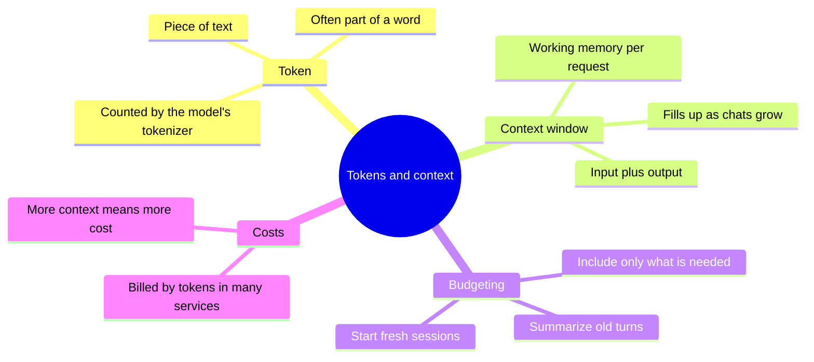
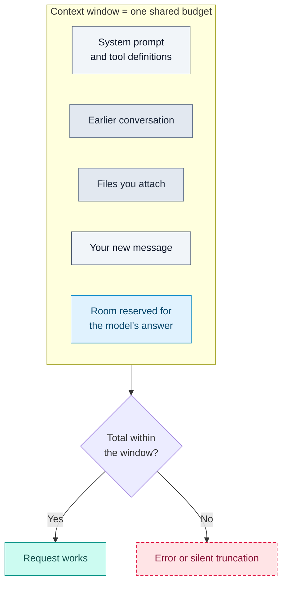

# Tokens and Context Windows

## Contents

- [Learning Objectives](#learning-objectives)
- [Prerequisites](#prerequisites)
- [Overview](#overview)
- [Mind Map](#mind-map)
- [Core Concepts](#core-concepts)
- [How It Works](#how-it-works)
- [Practical Example](#practical-example)
- [Step-by-Step Explanation](#step-by-step-explanation)
- [Expected Result](#expected-result)
- [Common Mistakes and Troubleshooting](#common-mistakes-and-troubleshooting)
- [Best Practices](#best-practices)
- [Hands-On Exercise](#hands-on-exercise)
- [Verification Checklist](#verification-checklist)
- [Conclusion](#conclusion)
- [Related Lessons](#related-lessons)
- [Official References](#official-references)

## Learning Objectives

After this lesson you can:

- Explain what a token is and why code often uses more tokens than you expect.
- Explain what a context window is and what counts against it.
- Estimate whether a prompt plus files will fit, and decide what to leave out.

## Prerequisites

[How Large Language Models Work](./how_llms_work.md)

## Overview

Models do not read letters or words. They read *tokens*, and they can only consider a limited number of them at once, called the *context window*. Everything you send and everything the model writes shares that budget. When you give an AI tool too much, it forgets, truncates or fails. Learning to budget context is one of the most practical skills in vibe coding.

## Mind Map



## Core Concepts

**Token.** A chunk of text a model works with. Many tokenizers use *subword* pieces: common words may be a single token, while rare words are split into smaller known pieces. The Hugging Face documentation gives the example of a rare word being split into pieces such as "annoying" and "ly". Tokens are not the same as words or characters.

**A rough rule of thumb.** For ordinary English text, a token is often around four characters, so a page of text is a few hundred tokens. This is only an estimate. Code, unusual names, numbers and non-English text can use more tokens per character, and every model has its own tokenizer. For real counts use the provider's token counter.

**Context window.** The amount of text, measured in tokens, that a model can consider in one request. The Claude platform documentation describes it as the model's working memory, covering all the text the model can see, including the response it is writing.

**What counts.** According to the same documentation, input and output draw from one budget. Input includes the system prompt, every message (including tool results, images and documents) and tool definitions. Output includes what the model generates. In a conversation each turn's input includes all earlier history, so the window fills as the conversation grows.

**What happens when it is exceeded.** Tools differ. A direct API call may return an error such as "prompt is too long." Applications may instead drop old content or summarize it, which means the model silently loses earlier instructions.

**Bigger is not always better.** The same documentation notes that accuracy and recall can degrade as the number of tokens grows. Putting everything into the context is not free: it costs more and can make the model less reliable at using any one part.

**Cost.** Many services bill by tokens processed, so large contexts cost more. Product prices change, so check the provider's current pricing page.

## How It Works



Legend: grey = inputs you supply, slate = accumulated content, blue = reserved output space, teal = success, dashed rose = failure. All five blocks share one window.

## Practical Example

[`examples/token-budget/budget.py`](../examples/token-budget/budget.py) estimates tokens with the four-characters rule and checks them against a window.

```python
CHARS_PER_TOKEN = 4

def estimate_tokens(text):
    return math.ceil(len(text) / CHARS_PER_TOKEN)

def budget(parts, window, reserve_for_output):
    used = sum(estimate_tokens(t) for t in parts.values())
    available = window - reserve_for_output
    return used, available, used <= available
```

Scenario: a 2,000-character prompt plus two files of 80,000 and 40,000 characters, 4,000 tokens reserved for the answer.

| Window size | Estimated input | Available for input | Fits? |
|---|---|---|---|
| 32,000 tokens | 30,500 | 28,000 | No |
| 200,000 tokens | 30,500 | 196,000 | Yes |

## Step-by-Step Explanation

1. Each part's characters are divided by four and rounded up: 500 + 20,000 + 10,000 = 30,500 estimated tokens.
2. The reserve for the answer is subtracted from the window to find the room for input.
3. In the 32,000-token window only 28,000 are available, so it does not fit. You must trim, summarize or split the work.
4. In the 200,000-token window it fits, but fitting is not the same as being a good idea: more context is more cost and possibly more distraction.

## Expected Result

```text
(30500, 28000, False)
(30500, 196000, True)
```

**Tested:** `examples/token-budget/test_budget.py` checks the estimator on empty, 4-character and 5-character text and both scenarios. It passed with Python 3.13 when this lesson was written. The window sizes are illustrative values chosen for the example, not the limits of any real product. The estimator itself is a heuristic and was not compared with any real tokenizer.

## Common Mistakes and Troubleshooting

| Mistake or symptom | Cause | Fix |
|---|---|---|
| The AI "forgets" an early instruction | Long conversation pushed it out or diluted it | Restate key rules, or start a fresh session with a summary |
| Request fails with a "too long" error | Input exceeds the window | Send fewer or smaller files |
| Pasting a whole repository | Most of it is irrelevant | Include only files the task touches |
| Trusting the four-characters rule for code or other languages | Different tokenization | Use the provider's counter |
| Forgetting to reserve room for the answer | Output is cut short | Reserve output tokens in your budget |

## Best Practices

- Give the model the files and facts that matter and nothing more.
- Keep standing instructions short and put them in a project instruction file (see the prompt chapter).
- Start a new session for a new task, carrying over only a brief summary.
- Check real token counts with the provider's tool before relying on an estimate.

## Hands-On Exercise

1. In `examples/token-budget/`, change the file sizes to match two real files from one of your projects (use their character counts).
2. Run the script with a window size you have verified from your tool's documentation. Record the date you checked it.
3. If the total does not fit, list three ways to reduce it without losing what the task needs.
4. Paste the same text into your provider's token counter, if it has one, and compare with the estimate. Record the difference.

## Verification Checklist

- [ ] I can define token and context window in my own words.
- [ ] My budget includes room for the answer.
- [ ] The window size I used came from a source I recorded, with a date.
- [ ] I compared the estimate with a real count, or I noted that I could not.

## Conclusion

Models read tokens and have a fixed window shared by instructions, history, files and the answer. Budget it deliberately: include what the task needs, reserve room for the output, and remember that more context costs more and is not always better.

## Related Lessons

- Previous: [How Large Language Models Work](./how_llms_work.md)
- Next: [Model Types and Capabilities](./model_types_and_capabilities.md)
- Choosing what to include: [Context Engineering](../../05-prompt-engineering-and-context/md/context_engineering.md)
- Controlling spend: [Token and Cost Management](../../25-performance-and-cost-optimization/md/token_and_cost_management.md)

## Official References

- Claude Platform documentation, [Context windows](https://platform.claude.com/docs/en/build-with-claude/context-windows) (verified 13 October 2026; the page is product documentation and its figures change).
- Hugging Face, [Tokenization algorithms](https://huggingface.co/docs/transformers/main/en/tokenizer_summary) (verified 13 October 2026).

---

**Navigation:** [Chapter index](../README.md) · [Previous: How Large Language Models Work](./how_llms_work.md) · [Next: Model Types and Capabilities](./model_types_and_capabilities.md)
