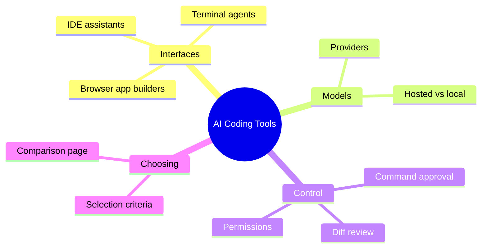

# 04 AI Coding Tools

> **Level:** Beginner · **Prerequisites:** Chapters 02 and 03.

## Overview

The families of AI coding tools, how to choose among them, and how to control what they may run.

## Learning objectives

By the end of this chapter you can:

- Classify tools into IDE, terminal, browser and provider families
- Make a change with an assistant and inspect the diff
- Write an allow and deny list for an agent

## Chapter mind map

## Lessons

Read in this order. Each lesson ends with a hands-on exercise.

| # | Lesson | Level | What you will do |
|---|---|---|---|
| 1 | [Tool Landscape Overview](./md/tool_landscape_overview.md) | Beginner | Classify tools into the mind-map families |
| 2 | [IDE Integrated Assistants](./md/ide_integrated_assistants.md) | Beginner | Make one change via an IDE assistant and inspect the diff |
| 3 | [Terminal Coding Agents](./md/terminal_coding_agents.md) | Beginner | Run an agent on a toy repo with approval on |
| 4 | [Browser Based App Builders](./md/browser_based_app_builders.md) | Beginner | Generate a landing page and list what you could not control |
| 5 | [Model Providers and Selection](./md/model_providers_and_selection.md) | Beginner | Complete the selection decision flowchart |
| 6 | [Tool Permissions and Command Approval](./md/tool_permissions_and_command_approval.md) | Beginner | Write an allow/deny list for an agent |
| 7 | [Tool Catalog and Comparison](./md/tool_catalog_and_comparison.md) | Beginner | Compare two tools on stated dimensions, with an as-verified date |

## Related

- [Prompt library](../30-prompt-library-and-checklists/README.md)
- [Hands-on projects](../28-hands-on-projects/README.md)

## Next step

Continue with [Chapter 05: Prompt Engineering and Context](../05-prompt-engineering-and-context/README.md).

---
[Back to the course home](../README.md)
