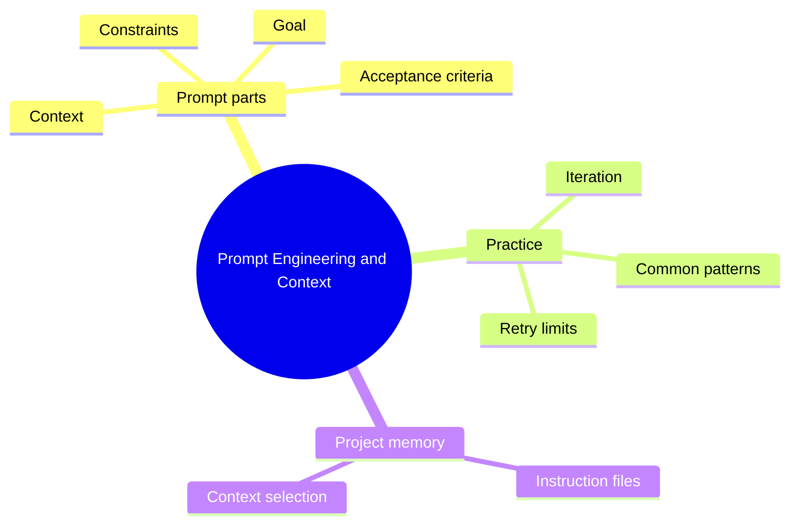

# 05 Prompt Engineering and Context

> **Level:** Beginner · **Prerequisites:** Chapter 04.

## Overview

How to ask AI tools for what you actually want and correct them when they miss.

## Learning objectives

By the end of this chapter you can:

- Write prompts with goal, context, constraints and acceptance criteria
- Choose which files and facts to include
- Stop unproductive prompt loops

## Chapter mind map

## Lessons

Read in this order. Each lesson ends with a hands-on exercise.

| # | Lesson | Level | What you will do |
|---|---|---|---|
| 1 | [Prompt Anatomy](./md/prompt_anatomy.md) | Beginner | Rewrite a vague prompt with all parts |
| 2 | [Context Engineering](./md/context_engineering.md) | Beginner | Choose which files to include for a task |
| 3 | [Constraints and Acceptance Criteria](./md/constraints_and_acceptance_criteria.md) | Beginner | Add testable acceptance criteria to a prompt |
| 4 | [Iteration and Refinement](./md/iteration_and_refinement.md) | Beginner | Fix a wrong result with a targeted follow-up |
| 5 | [Common Prompt Patterns](./md/common_prompt_patterns.md) | Beginner | Apply three patterns to one task |
| 6 | [Repository Instruction Files](./md/repository_instruction_files.md) | Intermediate | Write project instructions and test their effect |
| 7 | [Avoiding Unproductive Prompt Loops](./md/avoiding_unproductive_prompt_loops.md) | Intermediate | Set a retry limit and a switch-strategy rule |

## Related

- [Prompt library](../30-prompt-library-and-checklists/README.md)
- [Hands-on projects](../28-hands-on-projects/README.md)

## Next step

Continue with [Chapter 06: Requirements and Planning](../06-requirements-and-planning/README.md).

---
[Back to the course home](../README.md)
