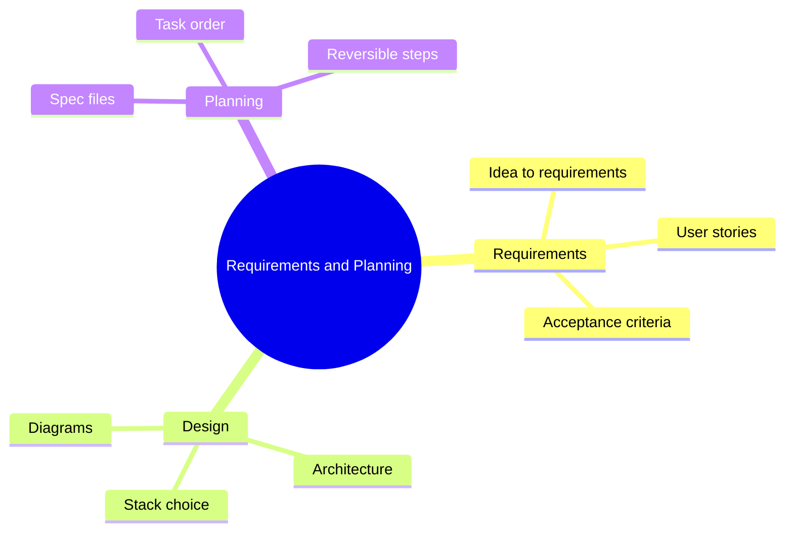

# 06 Requirements and Planning

> **Level:** Intermediate · **Prerequisites:** Chapter 05.

## Overview

Turn a rough idea into requirements, a specification and an ordered task plan an AI tool can follow.

## Learning objectives

By the end of this chapter you can:

- Write requirements and user stories with testable criteria
- Produce a specification file
- Break work into small reversible tasks

## Chapter mind map

## Lessons

Read in this order. Each lesson ends with a hands-on exercise.

| # | Lesson | Level | What you will do |
|---|---|---|---|
| 1 | [From Idea to Requirements](./md/from_idea_to_requirements.md) | Intermediate | Turn a one-line idea into requirements |
| 2 | [User Stories and Acceptance Criteria](./md/user_stories_and_acceptance_criteria.md) | Intermediate | Write five stories with criteria |
| 3 | [Specification Files](./md/specification_files.md) | Intermediate | Produce a spec file an agent can follow |
| 4 | [Architecture and Stack Selection](./md/architecture_and_stack_selection.md) | Intermediate | Choose a stack and record trade-offs |
| 5 | [Task Planning and Dependency Ordering](./md/task_planning_and_dependency_ordering.md) | Intermediate | Break a spec into ordered, reversible tasks |
| 6 | [Diagrams and Mind Maps with AI](./md/diagrams_and_mind_maps_with_ai.md) | Intermediate | Generate and correct an architecture diagram |

## Related

- [Prompt library](../30-prompt-library-and-checklists/README.md)
- [Hands-on projects](../28-hands-on-projects/README.md)

## Next step

Continue with [Chapter 07: UI and UX Design](../07-ui-ux-design/README.md).

---
[Back to the course home](../README.md)
