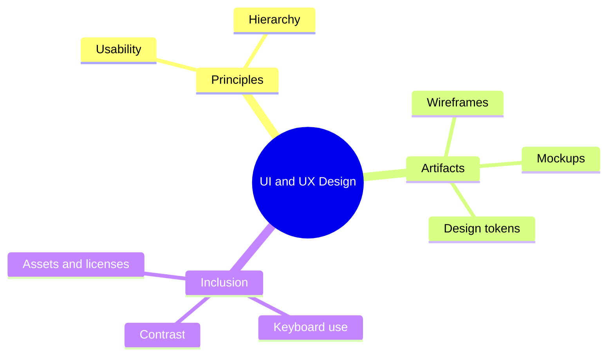

# 07 UI and UX Design

> **Level:** Intermediate · **Prerequisites:** Chapter 06.

## Overview

Use AI to design screens that are consistent, accessible and based on stated principles.

## Learning objectives

By the end of this chapter you can:

- Critique a screen against UX principles
- Wireframe screens from a specification
- Define design tokens and check keyboard accessibility

## Chapter mind map

## Lessons

Read in this order. Each lesson ends with a hands-on exercise.

| # | Lesson | Level | What you will do |
|---|---|---|---|
| 1 | [UX Principles with AI](./md/ux_principles_with_ai.md) | Intermediate | Critique a generated screen against principles |
| 2 | [Wireframes and Mockups](./md/wireframes_and_mockups.md) | Intermediate | Wireframe three screens from a spec |
| 3 | [Design Systems and Tokens](./md/design_systems_and_tokens.md) | Intermediate | Define tokens and apply them to a page |
| 4 | [Accessibility and Inclusive Design](./md/accessibility_and_inclusive_design.md) | Intermediate | Run a keyboard-only pass on a page |
| 5 | [Design References and Assets](./md/design_references_and_assets.md) | Intermediate | Build an asset list with source and license |

## Related

- [Prompt library](../30-prompt-library-and-checklists/README.md)
- [Hands-on projects](../28-hands-on-projects/README.md)

## Next step

Continue with [Chapter 08: Frontend Development](../08-frontend-development/README.md).

---
[Back to the course home](../README.md)
