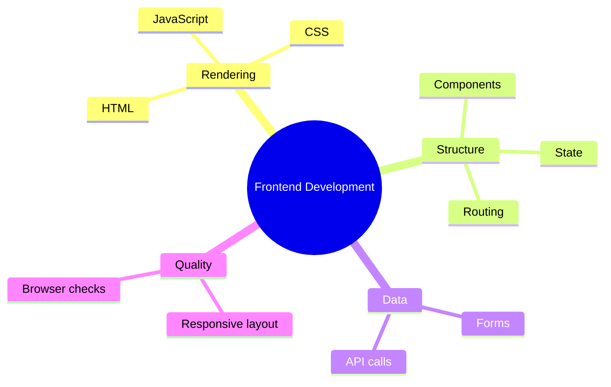

# 08 Frontend Development

> **Level:** Intermediate · **Prerequisites:** Chapters 06 and 07.

## Overview

Build and verify the user-facing part of an application with AI assistance.

## Learning objectives

By the end of this chapter you can:

- Build a responsive page from a mockup
- Split a page into components with state and routing
- Verify the result in a real browser

## Chapter mind map

## Lessons

Read in this order. Each lesson ends with a hands-on exercise.

| # | Lesson | Level | What you will do |
|---|---|---|---|
| 1 | [HTML and CSS with AI](./md/html_and_css_with_ai.md) | Intermediate | Build a page from a mockup |
| 2 | [JavaScript and TypeScript with AI](./md/javascript_and_typescript_with_ai.md) | Intermediate | Add interactivity and review the code |
| 3 | [Component Frameworks](./md/component_frameworks.md) | Intermediate | Split a page into components |
| 4 | [State and Routing](./md/state_and_routing.md) | Intermediate | Add a second route with shared state |
| 5 | [Forms and API Communication](./md/forms_and_api_communication.md) | Intermediate | Build a validated form calling a mock API |
| 6 | [Responsive Layout](./md/responsive_layout.md) | Intermediate | Test three breakpoints |
| 7 | [Browser Verification](./md/browser_verification.md) | Intermediate | Verify a generated page in a real browser |

## Related

- [Prompt library](../30-prompt-library-and-checklists/README.md)
- [Hands-on projects](../28-hands-on-projects/README.md)

## Next step

Continue with [Chapter 09: Backend Development](../09-backend-development/README.md).

---
[Back to the course home](../README.md)
