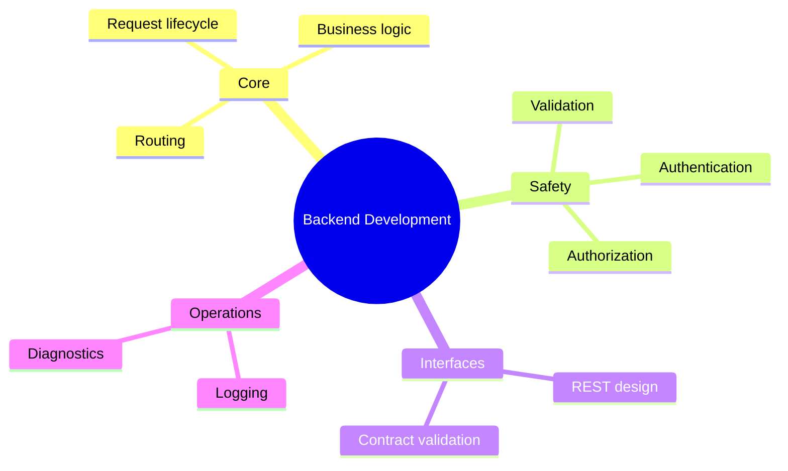

# 09 Backend Development

> **Level:** Intermediate · **Prerequisites:** Chapter 06.

## Overview

Build server-side logic, APIs and authentication, and keep them observable.

## Learning objectives

By the end of this chapter you can:

- Implement and document endpoints from a spec
- Protect an endpoint and test that access is denied
- Add structured logs and validate API contracts

## Chapter mind map

## Lessons

Read in this order. Each lesson ends with a hands-on exercise.

| # | Lesson | Level | What you will do |
|---|---|---|---|
| 1 | [Backend Fundamentals](./md/backend_fundamentals.md) | Intermediate | Draw the request lifecycle |
| 2 | [Routing and Business Logic](./md/routing_and_business_logic.md) | Intermediate | Implement two endpoints from a spec |
| 3 | [Validation, Authentication and Authorization](./md/validation_authentication_authorization.md) | Intermediate | Protect an endpoint and test denial |
| 4 | [REST API Design](./md/rest_api_design.md) | Intermediate | Design an API and document it |
| 5 | [API Contract Validation](./md/api_contract_validation.md) | Intermediate | Validate responses against a schema |
| 6 | [Logging and Diagnostics](./md/logging_and_diagnostics.md) | Intermediate | Add structured logs and find a failure |

## Related

- [Prompt library](../30-prompt-library-and-checklists/README.md)
- [Hands-on projects](../28-hands-on-projects/README.md)

## Next step

Continue with [Chapter 10: Databases and Data](../10-databases-and-data/README.md).

---
[Back to the course home](../README.md)
