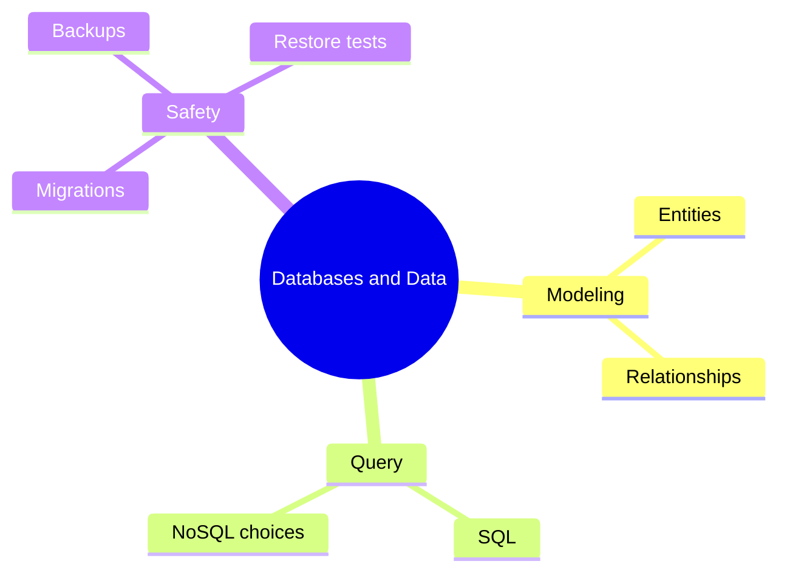

# 10 Databases and Data

> **Level:** Intermediate · **Prerequisites:** Chapter 06.

## Overview

Model data, write queries and change schemas without losing data.

## Learning objectives

By the end of this chapter you can:

- Model a schema and draw an ER diagram
- Write and review SQL
- Apply, reverse and restore from a migration and backup

## Chapter mind map

## Lessons

Read in this order. Each lesson ends with a hands-on exercise.

| # | Lesson | Level | What you will do |
|---|---|---|---|
| 1 | [Relational Modeling](./md/relational_modeling.md) | Intermediate | Model a schema and draw an ER diagram |
| 2 | [SQL with AI](./md/sql_with_ai.md) | Intermediate | Write and review three queries |
| 3 | [NoSQL and Backend Services](./md/nosql_and_backend_services.md) | Intermediate | Pick a store for three data shapes |
| 4 | [Migrations and Safe Schema Changes](./md/migrations_and_safe_schema_changes.md) | Intermediate | Apply and reverse a migration |
| 5 | [Backups and Restore Validation](./md/backups_and_restore_validation.md) | Intermediate | Back up, restore and verify |

## Related

- [Prompt library](../30-prompt-library-and-checklists/README.md)
- [Hands-on projects](../28-hands-on-projects/README.md)

## Next step

Continue with [Chapter 11: Full-Stack Development](../11-full-stack-development/README.md).

---
[Back to the course home](../README.md)
