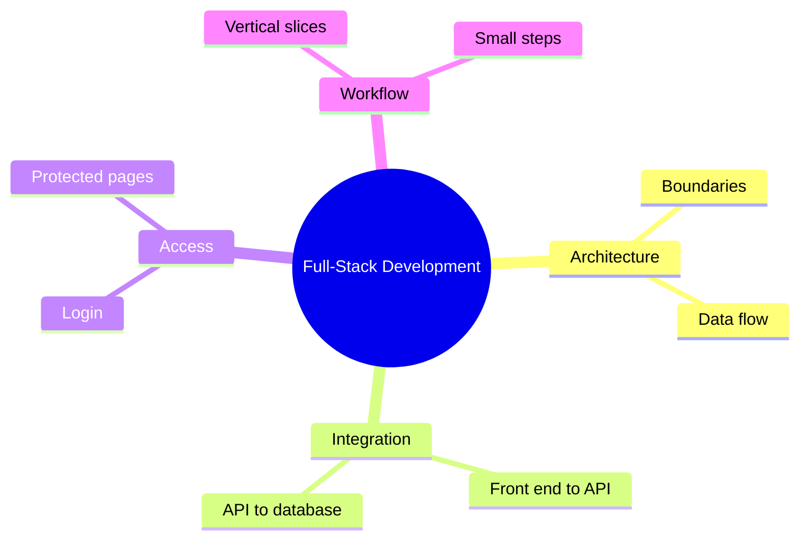

# 11 Full-Stack Development

> **Level:** Intermediate · **Prerequisites:** Chapters 08, 09 and 10.

## Overview

Connect front end, back end and data into one working vertical slice.

## Learning objectives

By the end of this chapter you can:

- Draw system boundaries and data flow
- Wire a form to a persisted endpoint
- Add login and a protected page

## Chapter mind map

## Lessons

Read in this order. Each lesson ends with a hands-on exercise.

| # | Lesson | Level | What you will do |
|---|---|---|---|
| 1 | [Full Stack Architecture](./md/full_stack_architecture.md) | Intermediate | Draw boundaries and data flow |
| 2 | [Connecting Frontend and Backend](./md/connecting_frontend_and_backend.md) | Intermediate | Wire a form to a persisted endpoint |
| 3 | [End to End Authentication](./md/end_to_end_authentication.md) | Intermediate | Add login and a protected page |
| 4 | [Full Stack Workflow with AI](./md/full_stack_workflow_with_ai.md) | Intermediate | Build one vertical slice end to end |

## Related

- [Prompt library](../30-prompt-library-and-checklists/README.md)
- [Hands-on projects](../28-hands-on-projects/README.md)

## Next step

Continue with [Chapter 12: AI-Powered Applications](../12-ai-powered-applications/README.md).

---
[Back to the course home](../README.md)
