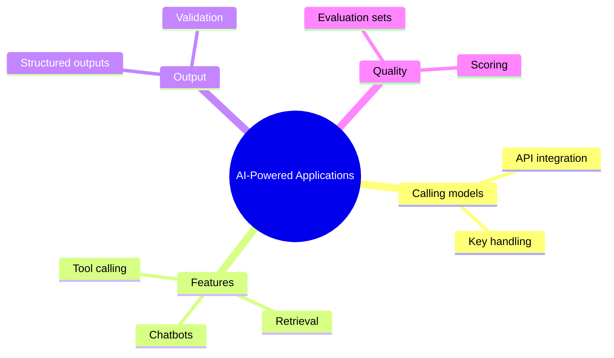

# 12 AI-Powered Applications

> **Level:** Advanced · **Prerequisites:** Chapter 11.

## Overview

Add AI features to your own application and evaluate them.

## Learning objectives

By the end of this chapter you can:

- Call a model API without exposing keys
- Build a chat feature and a retrieval feature
- Score an AI feature on a fixed test set

## Chapter mind map

## Lessons

Read in this order. Each lesson ends with a hands-on exercise.

| # | Lesson | Level | What you will do |
|---|---|---|---|
| 1 | [LLM API Integration](./md/llm_api_integration.md) | Advanced | Call a model API with keys kept out of code |
| 2 | [Building Chatbots](./md/building_chatbots.md) | Advanced | Build a chat UI with history |
| 3 | [Retrieval Augmented Generation](./md/retrieval_augmented_generation.md) | Advanced | Answer questions from your documents |
| 4 | [Structured Outputs and Tool Calling](./md/structured_outputs_and_tool_calling.md) | Advanced | Validate model output against a schema |
| 5 | [Evaluating AI Features](./md/evaluating_ai_features.md) | Advanced | Build a small test set and score it |

## Related

- [Prompt library](../30-prompt-library-and-checklists/README.md)
- [Hands-on projects](../28-hands-on-projects/README.md)

## Next step

Continue with [Chapter 13: Agentic Vibe Coding](../13-agentic-vibe-coding/README.md).

---
[Back to the course home](../README.md)
