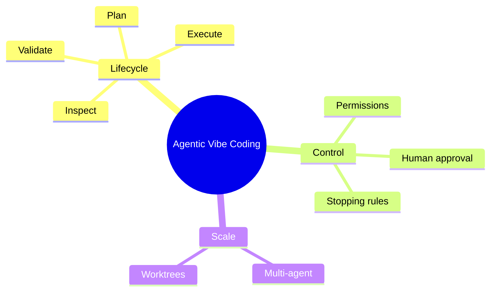

# 13 Agentic Vibe Coding

> **Level:** Advanced · **Prerequisites:** Chapters 04, 05 and 12.

## Overview

Work with agents that plan, run commands and edit files, with approvals and limits.

## Learning objectives

By the end of this chapter you can:

- Annotate an agent run against its lifecycle
- Scope an agent's permissions for a task
- Define approval gates and a retry budget

## Chapter mind map

## Lessons

Read in this order. Each lesson ends with a hands-on exercise.

| # | Lesson | Level | What you will do |
|---|---|---|---|
| 1 | [Agent Loop and Lifecycle](./md/agent_loop_and_lifecycle.md) | Advanced | Annotate the agent state diagram against a real run |
| 2 | [Planning and Context Retrieval](./md/planning_and_context_retrieval.md) | Advanced | Have an agent plan before it edits |
| 3 | [Tool Use and Permissions](./md/tool_use_and_permissions.md) | Advanced | Scope an agent's permissions for a task |
| 4 | [Multi Agent Workflows](./md/multi_agent_workflows.md) | Advanced | Split a task between two agents |
| 5 | [Human Approval and Stopping Conditions](./md/human_approval_and_stopping_conditions.md) | Advanced | Define approval gates and a retry budget |
| 6 | [Worktrees and Isolated Tasks](./md/worktrees_and_isolated_tasks.md) | Advanced | Run two tasks in separate worktrees |

## Related

- [Prompt library](../30-prompt-library-and-checklists/README.md)
- [Hands-on projects](../28-hands-on-projects/README.md)

## Next step

Continue with [Chapter 22: Advanced Vibe Coding](../22-advanced-vibe-coding/README.md).

---
[Back to the course home](../README.md)
