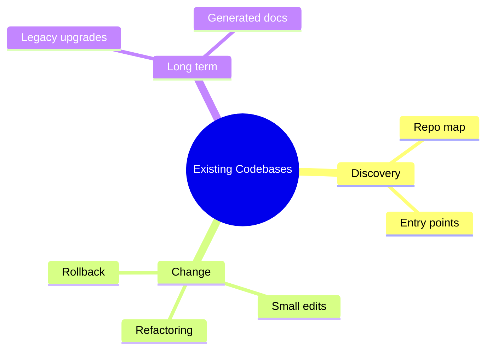

# 14 Existing Codebases

> **Level:** Intermediate · **Prerequisites:** Chapters 05 and 18 (Git basics).

## Overview

Understand and change code you did not write without breaking it.

## Learning objectives

By the end of this chapter you can:

- Produce a repository map before editing
- Trace a feature through unfamiliar code
- Make a small reversible change and review the diff

## Chapter mind map

## Lessons

Read in this order. Each lesson ends with a hands-on exercise.

| # | Lesson | Level | What you will do |
|---|---|---|---|
| 1 | [Repository Discovery](./md/repository_discovery.md) | Intermediate | Produce a repo map before any edit |
| 2 | [Understanding Unfamiliar Code](./md/understanding_unfamiliar_code.md) | Intermediate | Trace one feature through the code |
| 3 | [Safe Changes and Refactoring](./md/safe_changes_and_refactoring.md) | Intermediate | Make a small reversible change with a diff |
| 4 | [Legacy Modernization](./md/legacy_modernization.md) | Advanced | Plan an incremental upgrade |
| 5 | [Documentation Generation](./md/documentation_generation.md) | Intermediate | Generate docs and verify them against code |

## Related

- [Prompt library](../30-prompt-library-and-checklists/README.md)
- [Hands-on projects](../28-hands-on-projects/README.md)

## Next step

Continue with [Chapter 15: Debugging and Code Quality](../15-debugging-and-code-quality/README.md).

---
[Back to the course home](../README.md)
