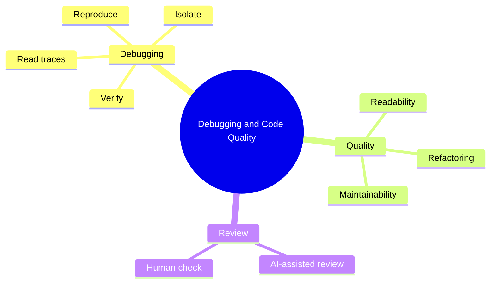

# 15 Debugging and Code Quality

> **Level:** Intermediate · **Prerequisites:** Chapters 11 and 14.

## Overview

Find root causes, keep code readable, and review AI output critically.

## Learning objectives

By the end of this chapter you can:

- Reproduce, isolate, fix and verify a bug
- Reject symptom patches in favor of root causes
- Refactor with tests green and review a pull request

## Chapter mind map

## Lessons

Read in this order. Each lesson ends with a hands-on exercise.

| # | Lesson | Level | What you will do |
|---|---|---|---|
| 1 | [Reading Errors and Stack Traces](./md/reading_errors_and_stack_traces.md) | Intermediate | Locate the cause from a trace |
| 2 | [Systematic Debugging with AI](./md/systematic_debugging_with_ai.md) | Intermediate | Reproduce, isolate, fix, verify one bug |
| 3 | [Root Cause vs Symptom Fixes](./md/root_cause_vs_symptom_fixes.md) | Intermediate | Reject a symptom patch and find the cause |
| 4 | [Code Quality and Readability](./md/code_quality_and_readability.md) | Intermediate | Review a generated file against a checklist |
| 5 | [Refactoring and Maintainability](./md/refactoring_and_maintainability.md) | Intermediate | Refactor with tests green throughout |
| 6 | [AI-Assisted Code Review](./md/ai_assisted_code_review.md) | Intermediate | Review a pull request with AI and a human check |

## Related

- [Prompt library](../30-prompt-library-and-checklists/README.md)
- [Hands-on projects](../28-hands-on-projects/README.md)

## Next step

Continue with [Chapter 16: Testing and QA](../16-testing-and-qa/README.md).

---
[Back to the course home](../README.md)
