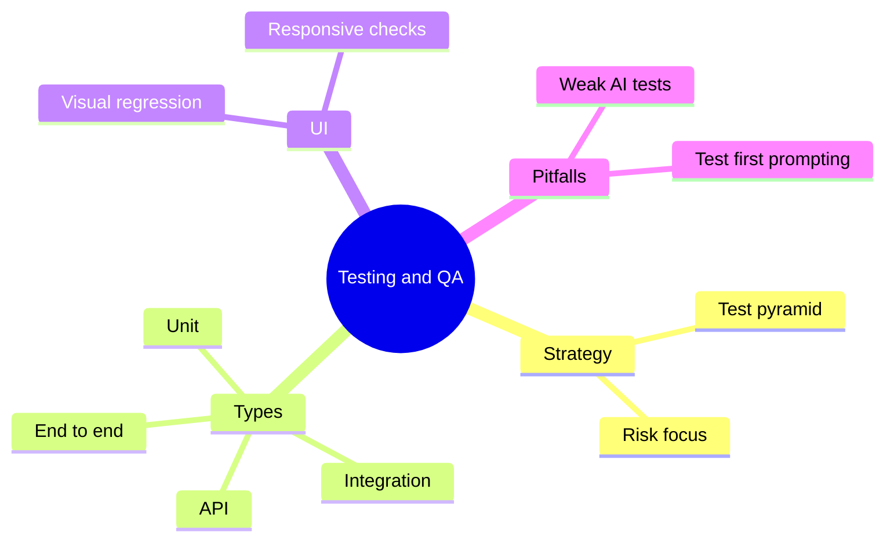

# 16 Testing and QA

> **Level:** Intermediate · **Prerequisites:** Chapter 15.

## Overview

Prove that generated code works, and catch tests that prove nothing.

## Learning objectives

By the end of this chapter you can:

- Choose test types for a feature
- Write unit, integration, API and end-to-end tests
- Find a test that passes for the wrong reason

## Chapter mind map

## Lessons

Read in this order. Each lesson ends with a hands-on exercise.

| # | Lesson | Level | What you will do |
|---|---|---|---|
| 1 | [Testing Strategy](./md/testing_strategy.md) | Intermediate | Choose test types for a feature |
| 2 | [Unit and Integration Tests](./md/unit_and_integration_tests.md) | Intermediate | Write and run both for one module |
| 3 | [API and End to End Tests](./md/api_and_end_to_end_tests.md) | Intermediate | Test an endpoint and one user flow |
| 4 | [UI and Visual Regression Testing](./md/ui_and_visual_regression_testing.md) | Intermediate | Capture a baseline and detect a change |
| 5 | [Pitfalls of AI Generated Tests](./md/pitfalls_of_ai_generated_tests.md) | Intermediate | Find a test that passes for the wrong reason |
| 6 | [Test Driven Vibe Coding](./md/test_driven_vibe_coding.md) | Intermediate | Prompt from tests first |

## Related

- [Prompt library](../30-prompt-library-and-checklists/README.md)
- [Hands-on projects](../28-hands-on-projects/README.md)

## Next step

Continue with [Chapter 17: Security and Responsible Development](../17-security-and-responsible-development/README.md).

---
[Back to the course home](../README.md)
