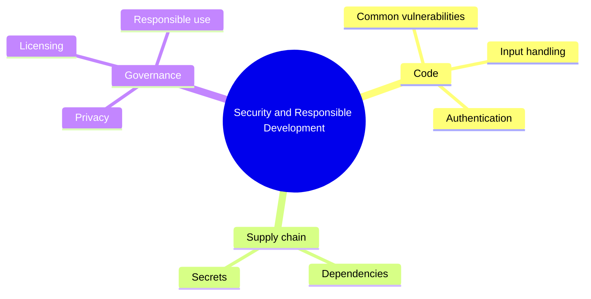

# 17 Security and Responsible Development

> **Level:** Advanced · **Prerequisites:** Chapter 16.

## Overview

Find and prevent security, privacy and licensing problems in AI-generated software.

## Learning objectives

By the end of this chapter you can:

- Audit an endpoint against common vulnerabilities
- Move secrets out of code and pin dependencies
- Classify data and record provenance for generated assets

## Chapter mind map

## Lessons

Read in this order. Each lesson ends with a hands-on exercise.

| # | Lesson | Level | What you will do |
|---|---|---|---|
| 1 | [Threat Basics and Common Vulnerabilities](./md/threat_basics_and_common_vulnerabilities.md) | Advanced | Audit one endpoint against the common-vulnerability list |
| 2 | [Secrets Management](./md/secrets_management.md) | Advanced | Move a leaked-style secret to environment config |
| 3 | [Input Handling and Secure Authentication](./md/input_handling_and_secure_authentication.md) | Advanced | Fix an injection-prone handler |
| 4 | [Dependency and Supply Chain Risk](./md/dependency_and_supply_chain_risk.md) | Advanced | Audit and pin dependencies |
| 5 | [Reviewing AI Code for Security](./md/reviewing_ai_code_for_security.md) | Advanced | Security-review a generated feature |
| 6 | [Privacy and Data Handling](./md/privacy_and_data_handling.md) | Advanced | Classify data and set logging boundaries |
| 7 | [Licensing and Provenance](./md/licensing_and_provenance.md) | Advanced | Record provenance for generated code and assets |
| 8 | [Responsible AI Use](./md/responsible_ai_use.md) | Advanced | Write a use policy for a small team |

## Related

- [Prompt library](../30-prompt-library-and-checklists/README.md)
- [Hands-on projects](../28-hands-on-projects/README.md)

## Next step

Continue with [Chapter 19: Deployment and DevOps](../19-deployment-and-devops/README.md).

---
[Back to the course home](../README.md)
