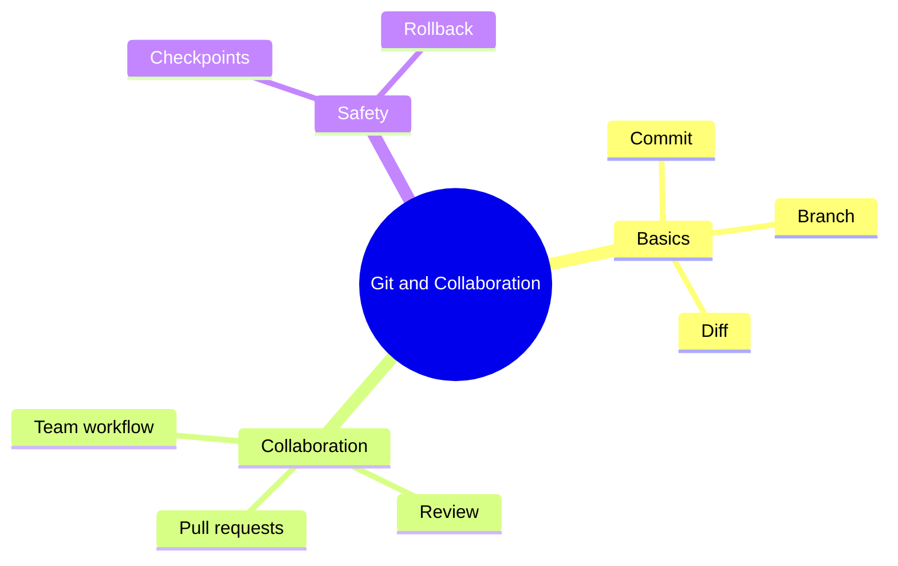

# 18 Git and Collaboration

> **Level:** Intermediate · **Prerequisites:** Chapter 11.

## Overview

Use Git to review, undo and share AI-generated changes.

## Learning objectives

By the end of this chapter you can:

- Commit, branch and read a diff
- Open and review a pull request
- Recover from a bad generation with a checkpoint

## Chapter mind map

## Lessons

Read in this order. Each lesson ends with a hands-on exercise.

| # | Lesson | Level | What you will do |
|---|---|---|---|
| 1 | [Git Fundamentals](./md/git_fundamentals.md) | Intermediate | Commit, branch, and read a diff |
| 2 | [Branching and Pull Requests](./md/branching_and_pull_requests.md) | Intermediate | Open and review a pull request |
| 3 | [AI-Assisted Commits and Reviews](./md/ai_assisted_commits_and_reviews.md) | Intermediate | Generate a commit message and check it |
| 4 | [Checkpoints and Rollback](./md/checkpoints_and_rollback.md) | Intermediate | Recover from a bad generation |
| 5 | [Team Collaboration Workflows](./md/team_collaboration_workflows.md) | Intermediate | Define a team workflow for AI-generated changes |

## Related

- [Prompt library](../30-prompt-library-and-checklists/README.md)
- [Hands-on projects](../28-hands-on-projects/README.md)

## Next step

Continue with [Chapter 19: Deployment and DevOps](../19-deployment-and-devops/README.md).

---
[Back to the course home](../README.md)
