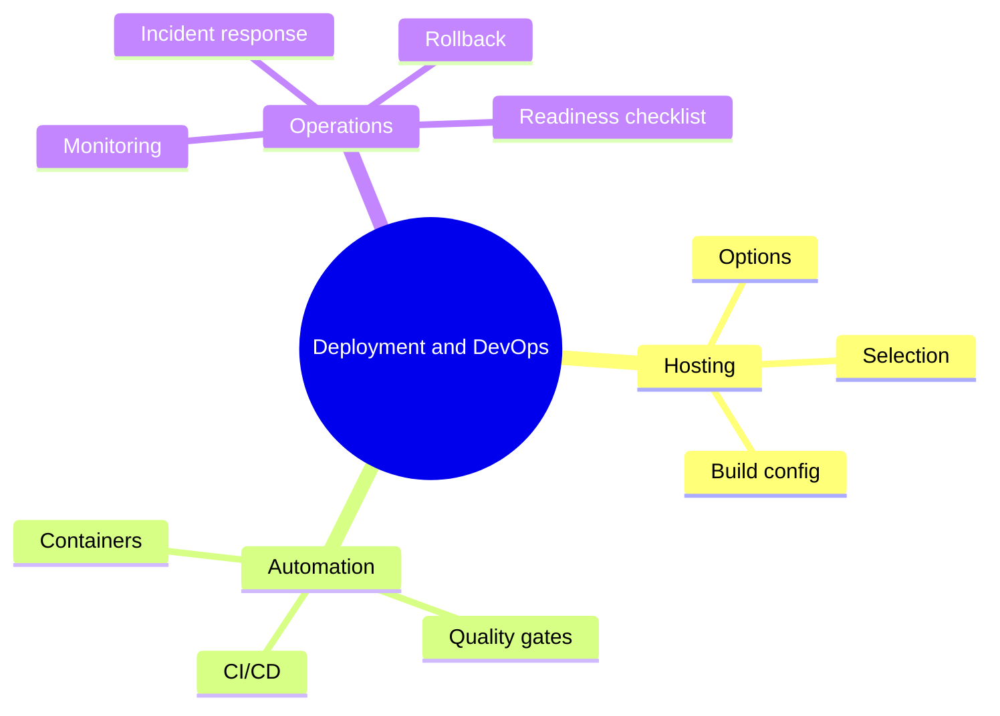

# 19 Deployment and DevOps

> **Level:** Advanced · **Prerequisites:** Chapters 17 and 18.

## Overview

Ship an application and keep it running, with automated checks and a way back.

## Learning objectives

By the end of this chapter you can:

- Deploy a full-stack app with separate dev and prod config
- Gate merges on tests in CI
- Roll back a failed release and audit readiness

## Chapter mind map

## Lessons

Read in this order. Each lesson ends with a hands-on exercise.

| # | Lesson | Level | What you will do |
|---|---|---|---|
| 1 | [Hosting Options and Selection](./md/hosting_options_and_selection.md) | Advanced | Pick a host with the decision flowchart |
| 2 | [Build and Environment Configuration](./md/build_and_environment_configuration.md) | Advanced | Separate dev and prod config |
| 3 | [Deploying a Full Stack App](./md/deploying_a_full_stack_app.md) | Advanced | Deploy the vertical slice |
| 4 | [CI/CD Pipelines and Quality Gates](./md/ci_cd_pipelines_and_quality_gates.md) | Advanced | Gate merges on tests |
| 5 | [Containers and Docker](./md/containers_and_docker.md) | Advanced | Containerize and run an app |
| 6 | [Monitoring and Observability](./md/monitoring_and_observability.md) | Advanced | Add a health check and an alert rule |
| 7 | [Deployment Rollback and Incident Response](./md/deployment_rollback_and_incident_response.md) | Advanced | Roll back a failed release |
| 8 | [Production Readiness Checklist](./md/production_readiness_checklist.md) | Advanced | Audit an app against the checklist |

## Related

- [Prompt library](../30-prompt-library-and-checklists/README.md)
- [Hands-on projects](../28-hands-on-projects/README.md)

## Next step

Continue with [Chapter 20: Integrations and Automation](../20-integrations-and-automation/README.md).

---
[Back to the course home](../README.md)
