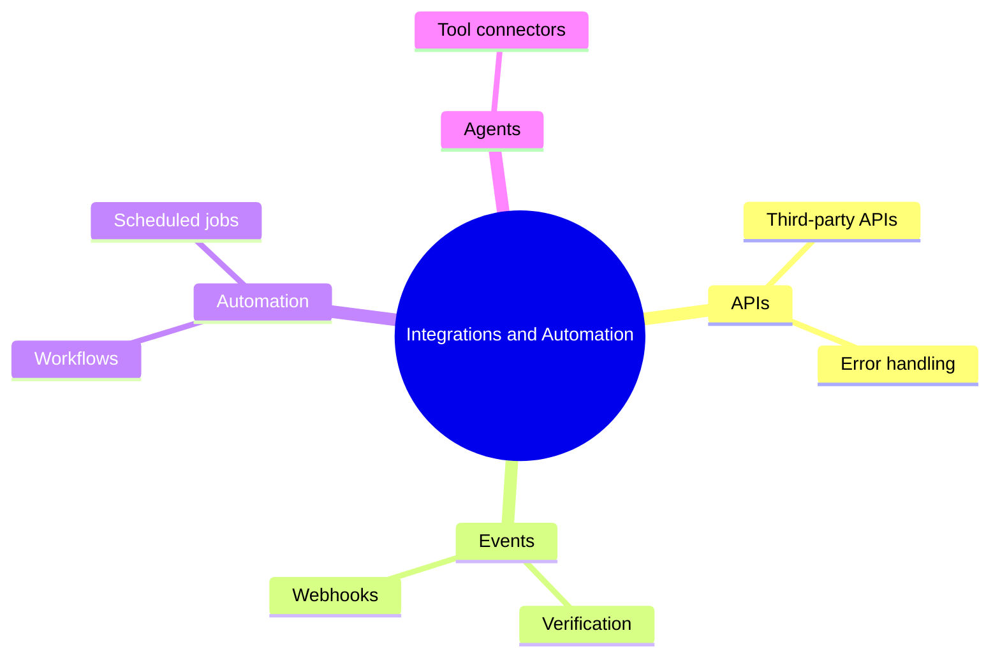

# 20 Integrations and Automation

> **Level:** Advanced · **Prerequisites:** Chapter 19.

## Overview

Connect your application to outside services and automate recurring work.

## Learning objectives

By the end of this chapter you can:

- Integrate an external API with error handling
- Receive and verify a webhook
- Schedule and monitor a recurring job

## Chapter mind map

## Lessons

Read in this order. Each lesson ends with a hands-on exercise.

| # | Lesson | Level | What you will do |
|---|---|---|---|
| 1 | [Third Party API Integration](./md/third_party_api_integration.md) | Advanced | Integrate an external API with error handling |
| 2 | [Webhooks and Events](./md/webhooks_and_events.md) | Advanced | Receive and verify a webhook |
| 3 | [Automation Services and Workflows](./md/automation_services_and_workflows.md) | Advanced | Automate a multi-step business workflow |
| 4 | [Scheduled Jobs](./md/scheduled_jobs.md) | Advanced | Schedule and monitor a recurring job |
| 5 | [Tool Protocols and Connectors](./md/tool_protocols_and_connectors.md) | Advanced | Connect an agent to an external tool (verify current protocol docs first) |

## Related

- [Prompt library](../30-prompt-library-and-checklists/README.md)
- [Hands-on projects](../28-hands-on-projects/README.md)

## Next step

Continue with [Chapter 22: Advanced Vibe Coding](../22-advanced-vibe-coding/README.md).

---
[Back to the course home](../README.md)
