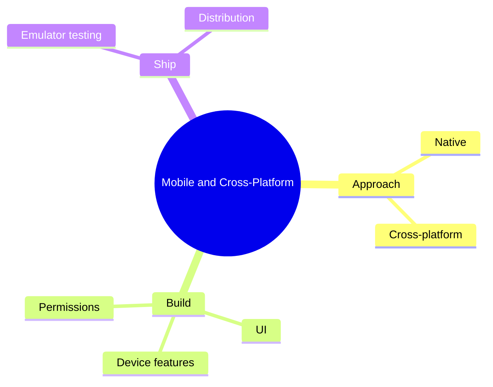

# 21 Mobile and Cross-Platform

> **Level:** Advanced · **Prerequisites:** Chapter 11.

## Overview

Build mobile and cross-platform apps and handle device features safely.

## Learning objectives

By the end of this chapter you can:

- Compare native and cross-platform approaches
- Build a screen on one framework
- Handle a permission request and run on an emulator

## Chapter mind map

## Lessons

Read in this order. Each lesson ends with a hands-on exercise.

| # | Lesson | Level | What you will do |
|---|---|---|---|
| 1 | [Mobile Development Basics](./md/mobile_development_basics.md) | Advanced | Compare native and cross-platform approaches |
| 2 | [Cross Platform Frameworks](./md/cross_platform_frameworks.md) | Advanced | Build one screen on one framework |
| 3 | [Mobile UI and Device Features](./md/mobile_ui_and_device_features.md) | Advanced | Handle a permission request correctly |
| 4 | [Testing and Distribution for Mobile](./md/testing_and_distribution_for_mobile.md) | Advanced | Run on an emulator and list release steps |

## Related

- [Prompt library](../30-prompt-library-and-checklists/README.md)
- [Hands-on projects](../28-hands-on-projects/README.md)

## Next step

Continue with [Chapter 23: Specialized Applications](../23-specialized-applications/README.md).

---
[Back to the course home](../README.md)
