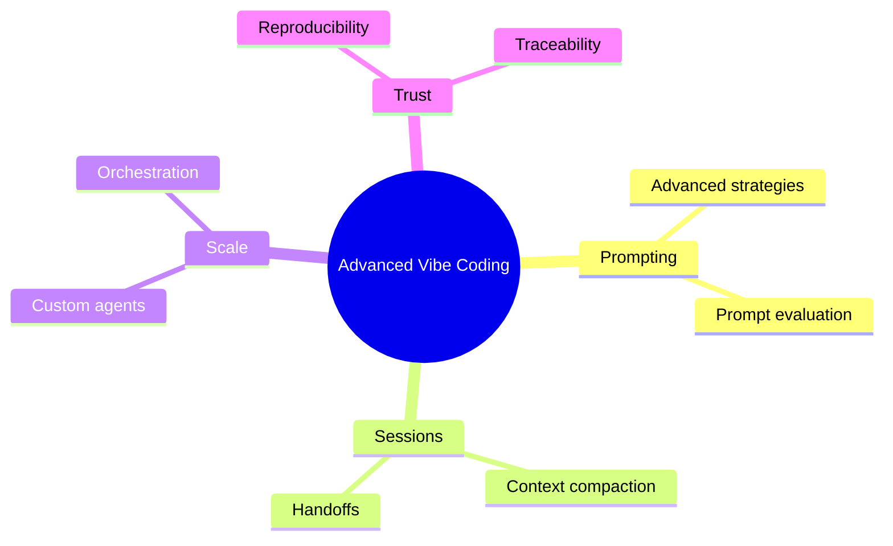

# 22 Advanced Vibe Coding

> **Level:** Expert · **Prerequisites:** Chapters 13 and 20.

## Overview

Techniques for long, large or repeated AI-assisted work.

## Learning objectives

By the end of this chapter you can:

- Compare prompt strategies on one task
- Write a session handoff and resume from it
- Package a repeated workflow and make a change reproducible

## Chapter mind map

## Lessons

Read in this order. Each lesson ends with a hands-on exercise.

| # | Lesson | Level | What you will do |
|---|---|---|---|
| 1 | [Advanced Prompt Strategies](./md/advanced_prompt_strategies.md) | Expert | Compare two strategies on one task |
| 2 | [Context Compaction and Session Handoffs](./md/context_compaction_and_session_handoffs.md) | Expert | Write a handoff note and resume from it |
| 3 | [Custom Agents and Reusable Skills](./md/custom_agents_and_reusable_skills.md) | Expert | Package a repeated workflow |
| 4 | [Large Scale Generation and Orchestration](./md/large_scale_generation_and_orchestration.md) | Expert | Orchestrate a multi-step build |
| 5 | [Evaluating Prompts and Outputs](./md/evaluating_prompts_and_outputs.md) | Expert | Score prompt variants on a fixed test set |
| 6 | [Reproducibility and Change Traceability](./md/reproducibility_and_change_traceability.md) | Expert | Make a generated change reproducible |

## Related

- [Prompt library](../30-prompt-library-and-checklists/README.md)
- [Hands-on projects](../28-hands-on-projects/README.md)

## Next step

Continue with [Chapter 23: Specialized Applications](../23-specialized-applications/README.md).

---
[Back to the course home](../README.md)
