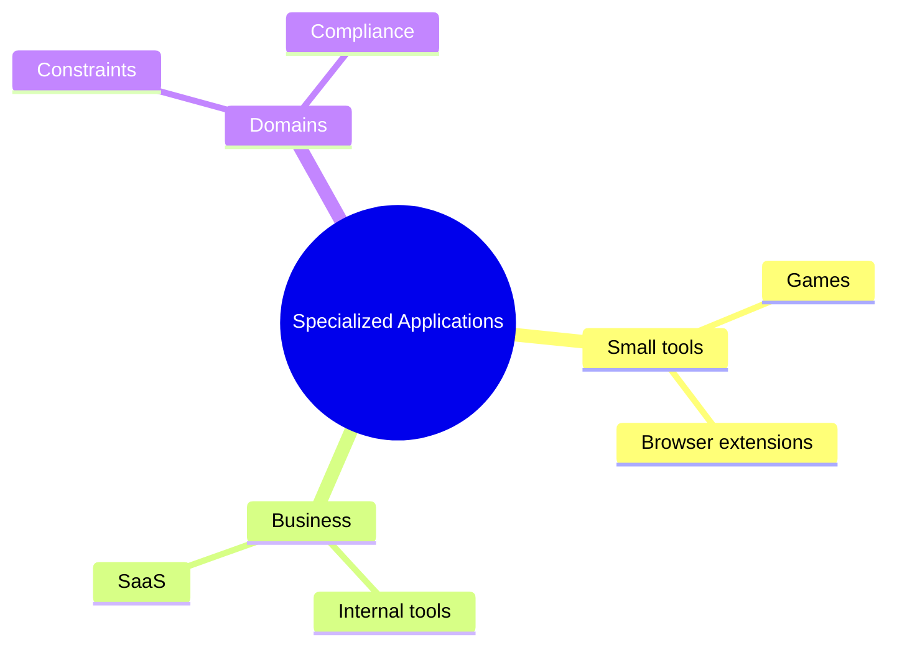

# 23 Specialized Applications

> **Level:** Advanced · **Prerequisites:** Chapter 22.

## Overview

Apply the workflow to games, extensions, internal tools, SaaS and domain-specific software.

## Learning objectives

By the end of this chapter you can:

- Build a small browser game
- Build an internal CRUD tool
- Write domain constraints into a specification

## Chapter mind map

## Lessons

Read in this order. Each lesson ends with a hands-on exercise.

| # | Lesson | Level | What you will do |
|---|---|---|---|
| 1 | [Games and Interactive Experiences](./md/games_and_interactive_experiences.md) | Advanced | Build a small browser game |
| 2 | [Browser Extensions and Small Tools](./md/browser_extensions_and_small_tools.md) | Advanced | Build and load an extension locally |
| 3 | [Internal Tools and Dashboards](./md/internal_tools_and_dashboards.md) | Advanced | Build an internal CRUD tool |
| 4 | [Business and SaaS Applications](./md/business_and_saas_applications.md) | Advanced | Outline a multi-user SaaS slice |
| 5 | [Domain Specific Applications](./md/domain_specific_applications.md) | Advanced | Write domain constraints into a spec |

## Related

- [Prompt library](../30-prompt-library-and-checklists/README.md)
- [Hands-on projects](../28-hands-on-projects/README.md)

## Next step

Continue with [Chapter 24: Data Science and Media](../24-data-science-and-media/README.md).

---
[Back to the course home](../README.md)
