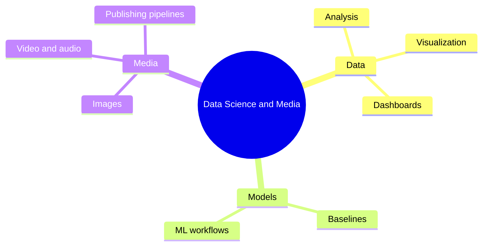

# 24 Data Science and Media

> **Level:** Advanced · **Prerequisites:** Chapters 03, 12 and 17.

## Overview

Use AI to analyze data and produce media, and verify the results.

## Learning objectives

By the end of this chapter you can:

- Analyze a dataset and verify numbers independently
- Train and evaluate a baseline model
- Produce media assets with recorded provenance

## Chapter mind map

## Lessons

Read in this order. Each lesson ends with a hands-on exercise.

| # | Lesson | Level | What you will do |
|---|---|---|---|
| 1 | [Data Analysis with AI](./md/data_analysis_with_ai.md) | Advanced | Analyze a dataset and verify the numbers independently |
| 2 | [Visualization and Dashboards](./md/visualization_and_dashboards.md) | Advanced | Build a chart set and check it against the data |
| 3 | [Machine Learning Workflows with AI](./md/machine_learning_workflows_with_ai.md) | Advanced | Train and evaluate a baseline model |
| 4 | [AI Image Generation Workflows](./md/ai_image_generation_workflows.md) | Advanced | Produce assets with recorded provenance |
| 5 | [AI Video and Audio Workflows](./md/ai_video_and_audio_workflows.md) | Advanced | Plan and script a short generated clip |
| 6 | [Content Pipelines and Publishing](./md/content_pipelines_and_publishing.md) | Advanced | Automate a draft-review-publish flow |

## Related

- [Prompt library](../30-prompt-library-and-checklists/README.md)
- [Hands-on projects](../28-hands-on-projects/README.md)

## Next step

Continue with [Chapter 25: Performance and Cost Optimization](../25-performance-and-cost-optimization/README.md).

---
[Back to the course home](../README.md)
