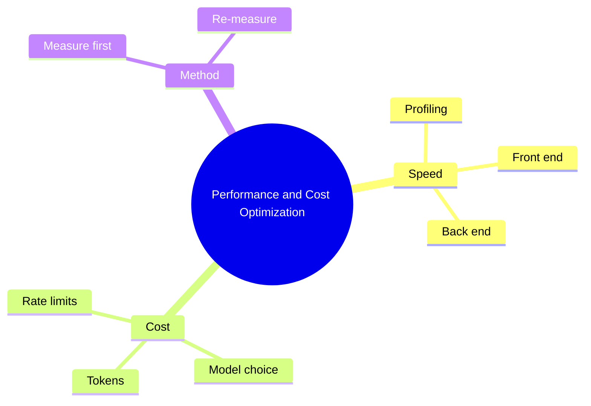

# 25 Performance and Cost Optimization

> **Level:** Advanced · **Prerequisites:** Chapter 19.

## Overview

Measure and reduce latency and cost, including model and token spend.

## Learning objectives

By the end of this chapter you can:

- Profile and fix the top bottleneck
- Reduce token use and measure savings
- Add backoff and a budget cap

## Chapter mind map

## Lessons

Read in this order. Each lesson ends with a hands-on exercise.

| # | Lesson | Level | What you will do |
|---|---|---|---|
| 1 | [Profiling and Performance Basics](./md/profiling_and_performance_basics.md) | Advanced | Profile a slow page or endpoint |
| 2 | [Frontend and Backend Optimization](./md/frontend_and_backend_optimization.md) | Advanced | Fix the top bottleneck and re-measure |
| 3 | [Token and Cost Management](./md/token_and_cost_management.md) | Advanced | Reduce tokens of a workflow and measure savings |
| 4 | [Model Choice Cost Latency Quality](./md/model_choice_cost_latency_quality.md) | Advanced | Benchmark two models on one task |
| 5 | [Rate Limits and Production Cost](./md/rate_limits_and_production_cost.md) | Advanced | Add backoff and a budget cap |

## Related

- [Prompt library](../30-prompt-library-and-checklists/README.md)
- [Hands-on projects](../28-hands-on-projects/README.md)

## Next step

Continue with [Chapter 29: Capstone and Evaluation](../29-capstone-and-evaluation/README.md).

---
[Back to the course home](../README.md)
