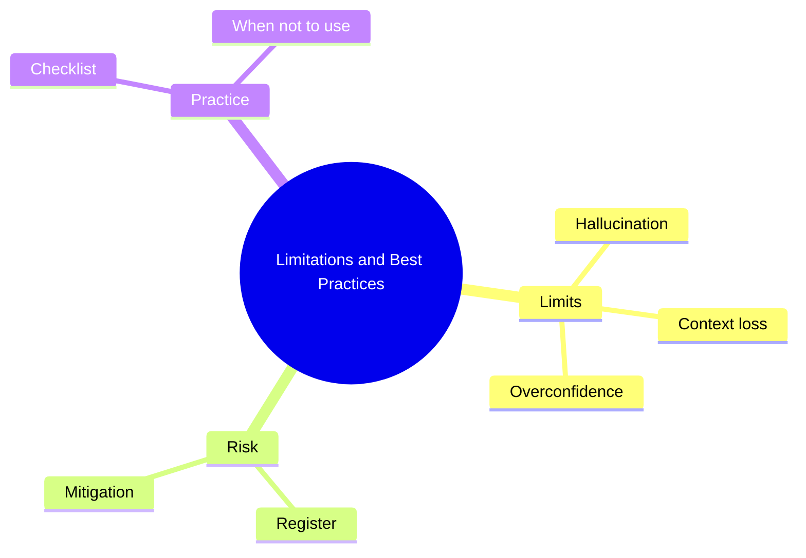

# 26 Limitations and Best Practices

> **Level:** Intermediate · **Prerequisites:** Chapters 03 and 16.

## Overview

What AI coding cannot do reliably, and the practices that reduce risk.

## Learning objectives

By the end of this chapter you can:

- List failure modes you have observed
- Build a risk register for a project
- Classify tasks by suitability for vibe coding

## Chapter mind map

## Lessons

Read in this order. Each lesson ends with a hands-on exercise.

| # | Lesson | Level | What you will do |
|---|---|---|---|
| 1 | [Known Limitations](./md/known_limitations.md) | Intermediate | List failure modes you have seen |
| 2 | [Risk Catalog and Mitigation](./md/risk_catalog_and_mitigation.md) | Intermediate | Build a risk register for a project |
| 3 | [Best Practices Checklist](./md/best_practices_checklist.md) | Intermediate | Adopt a checklist and apply it |
| 4 | [When Not to Use Vibe Coding](./md/when_not_to_use_vibe_coding.md) | Intermediate | Classify five tasks by suitability |

## Related

- [Prompt library](../30-prompt-library-and-checklists/README.md)
- [Hands-on projects](../28-hands-on-projects/README.md)

## Next step

Continue with [Chapter 27: Professional Development](../27-professional-development/README.md).

---
[Back to the course home](../README.md)
