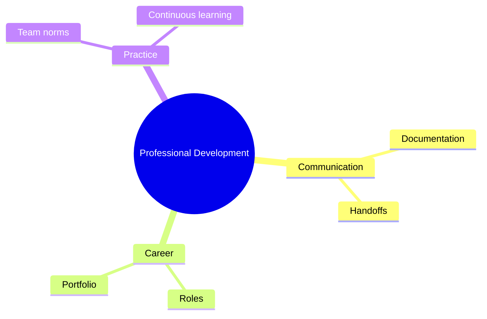

# 27 Professional Development

> **Level:** Intermediate · **Prerequisites:** Chapters 14 and 26.

## Overview

Communicate, document and present your work, and plan your growth.

## Learning objectives

By the end of this chapter you can:

- Write a project handoff document
- Publish a portfolio entry
- Set up a tool-tracking routine

## Chapter mind map

## Lessons

Read in this order. Each lesson ends with a hands-on exercise.

| # | Lesson | Level | What you will do |
|---|---|---|---|
| 1 | [Communication and Documentation](./md/communication_and_documentation.md) | Intermediate | Write a project handoff document |
| 2 | [Portfolio Building](./md/portfolio_building.md) | Intermediate | Publish a portfolio entry |
| 3 | [Career Paths and Roles](./md/career_paths_and_roles.md) | Intermediate | Map target roles to skills gaps |
| 4 | [Team Practice and Ethics](./md/team_practice_and_ethics.md) | Intermediate | Write team norms for AI use |
| 5 | [Continuous Learning](./md/continuous_learning.md) | Intermediate | Set up a tool-tracking routine |

## Related

- [Prompt library](../30-prompt-library-and-checklists/README.md)
- [Hands-on projects](../28-hands-on-projects/README.md)

## Next step

Continue with [Chapter 28: Hands-On Projects](../28-hands-on-projects/README.md).

---
[Back to the course home](../README.md)
