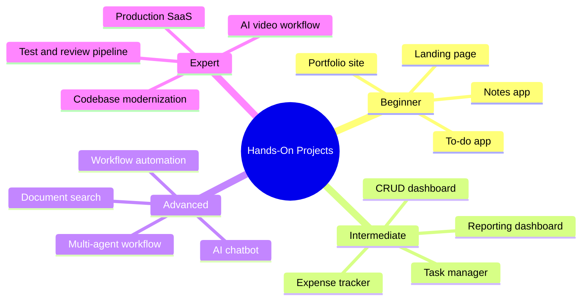

# 28 Hands-On Projects

> **Level:** Beginner to Expert · **Prerequisites:** The chapters listed beside each project.

## Overview

Sixteen projects that apply the course in order of difficulty. Each project README contains the problem statement, requirements, architecture, a prompt sequence, a test strategy, a security review, setup commands, a validation checklist and known limitations.

## Learning objectives

By the end of this chapter you can:

- Take a project from requirements to a verified result
- Choose and justify a stack for a given problem
- Show evidence, such as passing tests, that your project works

## Chapter mind map

## Projects

| # | Project | Level | Needs chapters |
|---|---|---|---|
| 1 | [Landing page](./beginner/landing-page/README.md) | Beginner | 05, 08 |
| 2 | [Portfolio site](./beginner/portfolio-site/README.md) | Beginner | 05, 08 |
| 3 | [To-do app](./beginner/todo-app/README.md) | Beginner | 05, 08 |
| 4 | [Notes app](./beginner/notes-app/README.md) | Beginner | 05, 08 |
| 5 | [Expense tracker with persistence](./intermediate/expense-tracker/README.md) | Intermediate | 08 to 11 |
| 6 | [CRUD dashboard with login](./intermediate/crud-dashboard-with-auth/README.md) | Intermediate | 09 to 11 |
| 7 | [Full-stack task manager](./intermediate/fullstack-task-manager/README.md) | Intermediate | 11, 16 |
| 8 | [Reporting dashboard with an external API](./intermediate/api-reporting-dashboard/README.md) | Intermediate | 20 |
| 9 | [AI chatbot](./advanced/ai-chatbot/README.md) | Advanced | 12 |
| 10 | [Document search with retrieval](./advanced/document-search-rag/README.md) | Advanced | 12 |
| 11 | [Business workflow automation](./advanced/workflow-automation/README.md) | Advanced | 20 |
| 12 | [Multi-agent workflow](./advanced/multi-agent-workflow/README.md) | Advanced | 13 |
| 13 | [AI video generation workflow](./expert/ai-video-workflow/README.md) | Expert | 24 |
| 14 | [Existing-codebase modernization](./expert/codebase-modernization/README.md) | Expert | 14 |
| 15 | [Production-oriented SaaS](./expert/production-saas/README.md) | Expert | 17, 19 |
| 16 | [Automated test-and-review pipeline](./expert/test-and-review-pipeline/README.md) | Expert | 16, 19 |

## Related

- [Prompt library](../30-prompt-library-and-checklists/README.md)
- [Checklists](../30-prompt-library-and-checklists/md/checklists.md)

## Next step

Continue with [Chapter 29: Capstone and Evaluation](../29-capstone-and-evaluation/README.md).

---
[Back to the course home](../README.md)
