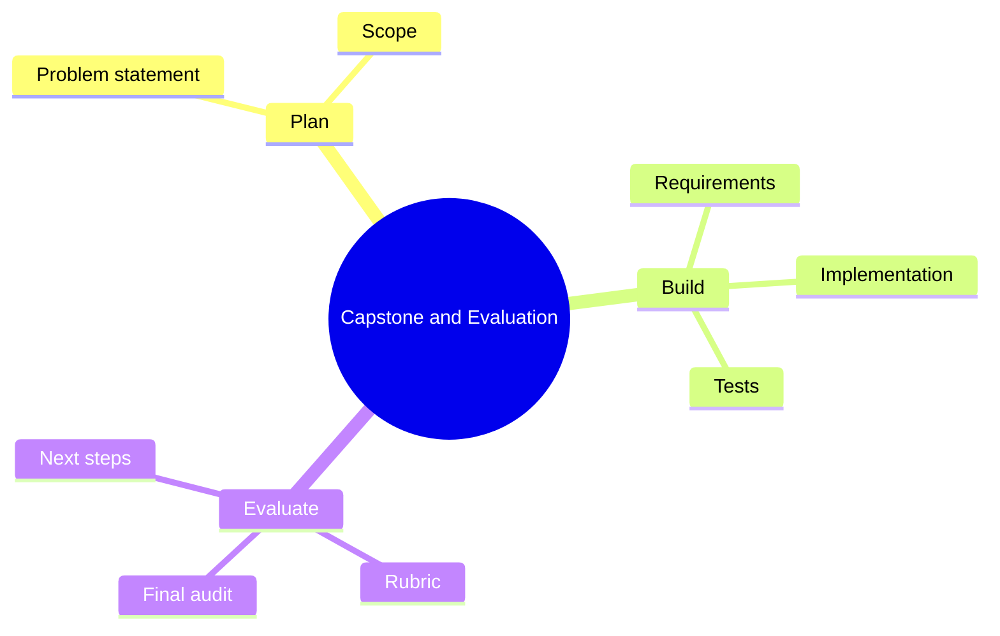

# 29 Capstone and Evaluation

> **Level:** Expert · **Prerequisites:** Chapters 22, 25 and 28.

## Overview

Select a realistic problem, build it end to end and evaluate it.

## Learning objectives

By the end of this chapter you can:

- Scope a capstone
- Self-score against the rubric
- Run the final audit and fix the findings

## Chapter mind map

## Lessons

Read in this order. Each lesson ends with a hands-on exercise.

| # | Lesson | Level | What you will do |
|---|---|---|---|
| 1 | [Capstone Brief and Problem Statements](./md/capstone_brief_and_problem_statements.md) | Expert | Select and scope a capstone |
| 2 | [Evaluation Rubric](./md/evaluation_rubric.md) | Expert | Self-score a draft against the rubric |
| 3 | [Final Project Audit](./md/final_project_audit.md) | Expert | Run the final audit prompt and fix findings |
| 4 | [Self Assessment and Next Steps](./md/self_assessment_and_next_steps.md) | Expert | Write a skills review |

## Related

- [Prompt library](../30-prompt-library-and-checklists/README.md)
- [Hands-on projects](../28-hands-on-projects/README.md)

## Next step

Continue with [Chapter 01: Introduction to Vibe Coding](../01-introduction-to-vibe-coding/README.md).

---
[Back to the course home](../README.md)
