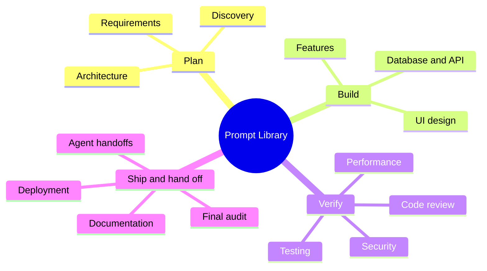

# 30 Prompt Library and Checklists

> **Level:** All levels · **Prerequisites:** None; use it alongside any chapter from 05 onward.

## Overview

Copy-ready prompts for each stage of the workflow. Every template states its objective, when to use it, required inputs, the prompt, expected deliverables, acceptance criteria, validation steps, failure cases and a follow-up prompt to correct a specific failure. Prompts tell agents to inspect existing files first, follow repository conventions, avoid unnecessary rewrites and verify results instead of claiming success.

## Learning objectives

By the end of this chapter you can:

- Pick the right template for a task and fill in its inputs
- Judge a result against the template's acceptance criteria
- Use the follow-up prompt to correct a specific failure

## Chapter mind map

## Templates

| # | Page | Covers |
|---|---|---|
| 1 | [Prompts: Discovery and Requirements](./md/prompts_discovery_and_requirements.md) | Project discovery and requirements analysis |
| 2 | [Prompts: Architecture and UI](./md/prompts_architecture_and_ui.md) | Architecture planning, mind-map generation and UI design |
| 3 | [Prompts: Features Bugs and Refactoring](./md/prompts_features_bugs_and_refactoring.md) | New features, bug fixing, refactoring and existing-repository analysis |
| 4 | [Prompts: Database API and Integration](./md/prompts_database_api_and_integration.md) | Database schemas and migrations, API integration |
| 5 | [Prompts: Testing Security and Performance](./md/prompts_testing_security_and_performance.md) | Testing, security audits, performance improvement |
| 6 | [Prompts: Review Documentation and Deployment](./md/prompts_review_documentation_and_deployment.md) | Code review, documentation, deployment |
| 7 | [Prompts: Agentic Planning and Handoffs](./md/prompts_agentic_planning_and_handoffs.md) | Agentic task planning and task handoffs |
| 8 | [Prompts: Final Audit](./md/prompts_final_audit.md) | Final project audit |
| 9 | [Checklists](./md/checklists.md) | Best-practice, security, release and review checklists |

## Related

- [Prompt anatomy](../05-prompt-engineering-and-context/md/prompt_anatomy.md)
- [Hands-on projects](../28-hands-on-projects/README.md)

## Next step

Apply the templates in [Chapter 28: Hands-On Projects](../28-hands-on-projects/README.md).

---
[Back to the course home](../README.md)
