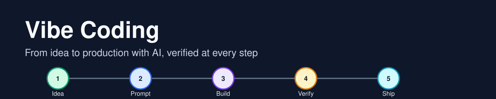
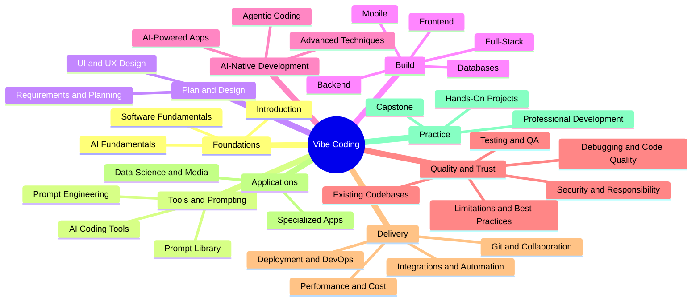
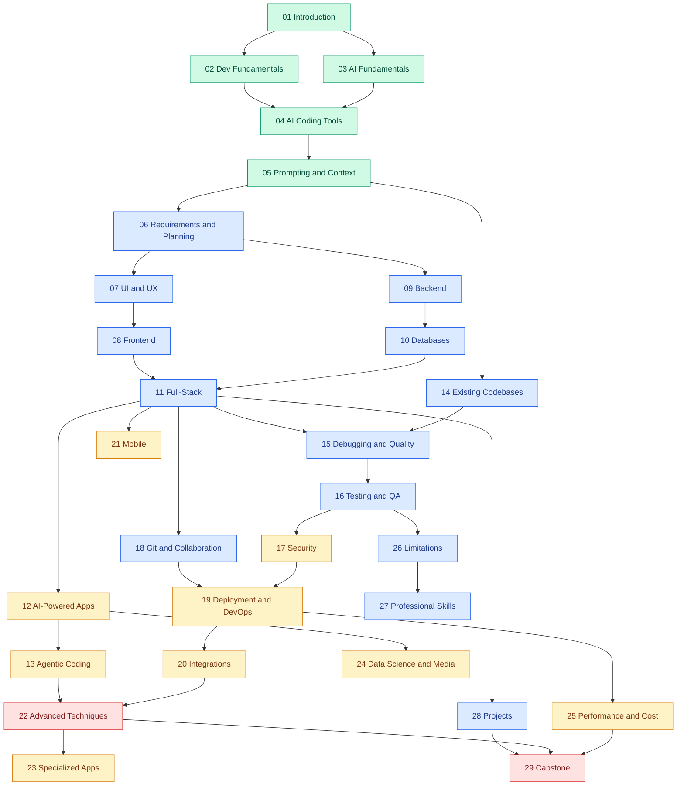

  

# Vibe Coding: From Idea to Production with AI

A beginner-to-expert course on building software with AI coding tools, and on checking what the AI gives you. Every chapter pairs concepts with exercises, reusable prompts and a verification step.

---

## Who this is for

- **Beginners** who want to build something real without a programming background.
- **Developers** who want a disciplined way to work with AI assistants and agents.
- **Teams** who need shared standards for reviewing, testing and shipping AI-generated code.

## What you will learn

By the end you can:
1. Turn an idea into requirements and acceptance criteria an AI tool can follow.
2. Prompt, steer and correct AI tools, and know when to stop and take over.
3. Build, test, secure, deploy and monitor a full-stack application.
4. Work safely in existing codebases and with agents that run commands.
5. Judge AI output with tests, reviews and measurements instead of trust.

## Prerequisites

None for chapters 1 to 5. A computer, a text editor and a willingness to run commands are enough. Later chapters list their own prerequisites.

## How to use this repository

1. Follow the [learning path](#learning-path) from chapter 01 in order, or jump to a chapter from the [contents](#contents).
2. Open a chapter's index, read its lessons in order, and do each lesson's exercise.
3. Use the [prompt library](./30-prompt-library-and-checklists/README.md) while you build.
4. Apply what you learn in the [hands-on projects](./28-hands-on-projects/README.md).
5. Finish with the [capstone](./29-capstone-and-evaluation/README.md).

---

## Curriculum mind map

**How to read it:** the inner ring is a subject family and the outer ring is a chapter. The map shows what exists and how it groups. It does not say what to study first; the learning path below does.

## Learning path

**Legend:** green = Beginner, blue = Intermediate, orange = Advanced, red = Expert. Every box also starts with its chapter number, so the level is readable without color. Chapter 30, the [prompt library](./30-prompt-library-and-checklists/README.md), is a reference you use throughout rather than a step in the sequence.

---

## Contents

### Foundations
| Chapter | Level | What it covers |
|---|---|---|
| [01 Introduction to Vibe Coding](./01-introduction-to-vibe-coding/README.md) | Beginner | What it is, how it differs from traditional coding, benefits and risks |
| [02 Software Development Fundamentals](./02-software-development-fundamentals/README.md) | Beginner | Programming concepts, the web, command line, build tools |
| [03 AI Fundamentals](./03-ai-fundamentals/README.md) | Beginner | How language models work, context windows, hallucinations |

### Tools and prompting
| Chapter | Level | What it covers |
|---|---|---|
| [04 AI Coding Tools](./04-ai-coding-tools/README.md) | Beginner | IDE assistants, terminal agents, app builders, permissions, tool comparison |
| [05 Prompt Engineering and Context](./05-prompt-engineering-and-context/README.md) | Beginner | Prompt anatomy, context, acceptance criteria, iteration |
| [30 Prompt Library and Checklists](./30-prompt-library-and-checklists/README.md) | All | Copy-ready prompts with acceptance criteria and correction follow-ups |

### Plan and design
| Chapter | Level | What it covers |
|---|---|---|
| [06 Requirements and Planning](./06-requirements-and-planning/README.md) | Intermediate | Requirements, specs, architecture choices, task planning |
| [07 UI and UX Design](./07-ui-ux-design/README.md) | Intermediate | UX principles, wireframes, design systems, accessibility |

### Build
| Chapter | Level | What it covers |
|---|---|---|
| [08 Frontend Development](./08-frontend-development/README.md) | Intermediate | HTML, CSS, JavaScript, components, forms, responsive layout |
| [09 Backend Development](./09-backend-development/README.md) | Intermediate | Routing, validation, authentication, API design, logging |
| [10 Databases and Data](./10-databases-and-data/README.md) | Intermediate | Modeling, SQL, NoSQL, migrations, backups |
| [11 Full-Stack Development](./11-full-stack-development/README.md) | Intermediate | Connecting front end, back end and data in one working slice |
| [21 Mobile and Cross-Platform](./21-mobile-and-cross-platform/README.md) | Advanced | Mobile basics, cross-platform frameworks, device features |

### AI-native development
| Chapter | Level | What it covers |
|---|---|---|
| [12 AI-Powered Applications](./12-ai-powered-applications/README.md) | Advanced | Model APIs, chatbots, retrieval, structured output, evaluation |
| [13 Agentic Vibe Coding](./13-agentic-vibe-coding/README.md) | Advanced | Agent loops, permissions, approvals, multi-agent work |
| [22 Advanced Vibe Coding](./22-advanced-vibe-coding/README.md) | Expert | Advanced prompting, handoffs, reusable skills, reproducibility |

### Quality and trust
| Chapter | Level | What it covers |
|---|---|---|
| [14 Existing Codebases](./14-existing-codebases/README.md) | Intermediate | Repository discovery, safe changes, legacy modernization |
| [15 Debugging and Code Quality](./15-debugging-and-code-quality/README.md) | Intermediate | Systematic debugging, readability, refactoring, AI-assisted review |
| [16 Testing and QA](./16-testing-and-qa/README.md) | Intermediate | Test strategy, unit, integration, end-to-end, visual tests |
| [17 Security and Responsible Development](./17-security-and-responsible-development/README.md) | Advanced | Vulnerabilities, secrets, supply chain, privacy, licensing |
| [26 Limitations and Best Practices](./26-limitations-and-best-practices/README.md) | Intermediate | Known limits, risk register, when not to use it |

### Delivery
| Chapter | Level | What it covers |
|---|---|---|
| [18 Git and Collaboration](./18-git-and-collaboration/README.md) | Intermediate | Git, pull requests, checkpoints, team workflows |
| [19 Deployment and DevOps](./19-deployment-and-devops/README.md) | Advanced | Hosting, CI/CD, containers, monitoring, rollback |
| [20 Integrations and Automation](./20-integrations-and-automation/README.md) | Advanced | Third-party APIs, webhooks, workflows, scheduled jobs |
| [25 Performance and Cost Optimization](./25-performance-and-cost-optimization/README.md) | Advanced | Profiling, token cost, model choice, rate limits |

### Applications
| Chapter | Level | What it covers |
|---|---|---|
| [23 Specialized Applications](./23-specialized-applications/README.md) | Advanced | Games, extensions, internal tools, SaaS, domain apps |
| [24 Data Science and Media](./24-data-science-and-media/README.md) | Advanced | Data analysis, charts, ML basics, AI image, video and audio workflows |

### Practice
| Chapter | Level | What it covers |
|---|---|---|
| [27 Professional Development](./27-professional-development/README.md) | Intermediate | Documentation, portfolio, career paths, team ethics |
| [28 Hands-On Projects](./28-hands-on-projects/README.md) | Beginner to Expert | Sixteen progressive projects |
| [29 Capstone and Evaluation](./29-capstone-and-evaluation/README.md) | Expert | Capstone brief, rubric, final audit |

---

## Technology landscape

Tool facts change quickly, so tools are compared on stated dimensions and carry an "as verified" date. The comparison pages are:

- AI coding tools, models and providers: [chapter 04](./04-ai-coding-tools/README.md)
- Frontend, backend and database stacks: chapters [08](./08-frontend-development/README.md), [09](./09-backend-development/README.md) and [10](./10-databases-and-data/README.md)
- Hosting and CI/CD: [chapter 19](./19-deployment-and-devops/README.md)
- Automation and tool connectors: [chapter 20](./20-integrations-and-automation/README.md)
- Mobile frameworks and media tools: chapters [21](./21-mobile-and-cross-platform/README.md) and [24](./24-data-science-and-media/README.md)

## Hands-on projects

Sixteen projects in four levels, each with requirements, a prompt sequence, tests and a validation checklist. Start with the [project catalog](./28-hands-on-projects/README.md).

| Level | Projects |
|---|---|
| Beginner | Landing page, portfolio site, to-do app, notes app |
| Intermediate | Expense tracker, CRUD dashboard with login, full-stack task manager, API reporting dashboard |
| Advanced | AI chatbot, document search with retrieval, workflow automation, multi-agent workflow |
| Expert | AI video workflow, codebase modernization, production SaaS, test-and-review pipeline |

## Capstone and evaluation

Pick a realistic problem, build it end to end, then score it against the [evaluation rubric](./29-capstone-and-evaluation/README.md). A capstone passes only if it runs from a clean checkout, its tests pass and its security review is done.

## Standards and contributing

The rules for lessons, diagrams, links and visuals are in [`docs/`](./docs/REPOSITORY_GUIDE.md). Propose new topics in [`to-review/`](./to-review/README.md); content there is not part of the published course. See [CONTRIBUTING.md](./CONTRIBUTING.md) for the process.

## Glossary

| Term | Meaning |
|---|---|
| Vibe coding | Building software by describing what you want to an AI tool and iterating on what it produces |
| Prompt | The instruction and context you give an AI model |
| Context window | The amount of text a model can consider at once |
| Hallucination | Output that sounds right but is invented, such as a function that does not exist |
| Agent | An AI tool that plans, runs commands and edits files in a loop |
| Acceptance criteria | Testable statements that define when a task is done |
| Diff | The exact lines a change adds, removes or edits |
| CI/CD | Automated checks and deployment that run when code changes |

## References

Each lesson ends with an "Official References" section linking to the documentation it relied on, with a verification date for anything that changes quickly.

---

&copy; Vibe Coding course contributors. See [LICENSE](./LICENSE).
