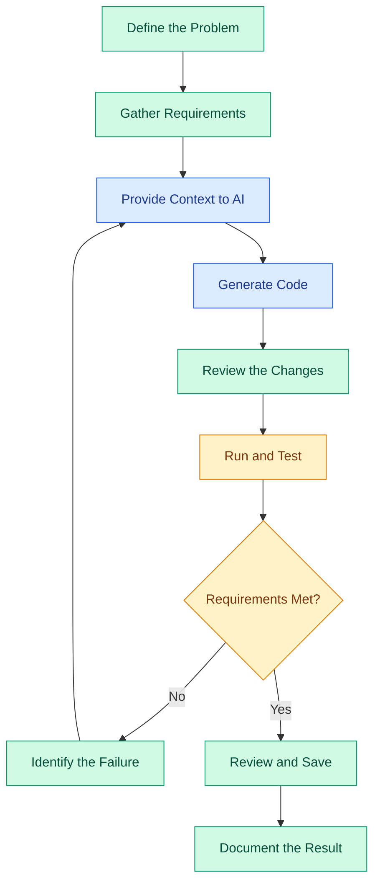

# What Is Vibe Coding?

## Contents

- [Learning Objectives](#learning-objectives)
- [Overview](#overview)
- [How Vibe Coding Works](#how-vibe-coding-works)
- [Vibe Coding Workflow](#vibe-coding-workflow)
- [Practical Example](#practical-example)
- [Step-by-Step Implementation](#step-by-step-implementation)
- [Expected Result](#expected-result)
- [Common Mistakes and Troubleshooting](#common-mistakes-and-troubleshooting)
- [Best Practices](#best-practices)
- [Hands-On Exercise](#hands-on-exercise)
- [Conclusion](#conclusion)
- [References](#references)

---

## Learning Objectives

After completing this lesson, you should be able to:

- Define Vibe Coding in simple terms.
- Explain how AI coding assistants help developers.
- Describe the typical Vibe Coding workflow.
- Write a clear prompt for generating a software application.
- Identify the limitations and risks of AI-generated code.
- Explain why testing and reviewing generated code are essential.

## Overview

### What Is Vibe Coding?

Vibe Coding is a software development approach in which a developer uses natural-language instructions to guide an AI tool in generating, modifying, explaining, and debugging code.

Instead of manually writing every line of code, the developer describes the intended outcome, provides relevant context, reviews the AI-generated implementation, and iteratively improves the result.

For example, a developer might ask:

"Build a task management application with a form to add tasks, a list to display them, and buttons to mark tasks as completed."

An AI coding assistant may generate the interface and supporting logic. The developer then checks whether the implementation meets the requirements and asks for corrections when necessary.

**Important:** Vibe Coding does not eliminate the need to understand software development. The developer remains responsible for the correctness, security, maintainability, and behavior of the application.

### Why Is Vibe Coding Useful?

Traditional development often requires developers to write code, search documentation, troubleshoot errors, and implement features manually.

Vibe Coding allows developers to delegate suitable coding tasks to AI while focusing on requirements, design decisions, validation, and problem-solving.

Common applications include:

- Creating website prototypes.
- Building small business applications.
- Developing dashboards and forms.
- Generating API endpoints.
- Exploring unfamiliar codebases.
- Writing tests and documentation.
- Debugging and refactoring existing code.
- Building minimum viable products (MVPs).

## How Vibe Coding Works

Vibe Coding combines human direction with AI-assisted implementation.

### 1. Define the Goal

Describe the problem you want to solve and the expected outcome.

Example:

"Create a personal expense tracker that allows users to record expenses and view their total spending."

### 2. Provide Context

Explain the application's purpose, required features, preferred technologies, existing architecture, and any constraints.

Useful context may include:

- Project requirements.
- Existing source files.
- Framework and language.
- Database structure.
- UI reference images.
- Expected inputs and outputs.

### 3. Generate Code

Ask the AI tool to implement a small, clearly defined part of the application.

The generated output might include UI components, functions, API routes, database queries, tests, or configuration files.

### 4. Review the Implementation

Inspect the generated code and compare it with the original requirements.

Check whether the code uses appropriate dependencies, follows the existing project structure, and handles expected errors.

### 5. Run and Test

Execute the application or relevant tests. Observe the actual behavior instead of assuming the generated code works.

### 6. Iterate and Improve

Provide specific feedback based on the observed result.

For example:

"The expense form accepts negative amounts. Add validation that rejects zero and negative values, and display a useful error message."

### 7. Verify and Save

Run the relevant checks again, review the final changes, and save the working implementation in version control.

## Vibe Coding Workflow



### Understanding the Workflow

- **Human direction:** The developer defines requirements and evaluates decisions.
- **AI assistance:** The coding tool generates or modifies implementation details.
- **Validation:** The developer runs the application, examines the output, and checks the requirements.
- **Iteration:** Failed checks lead to targeted corrections rather than blindly accepting the output.

The workflow is iterative. A feature may require several rounds of implementation and verification before it is ready.

## Practical Example

### Scenario: Build a Task Manager

Suppose you want a simple web application that allows users to manage daily tasks.

The application should allow users to:

1. Enter a task description.
2. Add the task to a list.
3. Mark a task as completed.
4. Delete a task.
5. See an appropriate message when the task list is empty.

### Example Development Prompt

```text
Act as an experienced frontend developer.

GOAL:
Build a simple task management web application.

CONTEXT:
This is a beginner-friendly project intended to demonstrate
AI-assisted software development.

REQUIREMENTS:
1. Display a heading named "Task Manager".
2. Provide an input field for a task description.
3. Add a button to create a task.
4. Display all created tasks in a list.
5. Allow users to mark tasks as completed.
6. Allow users to delete individual tasks.
7. Display an empty-state message when no tasks exist.

CONSTRAINTS:
- Use React and TypeScript.
- Use functional components and appropriate React state.
- Do not add a backend or database.
- Keep the implementation simple and readable.
- Do not introduce unnecessary dependencies.
- Validate empty or whitespace-only task descriptions.
- Do not modify unrelated files.

ACCEPTANCE CRITERIA:
- A valid task can be added.
- Empty task descriptions are rejected.
- A task can be marked as completed.
- A task can be deleted.
- The empty-state message appears when appropriate.
- The application builds successfully.

PROCESS:
1. Inspect the existing project before making changes.
2. Explain the proposed files and implementation briefly.
3. Implement the requested feature.
4. Run the available build or test commands.
5. Report the checks performed and any failures.
6. Summarize the files changed.
```

This is a reusable example prompt. It has not been executed against a project in this lesson.

## Step-by-Step Implementation

### Step 1: Open Your Coding Tool

Open an AI coding assistant that can help you generate code. Depending on the tool, this might be a chat interface, an IDE extension, or a repository-aware coding agent.

### Step 2: Explain the Requirement

Start with the task manager prompt above. Ensure the AI understands the required features and the project's technology stack.

### Step 3: Inspect the Proposed Changes

If the tool proposes changes across multiple files, inspect the file names and responsibilities before accepting them.

For an existing application, request focused changes that preserve unrelated functionality.

### Step 4: Run the Application

Use the commands appropriate to the actual project.

For an existing React project that uses npm, the commands may be:

```bash
npm install
npm run dev
```

Run these commands from the directory containing the project's `package.json`. These commands assume that the project defines a `dev` script.

### Step 5: Test Every Requirement

Manually verify that:

- Adding a valid task works.
- Empty input is rejected.
- Completion status changes correctly.
- Deleting a task works.
- The empty state appears when all tasks have been removed.

Also run the project's available build and test commands.

### Step 6: Request Targeted Corrections

If deleting a task does not work, describe the exact failure and ask the AI to investigate that behavior.

Avoid asking it to rewrite the entire application when a focused fix is sufficient.

### Step 7: Review the Final Changes

Inspect the code and confirm that the fix works. Review the final diff before committing the changes.

## Expected Result

A successful implementation should provide a task management interface with:

- A task input field.
- An add-task action.
- A list of tasks.
- A completion control.
- A delete action.
- An empty-state message.

These are the expected acceptance criteria, not a claim that the example has already been executed or tested.

The implementation may vary depending on the coding tool and the project structure.

## Common Mistakes and Troubleshooting

| Mistake | Why It Happens | Recommended Action |
|---|---|---|
| Giving vague prompts | The AI lacks precise requirements. | Specify features, constraints, and expected behavior. |
| Requesting too many features at once | Large changes are harder to inspect and debug. | Break the task into smaller milestones. |
| Accepting code without reviewing it | Generated code can contain logical errors. | Inspect the diff and understand important changes. |
| Assuming generated code works | Code generation does not prove runtime correctness. | Run the application and relevant tests. |
| Allowing unrelated changes | The AI may modify files outside the intended scope. | Restrict the requested scope and review all changed files. |
| Repeating the same failed prompt | The underlying cause may remain unidentified. | Capture the error, reproduce the issue, and investigate its root cause. |
| Ignoring security | A working prototype can still expose data or credentials. | Review input handling, secrets, permissions, and dependencies. |

## Best Practices

1. **Start with a clear problem statement.** Define what success means before requesting code.
2. **Provide relevant context.** Include existing files, technology choices, and project conventions.
3. **Work incrementally.** Implement one feature at a time.
4. **Set acceptance criteria.** Make the expected behavior observable and testable.
5. **Review generated code.** Understand important logic before relying on it.
6. **Verify actual behavior.** Run tests and reproduce important user flows.
7. **Protect secrets.** Never include real API keys or passwords in prompts, source files, or public repositories.
8. **Use version control.** Review diffs and create meaningful commits.
9. **Keep changes focused.** Avoid unnecessary rewrites and dependencies.
10. **Take responsibility for the result.** AI assistance does not replace engineering judgment.

## Hands-On Exercise

### Objective

Create a prompt for a simple student record management application.

### Requirements

The application should:

- Accept a student's name.
- Accept a student's roll number.
- Add the student to a displayed list.
- Reject missing values.
- Allow a student record to be deleted.

### Constraints

- Choose a frontend framework suitable for a beginner.
- Keep the first version frontend-only.
- Avoid unnecessary dependencies.
- Do not add a database unless explicitly requested later.

### Tasks

1. Write a prompt describing the application.
2. Specify its functional requirements.
3. Define at least four acceptance criteria.
4. Ask an AI coding assistant to inspect the project before implementation.
5. Generate the implementation in small steps.
6. Run the application and test each requirement.
7. Review the generated changes.

### Verification Criteria

- A valid student record can be added.
- Missing values are rejected.
- Existing records appear in the list.
- A record can be deleted.
- The application does not change unrelated project files.

### Optional Extension

Add a search field that filters students by name or roll number.

## Conclusion

Vibe Coding uses natural-language instructions and AI-assisted tools to accelerate software development.

The essential process is to define requirements, provide context, generate code, review changes, test the implementation, and improve it through targeted iterations.

The main principle is simple: **use AI to accelerate development, but use engineering judgment to verify the result.**

The next lesson in this chapter is **History and Evolution of Vibe Coding**.

## References

- [GitHub Copilot Documentation](https://docs.github.com/en/copilot)
- [Visual Studio Code Documentation](https://code.visualstudio.com/docs)
- [Git Documentation](https://git-scm.com/doc)
- [React Documentation](https://react.dev/learn)
- [TypeScript Documentation](https://www.typescriptlang.org/docs/)
